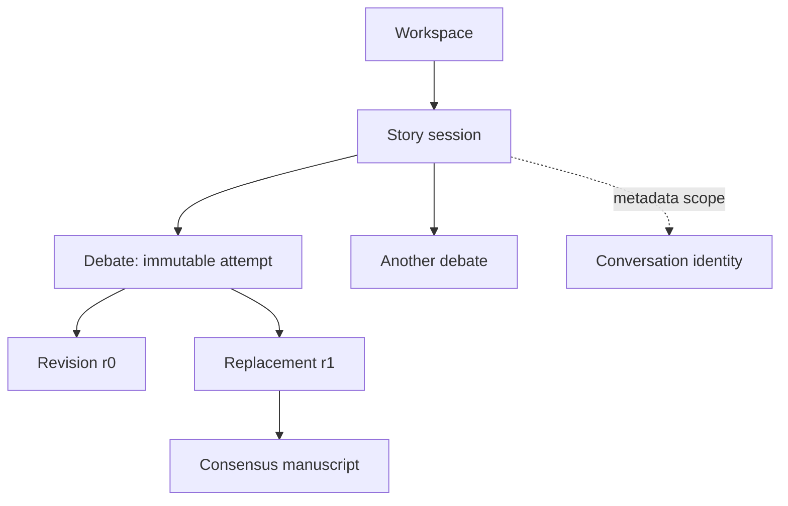

# Core concepts

> **Availability:** these concepts describe the implemented runtime. Conversation
> metadata exists, but conversation selection, transcripts, and search do not.

Key terms: **workspace**—the local project and persistence root; **story
session**—a group of related runs and agent history; **debate**—one immutable
attempt; **revision**—one candidate version; **consensus**—unanimous specialist
approval followed by a successful artifact commit.

A **workspace** is the local directory that holds configuration, editable role
prompts, story facts, logs, state, and manuscripts. It is both the project input
and the persistence boundary.

A **story session** groups related work. It carries runtime overrides,
owner-isolated agent history, and resumable provider thread references. A
provider-session manifest says whether new provider work is active; CLI
selection merely chooses a default session; a temporary lease prevents two
cooperating processes from using the same threads at once.

A **debate** is one immutable attempt to turn a prompt or complete draft into an
approved manuscript. Its **revision** starts at `r0`. Conflicts can produce
complete replacements `r1`, `r2`, and so on. **Consensus** means all three
specialists approved the same current revision and final artifacts committed.

In words: a workspace contains sessions; a session can contain many debates;
each debate owns a sequence of replacement revisions and at most one committed
manuscript. Conversation identity is a separate metadata-only foundation and
is not part of debate execution today.

## The four roles

| Role | Responsibility | Votes? |
| --- | --- | --- |
| `lead_orchestrator` | Moderates, synthesizes, and finalizes | No |
| `plot_architect` | Plot, structure, flow, and pacing | Yes |
| `character_custodian` | Character, relationships, world, and continuity | Yes |
| `execution_specialist` | Drafting, prose, POV, tone, grammar, and format | Yes |

The lead cannot erase a specialist conflict. All three specialists must approve
the same revision. Each role receives only its allowlisted core documents: the
plot specialist gets both outlines, the character specialist gets character
sheets, the execution specialist gets narrative rules, and the lead gets all
four.

## Public and owner-isolated memory

The **blackboard** is the debate's public JSONL history: input, candidates,
verdicts, critiques, proposals, visible errors, and commit metadata. Parallel
specialists receive the same pre-phase snapshot, then their outcomes are logged
in stable roster order.

Each agent also receives only its own concise persisted outcomes for the whole
story session. This history crosses debates but has no compaction or retention
limit. Provider thread references are separate again and can resume when the
same session and compatible agent definition are used.

## Core documents and manuscripts

The four core documents are durable story context: `global_outline.md`,
`part_outlines.md`, `character_sheets.md`, and `narrative_rules.md`. The lead
may propose full-text updates only after consensus. Manuscripts are immutable
runtime outputs: an existing target is never overwritten.

Next, follow [Getting started](getting-started.md) or read the
[system overview](design/overview.md).
