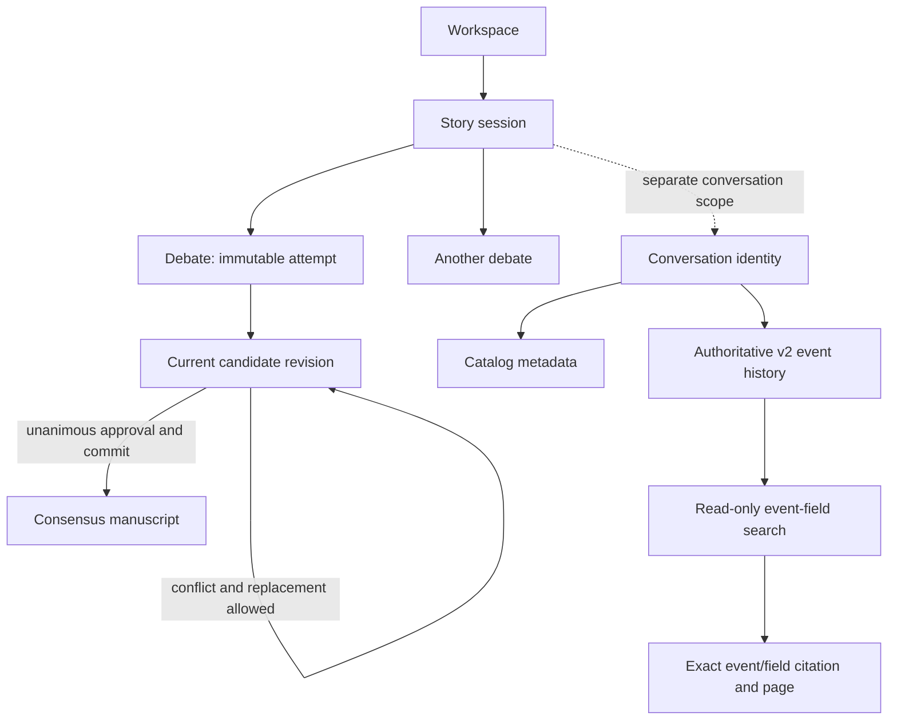

# Core concepts

> **Availability:** the TTY shell manages sessions/conversations and performs
> local search, history, transcript, and inspection reads. It does not dispatch
> an advisory turn or debate in this integration stage. See
> [Story sessions](guides/story-sessions.md).

Key terms: **scope**—what one persisted object groups; **ownership**—which
component controls data or a transition; **turn**—one user event and its
outcome; **flow**—how work moves from input to an approved artifact. For
vocabulary lookup, use the [Glossary](glossary.md).

The workspace is the outer project and persistence boundary. Within it, a story
session groups related overrides, agent history, and provider thread references.
A session can own many debates. Each debate is one immutable attempt and owns a
sequence of complete candidate revisions.

Work narrows from workspace to session to a lead conversation and collaboration
step. The current Python runtime stops after direct lead advice or the user's
exact decision on one proposal; later execution may enter a debate and move
through candidate revisions toward at most one committed manuscript.
Conversation identity is scoped by the same story session but
remains separate from debate execution. Its catalog owns subject/archive
status. The selected service stores schema-v2 collaboration events and derives
readable records, event-field search hits, exact citations, state, and bounded
pages from that same authority. Subject metadata is displayed with a hit but is
not searched. See
[Runtime API](reference/runtime-api.md) and
[Conversation search and cited transcript pages](reference/conversation-search.md).

## The four roles

| Role | Responsibility | Votes? |
| --- | --- | --- |
| `lead_orchestrator` | Sole user front channel; advises, critiques, recommends, watches constraints, and proposes specialist routing | No |
| `plot_architect` | Plot, structure, flow, and pacing | Yes |
| `character_custodian` | Character, relationships, world, and continuity | Yes |
| `execution_specialist` | Drafting, prose, POV, tone, grammar, and format | Yes |

For later debates, runtime components own phase ordering and consensus
validation. For the current advisory turn, the structured workflow owns
preflight, event/provider ordering, proposal authority, and reply validation.
The three specialists audit the same debate revision; the lead cannot vote or
erase a conflict. Context manifests and route-specific source authority limit
each agent to role-relevant current material and only its own private state.

## Public and owner-isolated memory

The public blackboard belongs to the debate. Every agent can receive its visible
history, while parallel reviewers start from the same pre-phase snapshot. The
runtime persists their completed outcomes in stable roster order.

Owner-isolated state belongs to one agent across the whole story session. It can
inform later debates, but it is never exposed as another agent's private history.
Provider thread references are a third channel: the backend may resume them
when session and agent definition remain compatible.

## Core documents and manuscripts

Core documents are authoritative contextual sources, not permanent mutable
bytes in built-in provider definitions. Fresh work bootstraps role-relevant
current material; compatible work receives exact changes and can boundedly
search/read omitted authorized sources. The retained internal publication
components can validate, journal, publish, and catalog approved bytes, while a
provider never writes workspace files directly. No public workflow currently
authorizes such a publication. See
[Bounded agent context](guides/agent-context.md) and
[Canonical writing artifacts](reference/writing-artifacts.md).

Continue with the [System overview](design/overview.md),
[Consensus workflow](design/consensus-workflow.md), or
[Persistence design](design/persistence.md).
