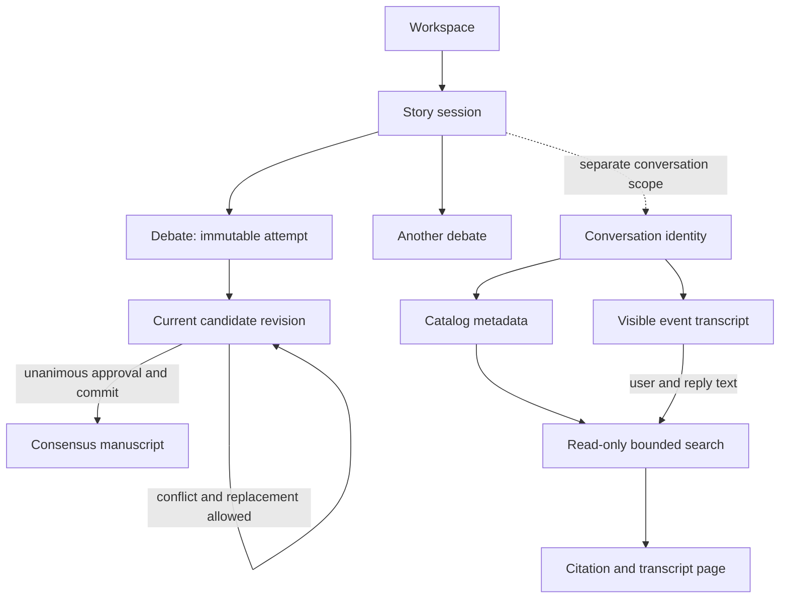

# Core concepts

> **Availability:** the TTY shell with a current attachment manages conversations,
> dispatches routed advisory turns, searches active records, and reads bounded
> active or archived transcripts. See [Story sessions](guides/story-sessions.md).

Key terms: **scope**—what one persisted object groups; **ownership**—which
component controls data or a transition; **turn**—one user event and its
outcome; **flow**—how work moves from input to an approved artifact. For
vocabulary lookup, use the [Glossary](glossary.md).

The workspace is the outer project and persistence boundary. Within it, a story
session groups related overrides, agent history, and provider thread references.
A session can own many debates. Each debate is one immutable attempt and owns a
sequence of complete candidate revisions.

In words: work narrows from workspace to session to debate, then moves through
candidate revisions toward at most one committed manuscript. Conversation
identity is scoped by the same story session but remains separate from debate
execution. Its catalog owns subject and archive status; its event store owns
the full visible transcript and a bounded complete-turn view. A read-only
memory service searches both and follows stable citations into bounded pages.
`StoryRuntime` can also persist and send one turn for an existing conversation
ID, without creating or focusing that identity. See [Runtime API](reference/runtime-api.md#one-conversation-turn)
and [Conversation search and cited transcript pages](reference/conversation-search.md).

## The four roles

| Role | Responsibility | Votes? |
| --- | --- | --- |
| `lead_orchestrator` | Moderates, synthesizes, and finalizes | No |
| `plot_architect` | Plot, structure, flow, and pacing | Yes |
| `character_custodian` | Character, relationships, world, and continuity | Yes |
| `execution_specialist` | Drafting, prose, POV, tone, grammar, and format | Yes |

For debates, the runtime owns phase ordering and consensus validation. For an
advisory turn, it owns preflight, event/provider ordering, and reply validation.
The three specialists audit the same debate revision; the lead cannot vote or
erase a conflict. Role definitions limit each agent to the core documents
needed for its responsibility.

## Public and owner-isolated memory

The public blackboard belongs to the debate. Every agent can receive its visible
history, while parallel reviewers start from the same pre-phase snapshot. The
runtime persists their completed outcomes in stable roster order.

Owner-isolated state belongs to one agent across the whole story session. It can
inform later debates, but it is never exposed as another agent's private history.
Provider thread references are a third channel: the backend may resume them
when session and agent definition remain compatible.

## Core documents and manuscripts

Core documents flow into agent definitions as durable project context. After
unanimous approval, finalization may update only the allowed core documents and
create one approved manuscript at a required part-scoped path. Only current
repository-provenanced core bytes flow into definitions; a manual edit remains
on disk but becomes ineligible. The story agents author candidate and update
text, while the runtime validates, journals, publishes, and catalogs it. The
provider never writes workspace files directly. See
[Canonical writing artifacts](reference/writing-artifacts.md).

Continue with the [System overview](design/overview.md),
[Consensus workflow](design/consensus-workflow.md), or
[Persistence design](design/persistence.md).
