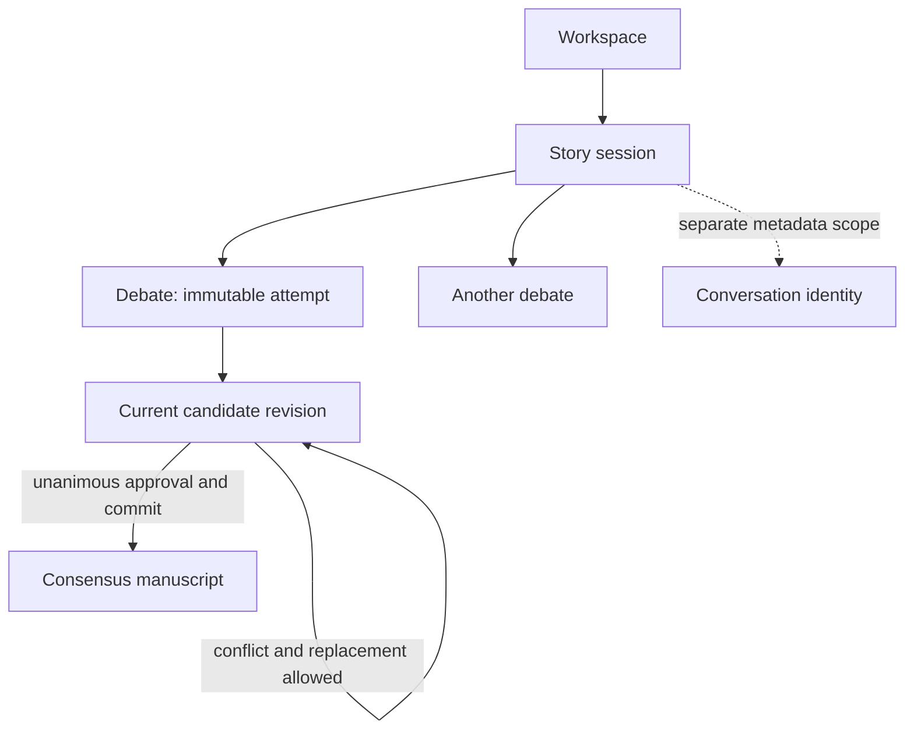

# Core concepts

> **Availability:** this model describes the implemented runtime. Conversation
> metadata exists, but conversation selection, transcripts, and search do not.

Key terms: **scope**—what one persisted object groups; **ownership**—which
component controls data or a transition; **flow**—how work moves from input to
an approved artifact. For vocabulary lookup, use the [Glossary](glossary.md).

The workspace is the outer project and persistence boundary. Within it, a story
session groups related overrides, agent history, and provider thread references.
A session can own many debates. Each debate is one immutable attempt and owns a
sequence of complete candidate revisions.

In words: work narrows from workspace to session to debate, then moves through
candidate revisions toward at most one committed manuscript. Conversation
identity is scoped by the same story session but belongs to a separate,
metadata-only catalog. It is not connected to debate execution today.

## The four roles

| Role | Responsibility | Votes? |
| --- | --- | --- |
| `lead_orchestrator` | Moderates, synthesizes, and finalizes | No |
| `plot_architect` | Plot, structure, flow, and pacing | Yes |
| `character_custodian` | Character, relationships, world, and continuity | Yes |
| `execution_specialist` | Drafting, prose, POV, tone, grammar, and format | Yes |

The runtime owns phase ordering and validation. The three specialists audit the
same current revision; the lead cannot vote or erase a conflict. Consensus
requires all three approvals before the lead can finalize artifacts. Role
definitions limit each agent to the core documents needed for its responsibility.

## Public and owner-isolated memory

The public blackboard belongs to the debate. Every agent can receive its visible
history, while parallel reviewers start from the same pre-phase snapshot. The
runtime persists their completed outcomes in stable roster order.

Owner-isolated state belongs to one agent across the whole story session. It can
inform later debates, but it is never exposed as another agent's private history.
Provider thread references are a third channel: the backend may resume them
when session and agent definition remain compatible.

## Core documents and manuscripts

Core documents flow into agent definitions as durable project context. After
unanimous approval, finalization may update only the allowed core documents and
create the approved manuscript. The workspace owns safe persistence; the
provider never writes these artifacts directly.

Continue with the [System overview](design/overview.md),
[Consensus workflow](design/consensus-workflow.md), or
[Persistence design](design/persistence.md).
