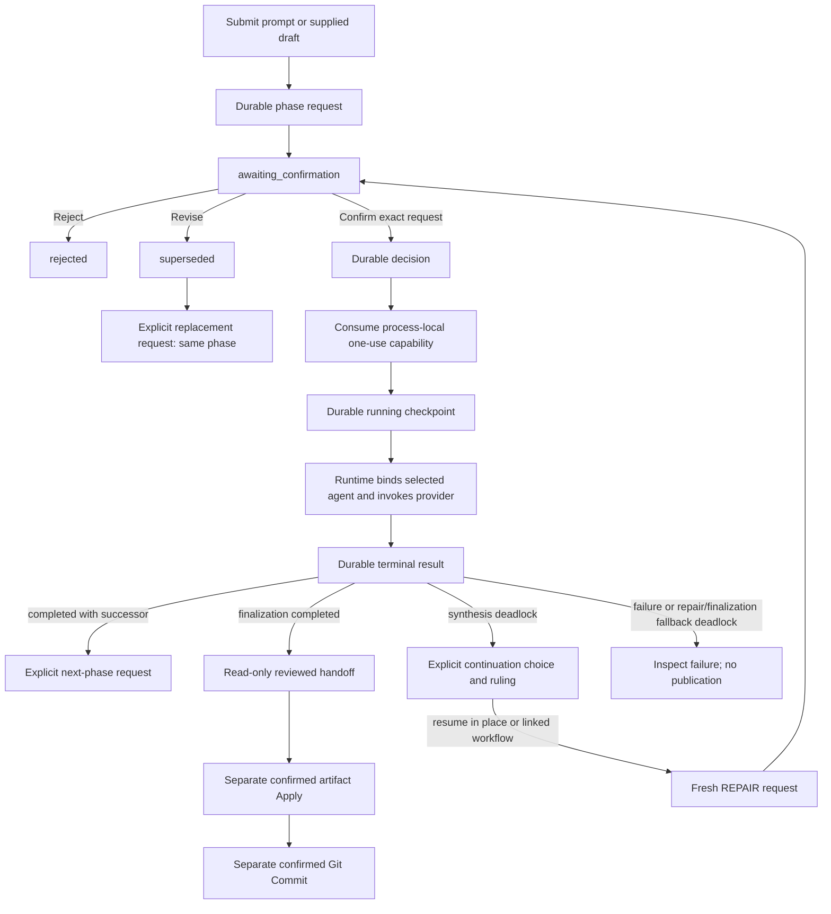

# Phase-confirmed consensus design

`StoryRuntime` implements the narrow `ConsensusRuntimePort` and retains a
`ConsensusRuntimeAdapter`. `RuntimeSession` only binds the session ID. The
adapter owns workflow decisions; the runtime owns persistence, provider
binding, prompt construction, material resolution, and interruption. The
installed CLI and interactive shell do not expose this Python workflow.

## Authority and event sequence

The diagram shows default AUTHORING. Explicit REVIEW_ONLY uses the provider-free
adoption/completion branches described in phase routing below.

Every phase uses request → decision → running → terminal events with monotonic
sequence numbers and exact correlations. A request is durable but contains no
executable capability. The adapter holds the capability only in the current
process, bound to workflow, phase request, owner, and process; Confirm consumes
it once. Durable history therefore cannot be replayed as authority after
restart.

Reject and Revise append a decision and terminal result without provider work.
Revise produces `superseded`; an explicit call creates a replacement request
for the same phase. Confirm saves its decision before consuming the capability and saves `running`
before the phase operation. INPUT_ADOPTION and REVIEW_COMPLETION verify the bound
material through runtime ports without calling a provider. An uncertain mutation directs
the caller to operator recovery instead of guessing or replaying.

## Phase routing

| Consensus phase | Bound agent(s) | Provider `Phase` | Result and normal successor |
| --- | --- | --- | --- |
| `input_adoption` | Runtime | None | Confirm exact supplied bytes as review-only `r0` → `audit`; zero provider calls |
| `draft` | Execution Specialist | `draft` | New unpublished `r0` candidate → `audit`; exhausted structured repair → failure with no candidate |
| `audit` | Plot Architect, Character Custodian, Execution Specialist | `audit` | Three current-revision votes → `synthesis` |
| `synthesis` | Lead Orchestrator | `synthesize` | AUTHORING chooses `repair`, `finalization` or continuable deadlock; REVIEW_ONLY chooses `review_completion` or terminal deadlock |
| `repair` | Execution Specialist | `propose_revision` | New unpublished candidate → `reaudit`; exhausted structured repair → noncontinuable deadlock retaining the prior candidate |
| `reaudit` | Same three auditors | `audit` | Three fresh votes → `synthesis` |
| `review_completion` | Runtime | None | Confirm completion of the reviewed original; zero provider calls, no artifact handoff or publication |
| `finalization` | Lead Orchestrator | `finalize` | Validated read-only handoff; exhausted structured repair → noncontinuable deadlock retaining the candidate; no publication |

`AuthoringIntent` is independent of drafting/review activity. Default AUTHORING
keeps the existing DRAFT transformation and FINALIZATION artifact-identity
contract. Explicit REVIEW_ONLY supplied input follows INPUT_ADOPTION → AUDIT →
SYNTHESIS → REVIEW_COMPLETION, with separate exact confirmations. Synthesis offers
review_completion or deadlock for that intent. It cannot select REPAIR, REAUDIT,
DRAFT or artifact FINALIZATION; revision needs a fresh AUTHORING submission.
Provider routing rejects adoption/completion phases, while execution verifies
material and saves the existing running/terminal events without invoking a
provider. Intent is immutable within the workflow and bound into review-only
request/proposal identity.

The lead does not vote. All three auditors inspect the same candidate handle
and revision. Synthesis cannot carry an audit verdict. Repair must produce a
different candidate digest. Finalization retains the candidate lineage and
identifies an already reviewed proposal; it cannot grant Apply or Git
authority.

## Durable deadlock continuation

An AUTHORING synthesis deadlock is terminal but resumable by an explicit new operation.
REVIEW_ONLY deadlock retains the original and does not permit continuation.
`continue_deadlock()` accepts the exact source workflow, deadlock-result event,
and expected tail; a closed continuation mode; an immutable ruling handle; and
a positive added-repair-round budget. It validates that the source is still an
exact terminal synthesis deadlock and that the current candidate plus every
unresolved conflict material remains available.

`resume_in_place` appends a REPAIR request to the existing workflow and keeps
its proposal identity. `linked_workflow` creates a distinct workflow/proposal
with `input_kind=continuation`; its submission points to the source deadlock.
Both modes reuse content-addressed candidate and critique handles, so no caller
passes candidate or critique text and no candidate copy becomes a new source
of truth. The request digest binds the complete continuation provenance,
including mode, ruling digest, source identities, conflicts, and budget.

Preparing either mode stores a request and a process-local one-use capability;
it performs no provider or artifact call. REPAIR, REAUDIT, and SYNTHESIS then
use the ordinary request/decision/running/result protocol, each with fresh user
confirmation. A completed REPAIR consumes one added round. Reject or Revise
does not consume one, and a replacement REPAIR request remains possible while
the budget permits. A requested REPAIR after exhaustion fails before execution.

Projection carries content-free continuation facts:
`continuation_mode`, `source_workflow_id`, `source_result_event_id`,
`source_revision_id`, `source_candidate_digest`, `ruling_digest`,
`ruling_present`, `added_revision_rounds`, and
`remaining_revision_rounds`. A synthesis deadlock projects
`next_action=continue_deadlock`; a REPAIR or FINALIZATION fallback deadlock
projects `next_action=inspect_failure`; and a continuation request projects the
ordinary `request_decision`. A repeated synthesis deadlock remains terminal and
nonpublishing, and may be continued only by another explicit exact operation.

Consensus workflow serialization writes version 4 with a strict version-3
AUTHORING reader. Historical nested AUTHORING shapes and request/proposal digests
remain unchanged; reserialization changes the envelope version. Version-3 records
cannot contain new intent or phase facts. No v2 reader or migration exists. Malformed, stale, cross-session, foreign-result,
or unavailable-material continuation input fails closed before provider or
artifact mutation. Linked creation revalidates the source tail immediately
before creating its content-free workflow; the event-store port does not
provide a cross-workflow transaction, so a concurrent source append can only
leave a harmless unexecuted linked request, never publish or invoke a provider.

REVIEW_ONLY terminal synthesis additionally retains the actual untrusted review
report as `review_findings`; inspection keeps it through completion and restart.
The report grants no candidate, repair, artifact or Git authority.

## Provider and material boundary

Runtime converts a `ConsensusPhaseInvocation` into an `AgentRequest` whose
agent, phase, ordinal, revision, task, input, and candidate are runtime-owned.
It uses the bound agent's existing contextual prompt definition. Strict
`AgentReply` validation maps candidate, audit, synthesis, deadlock, and
finalization replies into digest-bound `ConsensusProviderResult` values. When
one bounded structured repair is exhausted, DRAFT becomes a definite failure
with no candidate; REPAIR, SYNTHESIS, and FINALIZATION become deadlocks that
retain the trusted input candidate. Their content-free reply trace keeps
`origin=runtime_fallback` and `action=none`; no fallback grants publication.

Prompt text and supplied drafts are immutable content-addressed material.
Draft and repair output is likewise unpublished material. Durable events keep
handles and digests, not candidate bytes. For canonical artifact input,
runtime prepares the normal reference operation, verifies current path and
digest, and passes its authorized provider-read coordinator to the agent. It
never substitutes unverified file bytes for that operation.

## Projection and external meaning

`project_consensus()` rejects gaps, duplicate events, stale correlations,
changed lineage, replayed confirmation IDs, and invalid transitions. It emits
a content-free `ConsensusProjection` with phase, state, identities, candidate
digest, last sequence, and one safe `next_action`:

- `request_decision`: show the exact pending request to the user.
- `start_confirmed_phase` or `wait_for_phase`: execution is confirmed or
  active; do not issue another decision.
- `request_next_phase`: the prior phase completed or was revised; creating the
  next request is explicit and does not execute it.
- `inspect_failure`: interruption, definite failure, or a noncontinuable
  REPAIR/FINALIZATION fallback deadlock is terminal.
- `operator_recovery`: outcome or durability is uncertain; automation stops.
- `continue_deadlock`: offer an explicit synthesis-deadlock continuation or stop.
- `none`: finalization or rejection has no consensus successor.

The user meanings of all states and sample calls are in
[Consensus runs](../guides/consensus-runs.md).

## Interruption, restart, and publication

An interrupt cancels only tasks registered for the exact session,
conversation, workflow, and phase request. Confirmed cancellation appends an
`interrupted` result; failure to prove cancellation exposes
`recovery_required`.

Workflow storage is durable and reopen validation rejects malformed or
unsupported histories. `resume_consensus()` only reloads and projects history.
It neither resumes the physical provider call nor recreates confirmation
authority. Callers must not turn durable `awaiting_confirmation` with
`capability_available=False` into authority.

Every `ConsensusPhaseResult` fixes `publication_allowed=False`. Successful
finalization is only a reviewed handoff. Artifact Apply uses a fresh exact
confirmation and runtime write operation; Git Commit uses a later separate
confirmation. A discussion, vote, or provider response therefore cannot
silently mutate the writing workspace.
