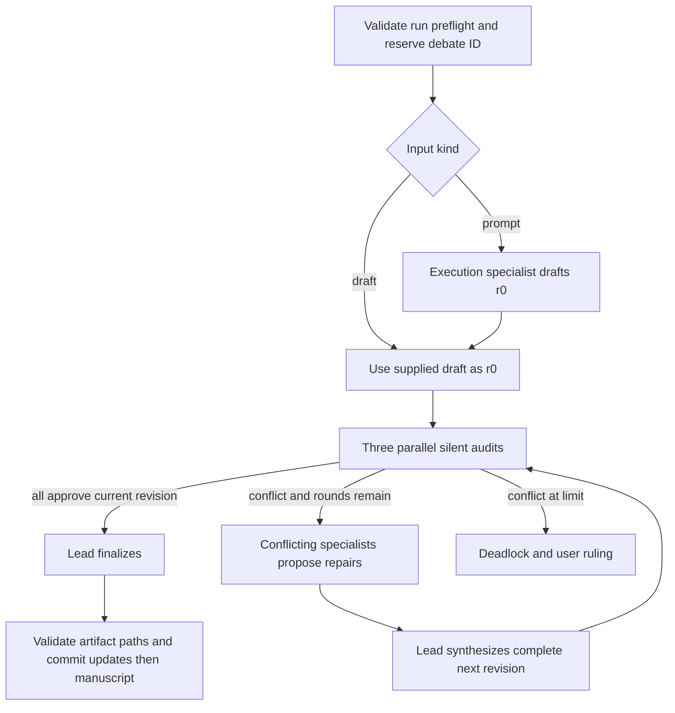

# Consensus workflow

> **Availability:** the complete prompt/draft, audit, revision, consensus,
> deadlock, and finalization workflow is implemented in `StoryRuntime`.

Key terms: **reservation**—the immutable claim on one debate ID; **silent
audit**—parallel review from one shared snapshot; **replacement revision**—a
complete successor candidate; **finalization**—the post-approval artifact step.

In words: the debate ID is reserved before any provider call; a prompt first
becomes `r0`, while a supplied draft already is `r0`; all specialists audit the
same candidate; conflicts can produce complete replacement revisions; only
unanimous approval of the current revision reaches artifact commit.

## Reservation and drafting

Before reservation, the runtime requires a backend, validates the session and
debate IDs, nonempty input, and round limit, and prepares the provider session.
It then exclusively creates lifecycle state. A concurrent attempt at the same
session/debate pair fails before debate execution. The original input is
appended to the public blackboard. Prompt input calls the execution specialist
for a full candidate; draft input skips that call.

The output name is only selected at this point, not path-validated. Manuscript
path safety and nonexistence are checked during finalization and artifact
commit. An unsafe output can therefore consume the reserved debate ID, reach a
terminal `failed` result, and require a new ID for retry.

## Parallel silent phases

Plot, character, and execution specialists audit concurrently from one
pre-audit blackboard snapshot. They cannot see or react to peer verdicts still
in flight. A reply must target the current revision and be approval with an
optional note or conflict with an actionable critique. Outcomes are appended
in canonical specialist order, not completion order. On the first backend or
validation failure, unfinished peers are cancelled and recorded stably.

Only specialists owning conflicts propose repairs. They again share one
pre-proposal snapshot. The non-voting lead then sees candidate, critiques, and
proposals and must synthesize one complete replacement. All three specialists
re-audit it. Older approvals never count. Round limit counts replacements, not
audits.

## Terminal paths

Remaining conflicts at the limit produce `deadlock` and `action_required`.
Handled backend, peer-cancellation, validation, finalization, or artifact
errors produce `failed`. Both persist state, public messages, owner outcomes,
and normally a result, without a successful manuscript. External coroutine
cancellation propagates and best-effort marks `interrupted`.

After three approvals, the lead may preserve the candidate and return
full-text updates for four allowlisted core documents. The runtime validates
all names, values, and manuscript nonexistence, replaces core documents in
allowlist order, then creates the exact approved manuscript. A later write
failure triggers best-effort rollback.

Debate IDs remain immutable after consensus, deadlock, failure, interruption,
or abandoned active state. Recovery is inspection, a user decision where
needed, and a new ID—not same-ID continuation.

Exact request/reply rules are in [Agent contracts](../reference/agent-contracts.md);
result shapes are in [Runtime API](../reference/runtime-api.md).
