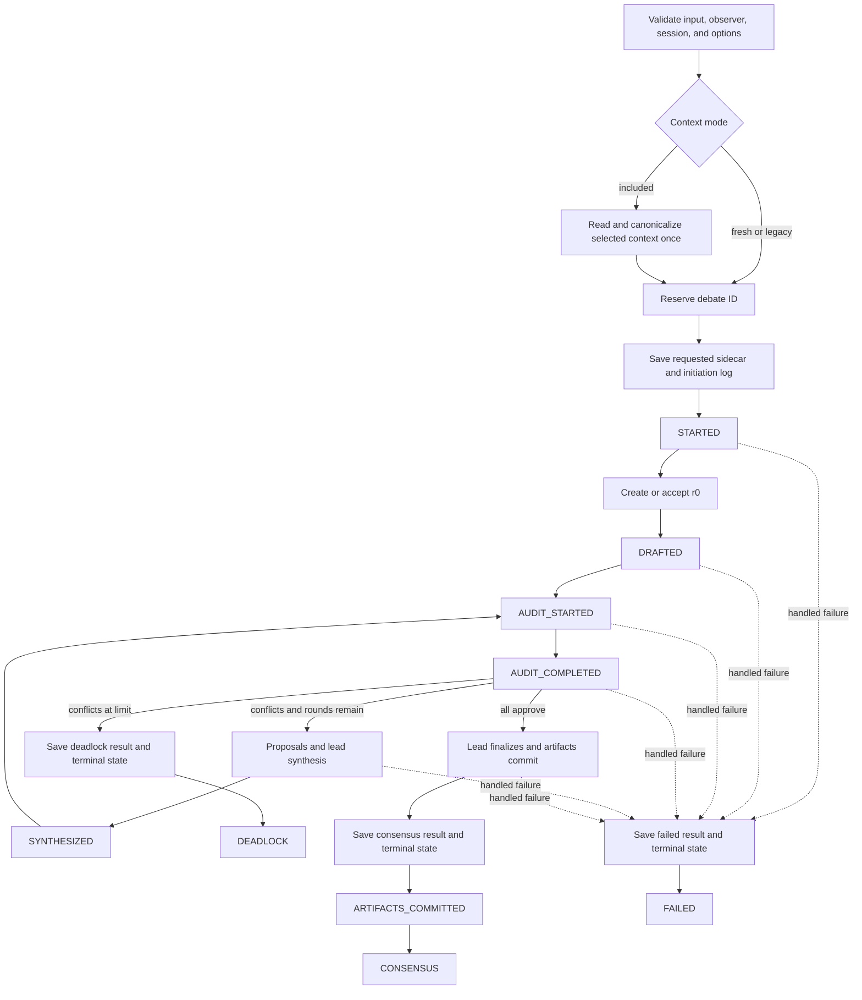

# Consensus workflow

> **Availability:** `StoryRuntime` implements prompt and supplied-draft debates,
> optional selected-conversation context, trusted progress, terminal results,
> and approved artifact commits.

Key terms: **reservation**—the immutable claim on one debate ID; **snapshot**—
one bounded conversation window; **revision round**—one complete replacement;
**terminal durability**—result and lifecycle state saved before terminal
progress; **observer**—the optional synchronous progress sink.

## Before provider work

The runtime validates the backend, nonempty input, IDs, round limit, optional
context request, and observer, then prepares the story session. Included mode
performs exactly one synchronous context read and canonical validation before
reservation. Fresh and legacy modes perform no context read. Any failure here
emits nothing and leaves the debate ID unreserved.

Reservation exclusively creates lifecycle state. A requested included or fresh
sidecar is then created before the initiation blackboard entry, provider work,
or `STARTED`. Sidecar failure is raised and best-effort makes the reserved state
terminal `failed`; it produces no result or progress.

## Trusted progress sequence

`STARTED` follows the durable initiation entry and is the only event carrying
context mode and counts. Prompt input then asks the execution specialist for
`r0`; supplied-draft input skips that provider call. Both emit `DRAFTED` once
`r0` exists.

Each revision emits `AUDIT_STARTED`, then the three specialists audit the same
candidate and the same immutable context snapshot in parallel. Successful
audit persistence precedes `AUDIT_COMPLETED`, whose typed agent list reports
conflicts in roster order. Peer prose never enters progress.

If conflicts remain and another replacement is allowed, only conflicting
specialists propose repairs. The lead synthesizes a complete next revision;
after it is durable the runtime emits `SYNTHESIZED` and starts the next audit.
There is no separate proposal event. Older approvals never count.

At the round limit, conflicts produce a durable deadlock result and state before
`DEADLOCK`. Unanimous approval allows lead finalization and artifact commit;
the consensus result and state are then durable before
`ARTIFACTS_COMMITTED`, followed by `CONSENSUS`. A handled provider, protocol,
context-propagation, workspace, finalization, or artifact failure similarly
saves its result and state before a typed `FAILED` event.

## Observer and cancellation boundaries

Declared coroutine or async-generator observers fail validation before
mutation. Every failure raised synchronously by an accepted observer, plus an
awaitable or non-`None` result, becomes `ProgressObserverError` through
`__cause__`.
Before terminal durability this best-effort marks the debate `interrupted` and
raises. After terminal durability it raises without rewriting the saved result,
state, or artifacts.

Genuine external cancellation remains `asyncio.CancelledError`. The runtime
joins its execution task, best-effort persists `interrupted`, and emits
`INTERRUPTED` only after that transition is confirmed. If that observer call
fails, cancellation remains primary and the observer error is its cause.

Exact types are in [Runtime API](../reference/runtime-api.md); artifact and
sidecar storage are in [Persistence](persistence.md); operator response is in
[Recovery and limitations](../operations/recovery-and-limitations.md).
