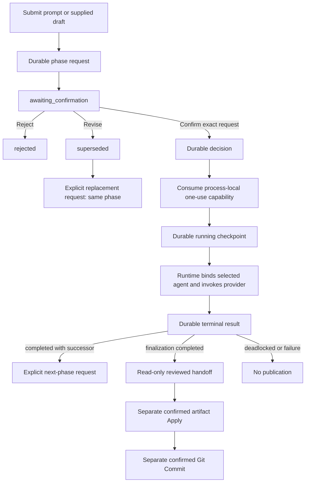

# Phase-confirmed consensus design

`StoryRuntime` implements the narrow `ConsensusRuntimePort` and retains a
`ConsensusRuntimeAdapter`. `RuntimeSession` only binds the session ID. The
adapter owns workflow decisions; the runtime owns persistence, provider
binding, prompt construction, material resolution, and interruption. The
installed CLI and interactive shell do not expose this Python workflow.

## Authority and event sequence

Every phase uses request → decision → running → terminal events with monotonic
sequence numbers and exact correlations. A request is durable but contains no
executable capability. The adapter holds the capability only in the current
process, bound to workflow, phase request, owner, and process; Confirm consumes
it once. Durable history therefore cannot be replayed as authority after
restart.

Reject and Revise append a decision and terminal result without provider work.
Revise produces `superseded`; an explicit call creates a replacement request
for the same phase. Confirm saves its decision before consuming the capability
and saves `running` before calling the provider. An uncertain mutation directs
the caller to operator recovery instead of guessing or replaying.

## Phase routing

| Consensus phase | Bound agent(s) | Provider `Phase` | Result and normal successor |
| --- | --- | --- | --- |
| `draft` | Execution Specialist | `draft` | New unpublished `r0` candidate → `audit` |
| `audit` | Plot Architect, Character Custodian, Execution Specialist | `audit` | Three current-revision votes → `synthesis` |
| `synthesis` | Lead Orchestrator | `synthesize` | Nonvoting choice of `repair`, `finalization`, or deadlock |
| `repair` | Execution Specialist | `propose_revision` | New unpublished candidate → `reaudit`; revision increments when requested |
| `reaudit` | Same three auditors | `audit` | Three fresh votes → `synthesis` |
| `finalization` | Lead Orchestrator | `finalize` | Validated read-only handoff; no successor or publication |

The lead does not vote. All three auditors inspect the same candidate handle
and revision. Synthesis cannot carry an audit verdict. Repair must produce a
different candidate digest. Finalization retains the candidate lineage and
identifies an already reviewed proposal; it cannot grant Apply or Git
authority.

## Provider and material boundary

Runtime converts a `ConsensusPhaseInvocation` into an `AgentRequest` whose
agent, phase, ordinal, revision, task, input, and candidate are runtime-owned.
It uses the bound agent's existing contextual prompt definition. Strict
`AgentReply` validation maps candidate, audit, synthesis, deadlock, and
finalization replies into digest-bound `ConsensusProviderResult` values.

Prompt text and supplied drafts are immutable content-addressed material.
Draft and repair output is likewise unpublished material. Durable events keep
handles and digests, not candidate bytes. For canonical artifact input,
runtime prepares the normal reference operation, verifies current path and
digest, and passes its authorized provider-read coordinator to the agent. It
never substitutes unverified file bytes for that operation.

## Projection and external meaning

`project_consensus()` rejects gaps, duplicate events, stale correlations,
changed lineage, replayed confirmation IDs, and invalid transitions. It emits
a content-free `ConsensusProjection` with phase, state, identities, candidate
digest, last sequence, and one safe `next_action`:

- `request_decision`: show the exact pending request to the user.
- `start_confirmed_phase` or `wait_for_phase`: execution is confirmed or
  active; do not issue another decision.
- `request_next_phase`: the prior phase completed or was revised; creating the
  next request is explicit and does not execute it.
- `inspect_failure`: interruption or definite failure is terminal.
- `operator_recovery`: outcome or durability is uncertain; automation stops.
- `none`: finalization, rejection, or deadlock has no consensus successor.

The user meanings of all states and sample calls are in
[Consensus runs](../guides/consensus-runs.md).

## Interruption, restart, and publication

An interrupt cancels only tasks registered for the exact session,
conversation, workflow, and phase request. Confirmed cancellation appends an
`interrupted` result; failure to prove cancellation exposes
`recovery_required`.

Workflow storage is durable and reopen validation rejects malformed or
unsupported histories. `resume_consensus()` only reloads and projects history.
It neither resumes the physical provider call nor recreates confirmation
authority. Callers must not turn durable `awaiting_confirmation` with
`capability_available=False` into authority.

Every `ConsensusPhaseResult` fixes `publication_allowed=False`. Successful
finalization is only a reviewed handoff. Artifact Apply uses a fresh exact
confirmation and runtime write operation; Git Commit uses a later separate
confirmation. A discussion, vote, or provider response therefore cannot
silently mutate the writing workspace.
