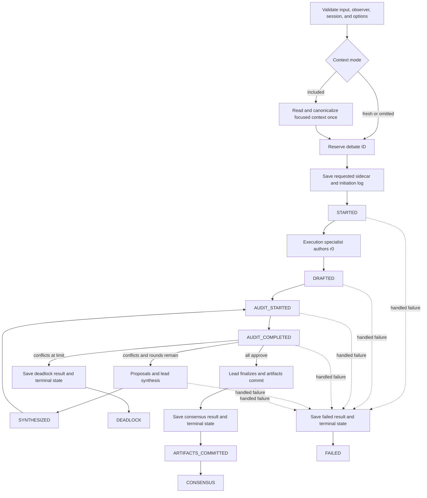

# Consensus workflow

> **Availability:** `StoryRuntime` implements prompt and supplied-draft debates,
> optional focused-conversation context, trusted progress, terminal results,
> and approved artifact commits.

Key terms: **reservation**—the immutable claim on one debate ID; **snapshot**—
one bounded conversation window; **revision round**—one complete replacement;
**terminal durability**—result and lifecycle state saved before terminal
progress; **observer**—the optional synchronous progress sink.

## Before provider work

The runtime validates the backend, nonempty input, required
`PART/PATH.md` output, IDs, round limit, optional context request, and observer,
then prepares the story session. Output validation happens before session
access, debate reservation, or provider work. Included mode
performs exactly one synchronous context read and canonical validation before
reservation. Fresh and context-omitted modes perform no context read. Any failure here
emits nothing and leaves the debate ID unreserved.

Reservation exclusively creates lifecycle state. A requested included or fresh
sidecar is then created before the initiation blackboard entry, provider work,
or `STARTED`. Sidecar failure is raised and best-effort makes the reserved state
terminal `failed`; it produces no result or progress.

## Trusted progress sequence

`STARTED` follows the durable initiation entry and is the only event carrying
context mode and counts. Both prompt and supplied-draft input ask the execution
specialist to author `r0`; for a supplied draft it preserves sound material and
applies requested changes before any audit. `DRAFTED` follows the durable
agent-authored candidate.

Each revision emits `AUDIT_STARTED`, then the three specialists audit the same
candidate and the same immutable context snapshot in parallel. Successful
audit persistence precedes `AUDIT_COMPLETED`, whose typed agent list reports
conflicts in roster order. Peer prose never enters progress.

If conflicts remain and another replacement is allowed, only conflicting
specialists propose repairs. The lead synthesizes a complete next revision;
after it is durable the runtime emits `SYNTHESIZED` and starts the next audit.
There is no separate proposal event. Older approvals never count.

At the round limit, conflicts produce a durable deadlock result and state before
`DEADLOCK`. Unanimous approval allows lead finalization and artifact commit;
finalization may return complete updates for only the four core documents. The
artifact repository journal-publishes one create-only part manuscript and any
core updates, then makes the provenance catalog visible last. The consensus
result and state are then durable before
`ARTIFACTS_COMMITTED`, followed by `CONSENSUS`. A handled provider, protocol,
context-propagation, workspace, finalization, or artifact failure similarly
saves its result and state before a typed `FAILED` event.

### Interactive phase presentation

The interactive shell presents each accepted progress event as one Panel titled
`Debate phase` in one terminal write. Its ordered fields are Debate ID, Phase,
Round, Revision, Action, Outcome, and Conflicts. Message details On inserts
Handoff between Revision and Action; Off omits only that diagnostic field.
`STARTED` also includes the fixed included/fresh context notice.

Before writing the panel, the controller reads the uncommitted suffix of the
durable debate log. It groups contiguous messages by their persisted phase,
round, and revision into sections titled
`Speeches · PHASE · round N · revision REVISION`, using `n/a` for an empty
revision. Every non-error agent speech is
shown in full as a speaker-aware chat block, with presentation-only strict JSON
formatting when applicable. Message details On adds the persisted Kind; Off
still shows the complete speech. An error-kind message is replaced with the
fixed safe text `Agent error details are unavailable.` If the log cannot be
read, the same panel contains the fixed `agent-saying` warning `Agent sayings
unavailable; the debate log could not be read.` If that warning panel is
written successfully, `STARTED` commits its candidate cursor of zero; a
later-phase read failure retains the existing cursor.

Only a successful panel write commits the candidate log cursor, accepted
progress event, `STARTED` mapping, and any `STARTED` or `AUDIT_COMPLETED`
conflict-cache update. The last successfully written `AUDIT_COMPLETED`
conflicts remain visible in subsequent phases. They reset only after a
successfully written `STARTED` panel and are replaced only after a successfully
written later audit panel. A failed write commits none of those changes, so a
retry sees the same suffix and retained conflicts. Successful consensus
receives a separate final `Consensus` Record after terminal progress; deadlock
and failed outcomes instead use typed error presentation. These display rules
neither replace nor weaken the runtime's durable-before-progress guarantees
above.

## Observer and cancellation boundaries

Declared coroutine or async-generator observers fail validation before
mutation. Every failure raised synchronously by an accepted observer, plus an
awaitable or non-`None` result, becomes `ProgressObserverError` through
`__cause__`.
Before terminal durability this best-effort marks the debate `interrupted` and
raises. After terminal durability it raises without rewriting the saved result,
state, or artifacts.

Genuine external cancellation remains `asyncio.CancelledError`. The runtime
joins its execution task, best-effort persists `interrupted`, and emits
`INTERRUPTED` only after that transition is confirmed. If that observer call
fails, cancellation remains primary and the observer error is its cause.

The interactive controller adds proof boundaries around that runtime contract.
Ctrl-C before coroutine entry, with the shared Runner quiescent, is provider-free:
no reservation, run row, or `last` update occurs. Once entered, friendly recovery
requires a joined cancellation and trusted terminal `INTERRUPTED`; that event may
be first after reservation and proves only the durable terminal state. Only
`STARTED` updates `/inspect last`. An entered cancellation without trusted proof
is fatal `operation_interrupted`; known attachment state is abandoned before
ordered cleanup. An interrupted debate cannot resume; `/run` creates a new ID.
Exact shell records are in the [terminal reference](../reference/interactive-terminal.md#exact-cancellation-records).

Exact types are in [Runtime API](../reference/runtime-api.md); artifact and
sidecar storage are in [Persistence](persistence.md), with the exact artifact
contract in [Canonical writing artifacts](../reference/writing-artifacts.md);
operator response is in
[Recovery and limitations](../operations/recovery-and-limitations.md).
