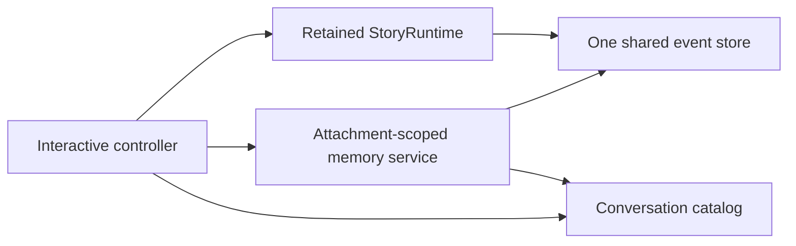

# System design overview

> **Availability:** this page describes implemented runtime ownership,
> dependency direction, filesystem adapters, and the installed interactive
> controller.

Key terms: **orchestration**—coordination of provider work;
**controller**—owner of interactive transition order; **adapter**—a concrete
provider-neutral implementation; **scope**—the session one service may read;
**selection**—a saved pointer, not the record it names.

`story-writing-agents` separates workflow, provider invocation, terminal
presentation, and filesystem persistence. In this project, “commit” means
writing approved story text; the runtime never invokes Git.

## Runtime and provider ownership

`StoryRuntime` owns workflow validation, sequencing, concurrency, and reply
validation. For debates it also owns reservation, consensus, blackboard,
owner-isolated history, and final artifact coordination. For one advisory turn
it owns preflight, a per-conversation lock, context read, user-before-provider
append, and one reply or safe error append. Exact rules belong to the
[Runtime API](../reference/runtime-api.md#one-conversation-turn).

`AgentBackend` owns provider routes, Codex preflight, prompt staging,
story-session leases, provider processes, and resumable thread metadata. A
`BoundAgent` owns one immutable definition and invocation path. Codex is
implemented; Gemini remains a reserved name that fails preflight.

`Workspace` is the local persistence and path-safety boundary. It owns strict
UTF-8 reads, JSON/JSONL artifacts, reservations, manuscripts, inspection, and
atomic file replacement. Exact guarantees belong to
[Filesystem safety](../operations/filesystem-safety.md).

## Fixed collaboration model

The lead orchestrator moderates, synthesizes, and finalizes but does not vote.
The plot architect, character custodian, and execution specialist audit every
current revision. Consensus requires all three approvals for that revision.
The public blackboard is append-only; owner-isolated agent history is a
separate channel. Peer outputs are persisted in stable roster order even when
provider calls finish in another order.

## Interactive ownership

| Owner | Responsibility |
| --- | --- |
| `interactive_commands` | Pure grammar and canonical agent-route metadata |
| `interactive_controller` | Attachment, selection, sticky target, dispatch, transition order, and cleanup coordination |
| `cli_context` | Saved session and per-session conversation selections |
| `ConversationCatalog` | Conversation identity, subject, archive status, and ordered metadata |
| `ConversationMemoryService` | One attachment-scoped search/read authorization |
| `ConversationEventStore` | Authoritative events and complete-turn context |
| `InteractiveTerminal` | Synchronous input and safe primitive presentation |
| `StoryRuntime` | Debate orchestration and advisory provider/transcript sequence |
| `AgentBackend` | Session leases, provider routes, threads, and processes |

The controller constructs one filesystem event store against its resolved
catalog and gives that exact instance to the retained runtime. For each
attachment it constructs a `ConversationMemoryService` over the same catalog
and event store.

On session switch, the destination service is built after destination
validation but before source detach. It becomes current only when the
destination attachment commits. End, abort, and final cleanup clear it.
Conversation create, use, rename, and archive do not replace it; their
consequence is simply that later reads observe current catalog and transcript
data in the same attached-session scope.

The controller calls only `StoryRuntime.converse()` for accepted content and
delegates result data to `ConversationMemoryService.search()` or
`read_transcript()`. Catalog reads resolve and validate identities. The
controller never calls the event store directly, invokes a bound agent, or
duplicates a transcript read.

## Dependency direction

The CLI creates terminal, backend, and controller. The controller depends
downward on backend, context, catalog, parser, terminal, runtime, memory, model,
and workspace contracts; parser and terminal do not depend back on it.
Orchestration depends on provider-neutral models, event contracts, and
workspace operations. The production graph remains acyclic.

This supports deterministic test collaborators but is not a dynamically
loaded plugin system. Exact public imports live in
[Package API](../reference/package-api.md); conversation contracts live in
[Conversation search](../reference/conversation-search.md) and
[Conversation transcripts](../reference/conversation-transcripts.md).
