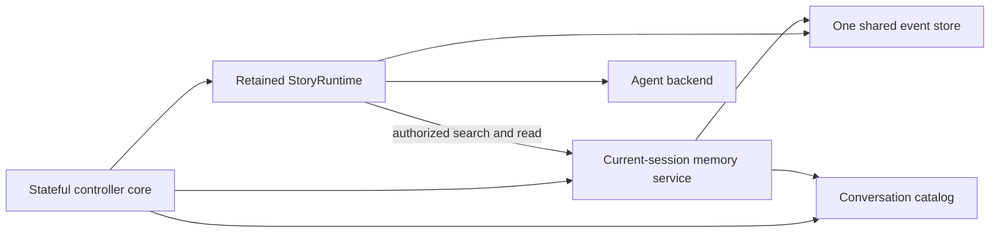
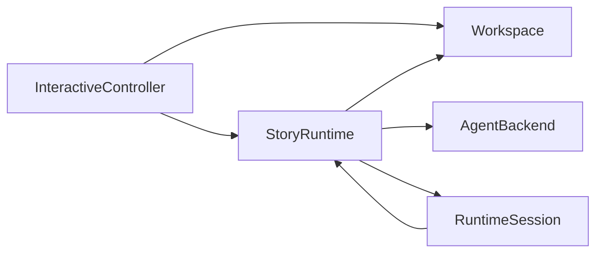
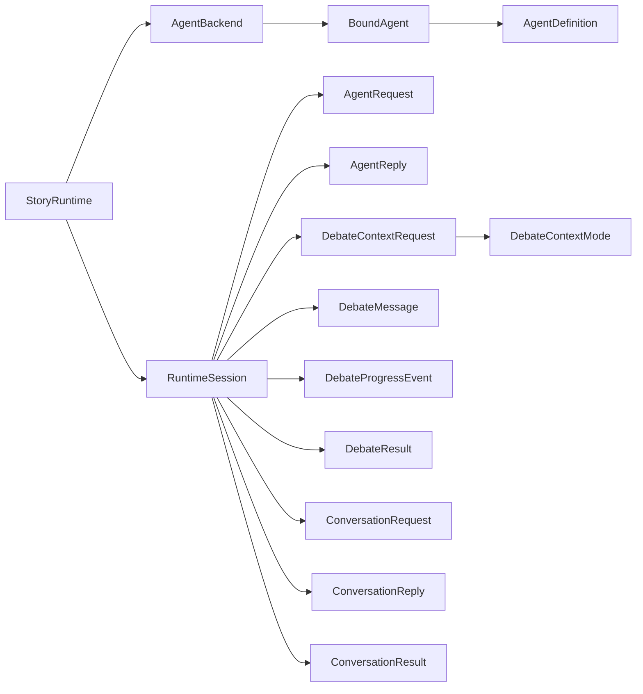
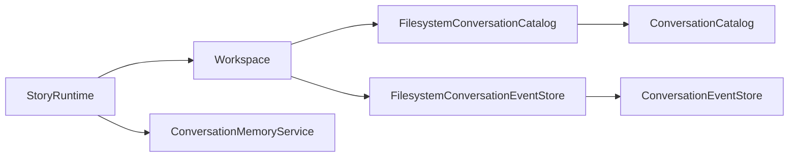
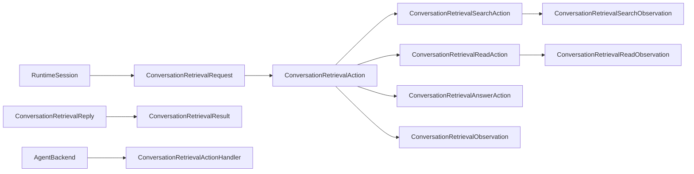
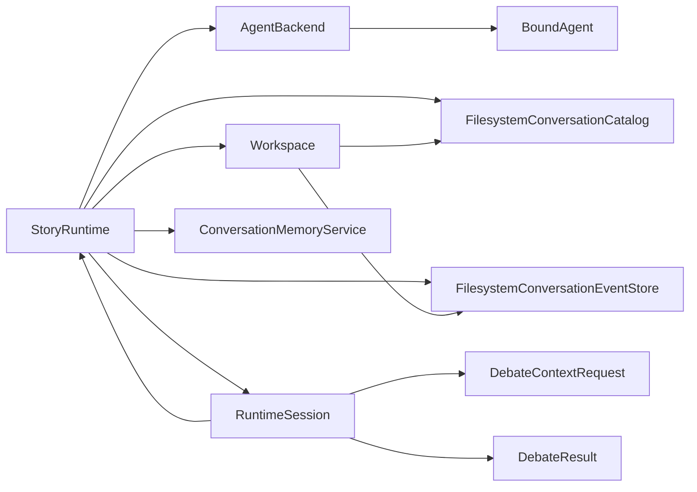
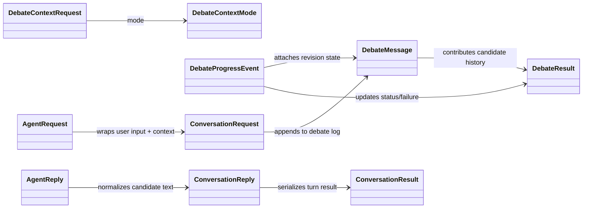
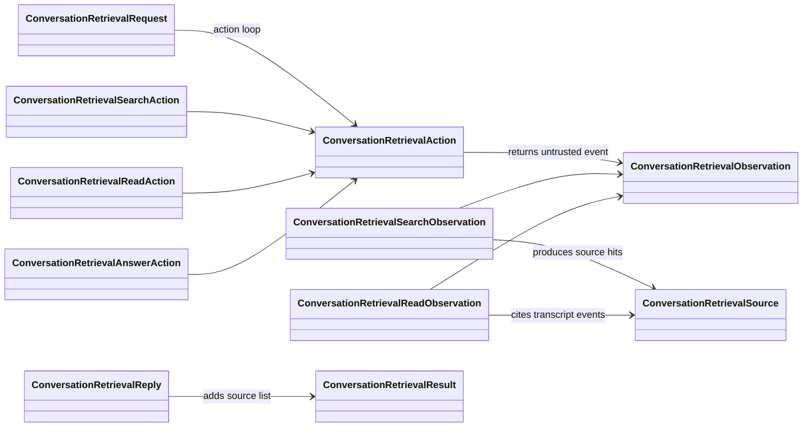

# System design overview

> **Availability:** this page describes implemented runtime ownership,
> dependency direction, filesystem adapters, and the installed interactive
> controller.

Key terms: **controller**—owner of interactive transition order;
**adapter**—provider-neutral implementation; **scope**—what a service may read;
**default**—persisted fallback; **focus**—current process-local scope.

`story-writing-agents` separates workflow, provider invocation, terminal
presentation, and filesystem persistence. In this project, “commit” means
writing approved story text; the runtime never invokes Git.

## Runtime and provider ownership

`StoryRuntime` owns validated debate/advisory sequencing, consensus, retrieval
authority, replies, and artifacts. See the
[Runtime API](../reference/runtime-api.md#one-conversation-turn).

`session_lifecycle` owns immutable provider-neutral lifecycle facts and pure
readiness, with no resource or I/O. `AgentBackend` retains manifests, access
claims, prompt staging, routes, processes, and threads;
`BoundAgent` owns one binding. Codex is implemented; Gemini fails preflight.

`Workspace` owns path-safe persistence, inspection, and atomic replacement. See
[Filesystem safety](../operations/filesystem-safety.md).

## Fixed collaboration model

The lead moderates and finalizes but does not vote. Three specialists audit each
revision; all must approve. Blackboard and owner-isolated history stay separate.

## Interactive ownership

| Owner | Responsibility |
| --- | --- |
| `interactive_commands` | Pure grammar, canonical agent-route metadata, and cursor-aware completion projection for finite main-command positions |
| `interactive_controller` | Stable `InteractiveController` import facade; no state or I/O |
| `interactive_controller._core` | Sole controller state, dispatch, transition order, I/O sequencing, resources, cleanup, and typed semantic output composition |
| `interactive_controller._session_policy` | Pure lifecycle validation, next actions, and typed failure classification |
| `interactive_controller._conversation_policy` | Pure catalog, reference, search, transcript, and failure interpretation |
| `interactive_controller._runtime_policy` | Pure progress, result, failure interpretation, and frozen validated inspection facts |
| `interactive_settings` | Package-internal immutable current/pending configuration snapshots, safe persona catalog, exact conflict detection, and guarded changed-only persistence with reverse exact-byte rollback |
| `cli_context`, catalog, memory service, event store | Defaults, identity, scoped reads, and authoritative events |
| `interactive_terminal` | Stable package-supported facade, package-internal real-CLI factory, and unlisted internal semantic output, picker, and cancellable-prompt adapters and component identities |
| `interactive_terminal._core` | Established terminal API behavior, explicit ordinary/main/composition/confirmation routing, canonical completion adaptation, semantic input-view and lifecycle-event construction, resource-free semantic output/picker/prompt adapters, and terminal-leaf coordination |
| `interactive_terminal._model`, `_controls`, `_render` | Immutable semantic/history/completion/composer/picker foundation; pure line, palette, history, composer, confirmation, prompt, and picker transitions; bounded picker viewport; and pure safe responsive output/input rendering |
| `interactive_terminal._driver` | Sole real-CLI raw streams, capabilities, width, incremental byte/key decoding, fixed Escape readiness wait, cursor controls, writes, flushes, restoration, one bounded process-local main-history store, and dedicated history-free picker/prompt lifecycles |
| `interactive_line_editor` | Standalone compatibility facade over the same supported main-command reader and one unified per-editor driver/history store |
| `StoryRuntime`, `AgentBackend` | Orchestration/retrieval authority and provider resources |

The supported import remains `from story_writing_agents.interactive_controller import InteractiveController`.
The facade re-exports the core's same class;
shell behavior and project-root exports are unchanged. Only the core retains
collaborators and mutable process state.

The supported terminal import remains
`from story_writing_agents.interactive_terminal import InteractiveTerminal`.
Its package facade preserves the exact existing public objects and signatures;
package leaves are internal. The CLI calls one package-internal factory to
construct a stream-backed terminal around one `RawTerminalDriver`. The
standalone line-editor facade delegates to that same driver implementation and
contains no second raw-terminal lifecycle. Each constructed stream terminal or
standalone editor has one isolated 100-entry process-local main-command store;
the callback-only terminal and controller have none.

The semantic models, responsive plain/fixed-ANSI renderer, and capability
profiles are implemented. Orientation, status/inspection, central errors and
recovery, and accepted management, advisory, retrieval, and consensus output
use them. Full/context help, roster, session/conversation lists, search,
transcript, and focused history now use them too. The controller sends each
dense row as one positioned, one-record `ListView` callback; empty and
interrupted outcomes remain explicit. Composition and confirmation now build
ordered semantic input views, and the four composer lifecycle records use
semantic `open`, `error`, `completed`, and `cancelled` notices. No internal
composer `write_status` site remains. Capable main reads now project canonical
command grammar into a semantic selectable palette; fallback, composition,
confirmation, and subject reads do not. There is no public theme API.

The generic picker foundation is also implemented entirely inside the terminal
package. It keeps opaque choice identities out of rendered text, separates
selection from highlight, exposes at most seven choices in a live viewport,
and uses a complete numbered list with exact retry grammar in line fallback.
Its resource-free adapter binds these pure controls and renderers to the sole
driver without history or completion state. Global `/settings` is its first
installed consumer and also uses the internal cancellable-prompt seam; neither
seam is supported public API.

The controller owns settings focus and semantic presentation. It delegates the
call-local immutable baseline, pending candidate, persona catalog, exact
stale-state checks, deterministic changed-only writes, and rollback to the
package-internal `interactive_settings` module. The active backend and runtime
retain their construction-time configuration snapshot, while session and
explicit runtime overrides remain live. A save affects only a later shell or
backend construction.

The core gives immutable facts to policy validators and receives validated
values, typed failures/errors, actions, or safe summaries. Leaves retain
nothing, perform no I/O, and have no sibling or core back-reference.

The core shares one filesystem event store with the retained runtime and builds
attachment-scoped memory over it. Runtime alone authorizes provider-requested
search/read; backend receives only the handler and framed observations. The core
builds destination memory before switch commit and clears it on pause, abort,
or cleanup. Direct search/transcript stays local. The core reads the store only
for history/status; it never appends, calls `read_context`, or calls a bound
agent. Lower layers retain storage, runtime, terminal, session, thread, and
provider ownership.

## Dependency direction

Controller dependency is exactly facade → stateful core → three leaves. Leaves
depend only on lower-layer contracts. Lifecycle consumers use canonical
`session_lifecycle`; `models` does not forward its objects. The runtime-policy
leaf returns frozen validated inspection facts to the core and does not format
terminal text.

CLI constructs one unified stream-backed terminal before controller
construction. The controller core imports the terminal facade's unlisted
component identities and resource-free semantic adapter; its policy leaves use
facade error contracts rather than terminal package leaves. Terminal core
depends on its pure controls, renderer, model, sole driver, and canonical
command/agent metadata. It binds a main completion projection and palette
renderer plus composition and empty confirmation preview providers per read,
without retaining prompt mode. Main reads use the driver's pure selectable
palette/history transition; composition and confirmation use history-free
semantic input views with a call-local injected renderer, while subject input
remains ordinary. The package-internal picker and cancellable-prompt adapters
likewise supply their transitions and live/fallback renderers call-locally to
the sole driver. The controller uses those seams for `/settings` and calls
`interactive_settings` directly for validation and persistence; that module
depends only on agents, configuration, errors, and workspace. The controller
sends one typed component per established
callback through the adapter and otherwise depends downward on runtime,
presentation, and storage. Retrieval's handler port prevents
backend-to-orchestrator access.

This supports deterministic collaborators, not a dynamic plugin system. Exact
imports live in [Package API](../reference/package-api.md), lifecycle meaning in
[Session lifecycle](session-lifecycle.md), and conversation contracts in
[Conversation search](../reference/conversation-search.md),
[Conversation transcripts](../reference/conversation-transcripts.md), and
[Bounded retrieval](../reference/conversation-retrieval.md).

## Core component relations (class, object, DTO)

### Overall relations split by scenario

This section is intentionally partitioned by scenario so each diagram stays small and focused.

### Scenario 1: Interactive command path

### Scenario 2: Debate and advisory orchestration

### Scenario 3: Conversation storage and catalog

### Scenario 4: Bounded retrieval flow

### Object-level runtime topology (example)

### DTO-focused partials

