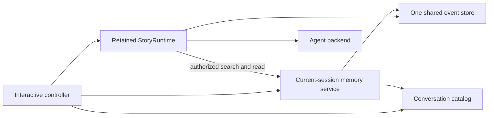

# System design overview

> **Availability:** this page describes implemented runtime ownership,
> dependency direction, filesystem adapters, and the installed interactive
> controller.

Key terms: **orchestration**—coordination of provider work;
**controller**—owner of interactive transition order; **adapter**—a concrete
provider-neutral implementation; **scope**—the session one service may read;
**default**—a persisted fallback; **focus**—current process-local scope.

`story-writing-agents` separates workflow, provider invocation, terminal
presentation, and filesystem persistence. In this project, “commit” means
writing approved story text; the runtime never invokes Git.

## Runtime and provider ownership

`StoryRuntime` owns workflow validation, sequencing, concurrency, and reply
validation. For debates it also owns reservation, consensus, blackboard,
owner-isolated history, and artifacts. For advisory turns it owns conversation
locking, context and transcript order, retrieval scope/actions/budgets, and the
final reply or safe error. See the [Runtime API](../reference/runtime-api.md#one-conversation-turn).

`session_lifecycle` owns immutable provider-neutral lifecycle facts and pure
readiness, with no resource or I/O. `AgentBackend` retains manifests, access
claims, prompt staging, routes, processes, and threads;
`BoundAgent` owns one binding. Codex is implemented; Gemini fails preflight.

`Workspace` is the local persistence and path-safety boundary. It owns strict
UTF-8 reads, JSON/JSONL artifacts, reservations, manuscripts, inspection, and
atomic file replacement. Exact guarantees belong to
[Filesystem safety](../operations/filesystem-safety.md).

## Fixed collaboration model

The lead orchestrator moderates, synthesizes, and finalizes but does not vote.
The plot architect, character custodian, and execution specialist audit every
current revision. Consensus requires all three approvals for that revision.
The public blackboard is append-only; owner-isolated agent history is a
separate channel. Peer outputs are persisted in stable roster order even when
provider calls finish in another order.

## Interactive ownership

| Owner | Responsibility |
| --- | --- |
| `interactive_commands` | Pure grammar and canonical agent-route metadata |
| `interactive_controller` | Current attachment/focus, agent focus, dispatch, transition order, and cleanup |
| `cli_context` | Default session and per-session default conversations |
| `ConversationCatalog` | Conversation identity, subject, archive status, and ordered metadata |
| `ConversationMemoryService` | One current-attachment search/read authorization |
| `conversation_retrieval` | Immutable actions, observations, policy, and runtime/backend handler port |
| `ConversationEventStore` | Authoritative events and complete-turn context |
| `InteractiveMainLineEditor` | Call-local POSIX main-input editing, suggestions, fallback, and restoration |
| `InteractiveTerminal` | Typed input facade and safe primitive presentation |
| `StoryRuntime` | Debate/advisory orchestration and retrieval authority |
| `AgentBackend` | Sessions, threads, provider processes, and retrieval call loop |

The controller gives one filesystem event store to the retained runtime and
builds each current-session memory service over that store and resolved catalog.

On switch, destination memory is built after validation and becomes current
only with committed attachment. Pause, abort, and cleanup clear it. Conversation
changes reuse it; later reads observe current data in the same session scope.

For advisory work the controller supplies the exact service to runtime. Runtime
alone calls search/read; backend sees only the handler and framed observations.
Direct `/search` and `/transcript` stay local. Controller calls the event store
only through `read(...)` for `/history` and `/status`; it never appends, calls
`read_context`, or calls a bound agent.

## Dependency direction

The facade and lifecycle consumers depend downward on canonical
`session_lifecycle` contracts. `models` owns debate and conversation models and
does not forward lifecycle objects. Backend, controller, orchestrator, CLI, and
smoke consume the canonical lifecycle module directly.

The CLI injects the editor's main-read callback before backend/controller
construction. The editor uses command metadata and terminal sanitization.
Controller receives completed actions and depends downward on runtime and
presentation/storage. Retrieval's handler port prevents backend-to-orchestrator
access, keeping the graph acyclic.

This supports deterministic collaborators, not a dynamic plugin system. Exact
imports live in [Package API](../reference/package-api.md), lifecycle meaning in
[Session lifecycle](session-lifecycle.md), and conversation contracts in
[Conversation search](../reference/conversation-search.md),
[Conversation transcripts](../reference/conversation-transcripts.md), and
[Bounded retrieval](../reference/conversation-retrieval.md).
