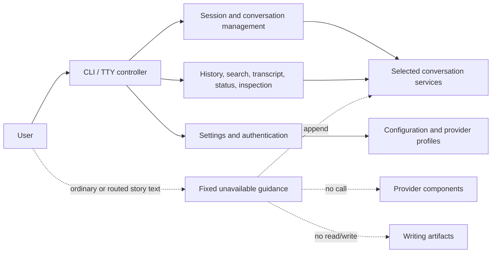

# System design overview

The current integration separates management/inspection from the forthcoming
lead-led execution workflow. Public schema-v1 direct-run consumers are absent;
generic provider, prompt, context, lifecycle, artifact, and terminal components
remain available behind explicit module boundaries.

The production graph contains 97 modules, 360 dependency edges, no cycles, and
118 package-root exports.

## Current user flow



The controller reads ordinary main input with the terminal's plain management
scope. The parser returns a typed rejection for ordinary/routed/removed
execution forms. The controller does not bind an agent, append an event, run
RAG/reference handling, report provider progress, or publish an artifact.

## Management runtime

`StoryRuntime` is a management/configuration/inspection facade. It owns:

- workspace-bound configuration and prompt snapshots;
- session-bound directives and overrides;
- quiescent settings prepare/commit coordination with `AgentBackend`;
- persisted session/debate/context inspection; and
- content-free artifact-reference operation inspection.

`RuntimeSession` binds the same operations to one validated session ID. Neither
class starts a story turn or debate. Broad root aliases are absent.

`session_lifecycle` owns provider-neutral durable/access facts and pure
readiness. `AgentBackend` still owns claims, manifests, provider routes,
bindings, thread references, model/effort resolution, and generic bound-agent
execution seams. Codex/Antigravity adapters own provider process protocols;
`provider_process` owns subprocess lifetime. These retained components do not
create an implicit public execution path.

## Conversation and collaboration storage

Conversation management uses one startup-selected complete service bundle:
catalog, event store, literal search, and mutation coordination. Filesystem and
SQLite implementations preserve exact authority/provenance rules. Selection is
next-shell configuration; transfer is a separate provider-free copy/parity
operation.

#466 delivered pure schema-v2 collaboration values. #474-#477 added readable
projection, search/page, filesystem/SQLite store, archive, and transfer pieces
on the integration branch. In this stage the shell retains its active-v1
service path where integration still requires it. #479 activates the sole v2
storage/inspection service and removes that last active-v1 path.

The controller's current catalog/transcript reads are provider-free and do not
invent transcript events for catalog mutations. Pure/direct schema-v2 readable
projection, search, and paging remain available outside the selected shell
service until #479.

## Optional local RAG

| Boundary | Owner |
| --- | --- |
| Contracts/budgets/source identities | `conversation_rag` |
| Deterministic local embedding/ranking | `conversation_rag_local` |
| Disposable generation/pointers/purge | `conversation_rag_store` |
| Optional generic adapter | `generic_rag_adapter` |
| Deferred concrete composition | `conversation_rag_composition` |
| Authorized inspection/search/projection | `conversation_rag_runtime` |
| Six provider-free/local CLI workflows | `conversation_rag_cli` |

RAG consumes a complete `ConversationStorageServices` authority and treats
derived text/vectors as non-authoritative. Direct search reauthorizes and
rereads current ranges. `/settings` can persist future Local/Automatic policy,
but no current shell story input consumes it.

## Writing artifacts and references

The `writing_artifacts` package owns canonical identities, strict source
discovery, range/path values, reference authorization/read actions,
provenance, journaled catalog-last publication, and recovery. Generic
`Workspace` writes cannot manufacture artifact provenance.

The four supported core paths and every eligible lowercase-`.md` descendant of
`manuscript/` remain reference sources. The terminal retains generic picker and
independent text-viewer components, but the current parser/controller exposes
no provider-text span. `$`/`$$` therefore do not activate from main input.

## Interactive ownership

| Owner | Responsibility |
| --- | --- |
| `interactive_commands` | Pure retained grammar, fixed agent metadata, removal guidance, and command completion. |
| `interactive_controller._core` | Stateful lifecycle/settings/catalog/read dispatch, validation, cleanup, and semantic output. |
| Controller policy leaves | Pure lifecycle, conversation, exchange, and inspection interpretation. |
| `interactive_settings` | Immutable current/pending settings, exact conflict checks, prepared writes, and rollback. |
| `interactive_terminal` | Public semantic terminal facade and internal capable/fallback input, pickers, prompts, viewers, and rendering. |
| `agent_exchanges` plus external viewer | Bounded request/result/outcome storage and immutable read-only inspection. |

The controller is the sole orchestration hub for terminal transitions. Policy
leaves retain no state and perform no I/O. The terminal owns raw-mode and
cleanup resources, sanitizes untrusted text, and exposes semantic rather than
provider-native output. `/exchanges` is inspection-only and cannot replay a
provider call.

## Lead/specialist target

The fixed roster remains Lead Orchestrator, Plot Architect, Character
Custodian, and Execution Specialist. The lead is the intended user-facing
channel; specialists are lead-routed collaborators. That target behavior is
not a current CLI dispatch claim.

After #479 completes the v2 storage cutover and parent #467 completes, open
#452 owns the lead proposal/confirmation/reconfirmation workflow and open #453
owns specialist execution/result/finalization/outcome-unknown behavior. Both
must use the sole v2 store rather than reintroducing direct-run consumers.

## Dependency direction

High-level composition flows downward:

```text
CLI -> controller -> policies/runtime/storage/terminal
runtime -> configuration/workspace/artifact inspection/backend coordination
backend -> provider adapters/process/context seams
conversation services -> filesystem or SQLite ports
RAG runtime -> conversation-service contracts
terminal -> pure models/controls/render/driver leaves
```

Storage, provider, terminal, and policy leaves do not import the controller.
The external JSONL viewer imports no Story module. Agent-context and artifact
components remain provider-neutral. Exact modules and exports are in
[PYTHON_MODULE_INDEX.md](../../PYTHON_MODULE_INDEX.md) and the
[package API](../reference/package-api.md).

See [Runtime management API](../reference/runtime-api.md),
[session lifecycle](session-lifecycle.md),
[collaboration history](../reference/collaboration-history.md), and
[lead-agent status](../guides/lead-agent.md).
