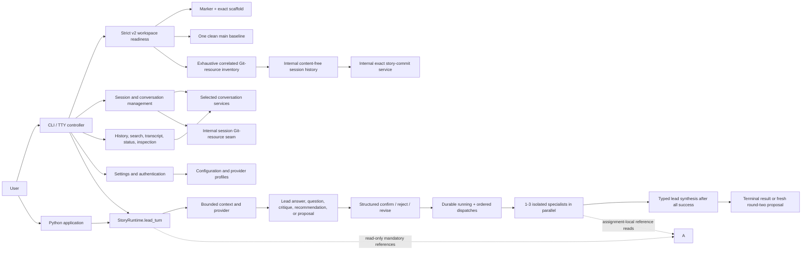

# System design overview

The current integration connects the shell to the same lead conversation and
confirmed-collaboration APIs used by Python callers. Public schema-v1
direct-run consumers are absent; generic provider,
prompt, context, lifecycle, artifact, and terminal components remain behind
explicit module boundaries.

The production graph contains 143 modules, 576 runtime dependency edges, no
cycles, and 106 package-root exports.

## Current user flow



The parser returns ordinary non-slash text unchanged as `lead_input`. After
attachment and active conversation focus, the controller calls
`RuntimeSession.lead_turn()` and presents typed progress and results. Removed
slash execution forms remain unavailable. The lead is the sole
user-facing agent, may search/read bounded authorized context, and either
answers directly or discloses one proposal. `decide_lead_step()` records an
exact structured decision. Confirmation executes only the disclosed step.
Artifact Apply and local Commit use distinct exact decisions.

## Workspace initialization and readiness

`story init` is the one user-facing schema-v2 creation path:

```text
missing/empty root
  -> strict initializing journal
  -> exact 25-file scaffold, including four empty core documents
  -> fixed #448 main root commit with effective Git identity
  -> verification with journal
  -> journal removal
  -> exact clean ready verification
```

Internally, `workspace.schema` is the pure owner of marker, journal, scaffold,
and static session naming policy. `workspace.initialization` owns root
classification, descriptor-safe convergence, current readiness, discovery, and
Git composition. `workspace.core` owns the public `Workspace` object and generic
persistence and delegates the lifecycle; it does not define a second schema or
run Git directly. Package-internal `git.process`, `git.session_contracts`, and
`git.session_resources` own the shared fixed-process lifecycle, pure session
Git values, and serialized resource lifecycle respectively. The package-
internal `git.repository_lock`, `git.session_history_contracts`, and
`git.session_history` modules add one shared repository lease, pure durable
history values, and descriptor-safe storage for later commits/checkpoints.
They add no public facade exports.

Externally, success means one standalone clean `main` root with exactly one
parentless commit named `Initialize story workspace`. A clean rerun validates
without mutation. An exact interrupted journal can be resumed only by a fresh
object/process, and that initialization/recovery traversal remains recursively
closed. Once the journal is absent, readiness instead projects only required
paths and exact Git invariants: unknown ignored/untracked entries are opaque
and permitted, while required-path drift, staged or disallowed tracked state,
tracked unknown additions, and unsafe topology are preserved and rejected.
Opaque state is not trusted; its owner validates it on consumption. There is no
migration, compatibility, prompt overwrite, or adoption path.

The marker stores `story/session/`,
`refs/story-writing-agents/runtime/sessions/`, and `.story-worktrees` naming
policy. Initialization creates no session branch, internal ref, or sibling
worktree. The package-internal #504 seam can inspect/list and provision or
require-ready one exact correlated triple while the original root remains the
pristine initialization baseline. Installed session transitions consume that
seam through stable recovery assessment. #505 coordinates confirmed history work. Exact story commits now exist as
package-internal #509 infrastructure; the integrated runtime now owns separately
confirmed artifact application and local story-commit execution. Exact
closed-path internal checkpoints now
exist as package-internal #510 infrastructure.

### Session Git-resource lifecycle

Provisioning derives exactly one branch, internal ref, and sibling linked
worktree from a validated session ID. One common-Git repository lock serializes
all sessions. An immutable, at-most-64-KiB owner-only journal precedes the
deterministic empty-tree seed, compare-and-swap ref and branch creation, and
exact worktree creation. Complete verification precedes journal removal and is
repeated afterward. Exact facts are idempotently ready; an exact journal prefix
can resume; partial, unknown, colliding, moved, substituted, or mismatched facts
are preserved and fail closed.

Main readiness now composes descriptor-bound reads of required directories,
the 25 scaffold leaves, mutable configuration and referenced personae with the
exact scaffold/baseline and an exhaustive correlated session inventory. It
does not enumerate unknown filesystem or untracked Git entries. Session-root
readiness checks the 25 Git-materialized leaves and ancestors, local
configuration/personae, a clean index, the exact schema-derived linked
worktree, and immutable baseline/seed roots; schema-only empty runtime
directories need not be materialized there, and unstaged story work is
allowed. It reports current tips without interpreting later #505 history.
Typed discovery retains main/session role and session identity. Inspect, list,
and require-ready are read-only; provision is the only mutation authority and
cannot be invoked by provider or lead text. See
[the exact contract](../reference/git-adapter.md#package-internal-session-git-resources).

### Durable session-history infrastructure

One common-Git repository lease now serializes session provisioning and
session-history work. For each ready session, the internal history owner stores
immutable candidate metadata, monotonic story-commit operation metadata,
monotonic checkpoint operation metadata, and any operation-owned alternate
index that must survive an ambiguous result. Records contain identities,
canonical paths, digests, correlations, and fixed states, not manuscript/core-
document bytes, provider text, or executable authority.

Closed Git process profiles suppress prompts and repository- or user-controlled
execution extensions. Only the internal-checkpoint profile can receive the
validated alternate index derived from an exact session/operation identity;
callers cannot inject arbitrary `GIT_*` environment variables. #509 now
consumes the story-commit seam, and #510 now consumes the checkpoint seam. #492
owns the user confirmation UI. This revision exposes no command, lead action,
or public facade for the new infrastructure. See the
[exact history contract](../reference/git-adapter.md#package-internal-session-history).

### Exact confirmed story commits

Package-internal `git.story_commit_contracts` owns immutable application,
candidate, lead-projection, confirmation, result, state, and failure values.
`git.story_commit_candidates` owns read-only capture/revalidation plus immutable
candidate-history publication. `git.story_commits` owns the process-local
one-use authority, decision recording, exact execution, inspection, and
conservative recovery. None is exported through a facade.

Prepare requires a ready session and successful typed application evidence. It
proves a clean real index, exact symbolic session branch/tip, complete canonical
artifact state, expected tree, effective identity/source, unchanged internal
ref, and unchanged main root. Apart from immutable candidate history, it does
not stage, write a Git object, create a commit, update a ref, or modify a
working file. The content-free projection is suitable for the interactive Lead UI;
it carries no story bytes or authority.

Only a fresh exact structured Commit decision can mint a service/process/thread-
bound, nonserializable, one-use authority. Execute consumes it before I/O,
revalidates all facts under the shared repository lease, durably records
`running`, stages literal candidate blobs/paths, records `staged`, verifies the
tree, creates a one-parent commit with the captured identity/message, and
compare-and-swap updates only the expected session branch. It then actively
verifies the exact session tip/tree, original main head/status, and internal ref
before recording `committed`. Unrelated noncandidate bytes remain untargeted
and unchanged; focused invariance tests verify that preservation rather than
the runtime rereading each byte. Reject and Revise record no Git mutation;
Revise requires a newly prepared candidate. Recovery never resets or replays
staged work and can finalize an already-correlated branch tip without a
duplicate commit. See
[the user scenarios](../guides/workspaces.md#exact-confirmed-story-commits) and
[the internal contract](../reference/git-adapter.md#package-internal-exact-story-commits).

### Exact session runtime checkpoints

Package-internal `git.session_checkpoint_contracts` owns the closed classifier
and immutable owner/delta/result values. `git.session_checkpoints` owns exact
tree derivation, isolated-index execution, internal-ref CAS, inspection, and
conservative recovery. Five runtime owners may submit only their eleven
allowlisted same-session path families; omission is preservation, not deletion.

Checkpoint execution validates the complete current and resulting internal
trees, durably records `running`, constructs the result in the exact
operation-owned alternate index, makes a one-parent commit with captured local
identity and UTC timestamps, and compare-and-swap advances only the session
internal ref. The shared repository lease serializes this sequence with #509.
The story branch and real indexes, both working trees and `HEAD` values,
canonical artifacts, unrelated bytes, and pristine main remain untargeted and
unchanged. Recovery correlates an exact post-CAS tip without replay; otherwise
it preserves ambiguity or requires an operator. See
[the checkpoint scenarios](../guides/workspaces.md#exact-session-runtime-checkpoints)
and [the internal contract](../reference/git-adapter.md#package-internal-session-checkpoints).

Explicit `story smoke --workspace` constructs a fresh workspace verifier and
performs no mutation or diagnostic submission. Disposable smoke uses the same
real initializer and removes its temporary root.

## Management runtime

`StoryRuntime` is the management/configuration/inspection and lead-workflow
facade. It owns:

- workspace-bound configuration and prompt snapshots;
- session-bound directives and overrides;
- quiescent settings prepare/commit coordination with `AgentBackend`;
- persisted session/debate/context inspection;
- content-free artifact-reference operation inspection; and
- lead provider turns, proposal construction, structured decisions, confirmed
  specialist execution/synthesis, supersession, and restart-safe recovery.

`RuntimeSession` binds the same operations to one validated session ID. Both
classes expose confirmed consultations and direct advisory proposals. Runtime
code alone executes separately confirmed artifact writes and local Git commits;
agent prose cannot authorize either operation. Broad root aliases are absent.

`session_lifecycle` owns provider-neutral durable/access facts and pure
readiness. `AgentBackend` still owns claims, manifests, provider routes,
bindings, thread references, model/effort resolution, and generic bound-agent
execution seams. Codex/Antigravity adapters own provider process protocols;
`provider_process` owns subprocess lifetime. These retained components do not
create an implicit public execution path.

## Conversation and collaboration storage

Conversation management uses one startup-selected complete service bundle:
catalog, `CollaborationEventStore`, aggregate event-field search, and mutation
coordination. Filesystem and SQLite implementations preserve exact
authority/provenance rules. Selection is next-shell configuration; transfer is
a separate provider-free copy/parity operation.

The controller uses that schema-v2 service for `/history`, `/search`,
`/transcript`, and `/status`. Catalog mutations do not invent events; subjects
are displayed but never searched. Projection, exact citation, paging, context,
archive, and transfer all validate canonical events from the same authority.
Concrete filesystem/SQLite v2 adapters remain direct-module-only; public
facades expose contracts and compositions rather than concrete store classes.

## Optional local RAG

| Boundary | Owner |
| --- | --- |
| Contracts/budgets/source identities | `conversation_rag` |
| Deterministic local embedding/ranking | `conversation_rag_local` |
| Disposable generation/pointers/purge | `conversation_rag_store` |
| Optional generic adapter | `generic_rag_adapter` |
| Deferred concrete composition | `conversation_rag_composition` |
| Authorized inspection/search/projection | `conversation_rag_runtime` |
| Six provider-free/local CLI workflows | `conversation_rag_cli` |

RAG consumes a complete `ConversationStorageServices` authority and treats
derived text/vectors as non-authoritative. Direct search reauthorizes and
rereads current ranges. `/settings` can persist future Local/Automatic policy,
but no current shell story input consumes it.

## Writing artifacts and references

The `writing_artifacts` package owns canonical identities, strict source
discovery, range/path values, reference authorization/read actions,
provenance, journaled catalog-last publication, and recovery. Generic
`Workspace` writes cannot manufacture artifact provenance.

The four supported core paths and every eligible lowercase-`.md` descendant of
`manuscript/` remain reference sources. In focused Lead input, `$` opens the
canonical picker and `$$` opens that picker before the independent range viewer.
They insert identity-only whole/ranged indicators; runtime performs the
authorized read after submission.

## Interactive ownership

| Owner | Responsibility |
| --- | --- |
| `interactive_commands` | Pure management grammar, literal Lead-input action, fixed agent metadata, removed-command guidance, and completion. |
| `interactive_controller._core` | Stateful lifecycle/settings/catalog/read and Lead-input dispatch, validation, cleanup, and semantic output. |
| Controller policy leaves | Lifecycle, conversation, exchange, inspection, and structured Lead-decision interpretation. |
| `interactive_settings` | Immutable current/pending settings, exact conflict checks, prepared writes, and rollback. |
| `interactive_terminal` | Public semantic terminal facade and internal capable/fallback input, pickers, prompts, viewers, and rendering. |
| `agent_exchanges` plus external viewer | Bounded request/result/outcome storage and immutable read-only inspection. |

The controller is the sole orchestration hub for terminal transitions. Policy
leaves retain no state and perform no I/O. The terminal owns raw-mode and
cleanup resources, sanitizes untrusted text, and exposes semantic rather than
provider-native output. `/exchanges` is inspection-only and cannot replay a
provider call.

## Lead/specialist target

The fixed roster remains Lead Orchestrator, Plot Architect, Character
Custodian, and Execution Specialist. The lead is the workflow's sole
user-facing channel. It critiques, recommends the next action, watches
artifact/workflow constraints, and routes a proposed assignment by subject.
Specialists are selectively lead-routed collaborators. After exact
confirmation, one to three run concurrently with isolated evidence; only an
all-success set reaches typed lead synthesis. The shell reaches specialists
only through this confirmed lead route; no specialist command is exposed.

The integrated lead layer owns proposal, confirmation, and reconfirmation
behavior. Specialist execution owns result, finalization, and outcome-unknown
behavior. Whole-workspace rejection of unsupported history is implemented at
the strict workspace-v2 readiness boundary, not deferred to a provider call.
The integrated runtime uses the sole v2 store. Artifact Apply and Git Commit
are separate, non-reusable, runtime-executed operations; the lead remains their
semantic trigger and user-facing coordinator.

## Dependency direction

High-level composition flows downward:

```text
CLI -> controller -> policies/runtime/storage/terminal
CLI -> workspace.initialization -> workspace.schema + git
runtime -> conversations/context/backend/configuration/workspace/artifact reads
backend -> provider adapters/process/context seams
conversation services -> filesystem or SQLite ports
RAG runtime -> conversation-service contracts
terminal -> pure models/controls/render/driver leaves
```

Storage, provider, terminal, and policy leaves do not import the controller.
The external JSONL viewer imports no Story module. Agent-context and artifact
components remain provider-neutral. Exact modules and exports are in
[PYTHON_MODULE_INDEX.md](../../PYTHON_MODULE_INDEX.md) and the
[package API](../reference/package-api.md).

See [Runtime management API](../reference/runtime-api.md),
[session lifecycle](session-lifecycle.md),
[collaboration history](../reference/collaboration-history.md), and
[lead-agent status](../guides/lead-agent.md).
