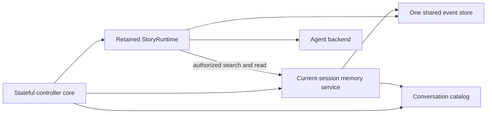

# System design overview

> **Availability:** this page describes implemented runtime ownership,
> dependency direction, filesystem adapters, and the installed interactive
> controller.

Key terms: **controller**—owner of interactive transition order;
**adapter**—provider-neutral implementation; **scope**—what a service may read;
**default**—persisted fallback; **focus**—current process-local scope.

`story-writing-agents` separates workflow, provider invocation, terminal
presentation, and filesystem persistence. In this project, “commit” means
writing approved story text; the runtime never invokes Git.

## Runtime and provider ownership

`StoryRuntime` owns validated debate/advisory sequencing, consensus, retrieval
authority, replies, and artifacts. See the
[Runtime API](../reference/runtime-api.md#one-conversation-turn).

`session_lifecycle` owns immutable provider-neutral lifecycle facts and pure
readiness, with no resource or I/O. `AgentBackend` retains manifests, access
claims, prompt staging, routes, processes, and threads;
`BoundAgent` owns one binding. Codex is implemented; Gemini fails preflight.

`Workspace` owns path-safe persistence, inspection, and atomic replacement. See
[Filesystem safety](../operations/filesystem-safety.md).

## Fixed collaboration model

The lead moderates and finalizes but does not vote. Three specialists audit each
revision; all must approve. Blackboard and owner-isolated history stay separate.

## Interactive ownership

| Owner | Responsibility |
| --- | --- |
| `interactive_commands` | Pure grammar and canonical agent-route metadata |
| `interactive_controller` | Stable `InteractiveController` import facade; no state or I/O |
| `interactive_controller._core` | Sole controller state, dispatch, transition order, I/O sequencing, resources, cleanup, and typed semantic output composition |
| `interactive_controller._session_policy` | Pure lifecycle validation, next actions, and typed failure classification |
| `interactive_controller._conversation_policy` | Pure catalog, reference, search, transcript, and failure interpretation |
| `interactive_controller._runtime_policy` | Pure progress, result, failure interpretation, and frozen validated inspection facts |
| `cli_context`, catalog, memory service, event store | Defaults, identity, scoped reads, and authoritative events |
| `interactive_terminal` | Stable package-supported facade, package-internal real-CLI factory, and unlisted internal semantic adapter/component identities |
| `interactive_terminal._core` | Established terminal API behavior, explicit ordinary/main/composition routing, resource-free semantic adapter, and terminal-leaf coordination |
| `interactive_terminal._model`, `_controls`, `_render` | Immutable semantic/history foundation, pure line editing and bounded main-history transitions, main/composition suggestion projection, and pure safe responsive rendering |
| `interactive_terminal._driver` | Sole real-CLI raw streams, capabilities, width, keys, cursor controls, writes, flushes, restoration, and one bounded process-local main-history store per instance |
| `interactive_line_editor` | Standalone compatibility facade over one unified per-editor driver/history store |
| `StoryRuntime`, `AgentBackend` | Orchestration/retrieval authority and provider resources |

The supported import remains `from story_writing_agents.interactive_controller import InteractiveController`.
The facade re-exports the core's same class;
shell behavior and project-root exports are unchanged. Only the core retains
collaborators and mutable process state.

The supported terminal import remains
`from story_writing_agents.interactive_terminal import InteractiveTerminal`.
Its package facade preserves the exact existing public objects and signatures;
package leaves are internal. The CLI calls one package-internal factory to
construct a stream-backed terminal around one `RawTerminalDriver`. The
standalone line-editor facade delegates to that same driver implementation and
contains no second raw-terminal lifecycle. Each constructed stream terminal or
standalone editor has one isolated 100-entry process-local main-command store;
the callback-only terminal and controller have none.

The semantic models, responsive plain/fixed-ANSI renderer, and capability
profiles are implemented. Orientation, status/inspection, central errors and
recovery, and accepted management, advisory, retrieval, and consensus output
use them. Full/context help, roster, session/conversation lists, search,
transcript, and focused history now use them too. The controller sends each
dense row as one positioned, one-record `ListView` callback; empty and
interrupted outcomes remain explicit. Only four composer `write_status` sites
retain their established plain records pending #86. There is no public theme
API.

The core gives immutable facts to policy validators and receives validated
values, typed failures/errors, actions, or safe summaries. Leaves retain
nothing, perform no I/O, and have no sibling or core back-reference.

The core shares one filesystem event store with the retained runtime and builds
attachment-scoped memory over it. Runtime alone authorizes provider-requested
search/read; backend receives only the handler and framed observations. The core
builds destination memory before switch commit and clears it on pause, abort,
or cleanup. Direct search/transcript stays local. The core reads the store only
for history/status; it never appends, calls `read_context`, or calls a bound
agent. Lower layers retain storage, runtime, terminal, session, thread, and
provider ownership.

## Dependency direction

Controller dependency is exactly facade → stateful core → three leaves. Leaves
depend only on lower-layer contracts. Lifecycle consumers use canonical
`session_lifecycle`; `models` does not forward its objects. The runtime-policy
leaf returns frozen validated inspection facts to the core and does not format
terminal text.

CLI constructs one unified stream-backed terminal before controller
construction. The controller core imports the terminal facade's unlisted
component identities and resource-free semantic adapter; its policy leaves use
facade error contracts rather than terminal package leaves. Terminal core
depends on its pure controls, renderer, model, sole driver, and canonical
command/agent metadata. It binds main and composition preview providers per
read without retaining prompt mode. Main reads use the driver's pure bounded
history transition; composition remains history-free, and subject and
confirmation reads remain ordinary. The controller sends one typed component
per established callback through the adapter and otherwise depends downward on
runtime, presentation, and storage. Retrieval's handler port prevents
backend-to-orchestrator access.

This supports deterministic collaborators, not a dynamic plugin system. Exact
imports live in [Package API](../reference/package-api.md), lifecycle meaning in
[Session lifecycle](session-lifecycle.md), and conversation contracts in
[Conversation search](../reference/conversation-search.md),
[Conversation transcripts](../reference/conversation-transcripts.md), and
[Bounded retrieval](../reference/conversation-retrieval.md).
