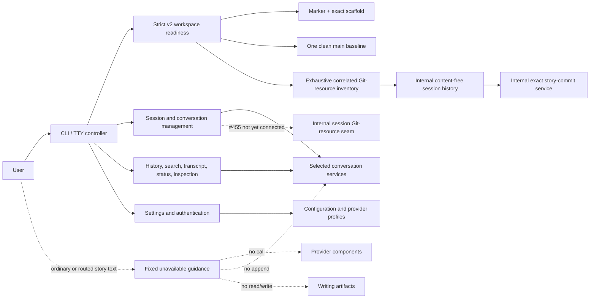

# System design overview

The current integration separates management/inspection from the forthcoming
lead-led execution workflow. Public schema-v1 direct-run consumers are absent;
generic provider, prompt, context, lifecycle, artifact, and terminal components
remain available behind explicit module boundaries.

The production graph contains 113 modules, 407 dependency edges, no cycles, and
104 package-root exports.

## Current user flow



The controller reads ordinary main input with the terminal's plain management
scope. The parser returns a typed rejection for ordinary/routed/removed
execution forms. The controller does not bind an agent, append an event, run
RAG/reference handling, report provider progress, or publish an artifact.

## Workspace initialization and readiness

`story init` is the one user-facing schema-v2 creation path:

```text
missing/empty root
  -> strict initializing journal
  -> exact 22-file scaffold, including four empty core documents
  -> fixed #448 main root commit with effective Git identity
  -> verification with journal
  -> journal removal
  -> exact clean ready verification
```

Internally, `workspace.schema` is the pure owner of marker, journal, scaffold,
and static session naming policy. `workspace.initialization` owns root
classification, descriptor-safe convergence, current readiness, discovery, and
Git composition. `workspace.core` owns the public `Workspace` object and generic
persistence and delegates the lifecycle; it does not define a second schema or
run Git directly. Package-internal `git.process`, `git.session_contracts`, and
`git.session_resources` own the shared fixed-process lifecycle, pure session
Git values, and serialized resource lifecycle respectively. The package-
internal `git.repository_lock`, `git.session_history_contracts`, and
`git.session_history` modules add one shared repository lease, pure durable
history values, and descriptor-safe storage for later commits/checkpoints.
They add no public facade exports.

Externally, success means one standalone clean `main` root with exactly one
parentless commit named `Initialize story workspace`. A clean rerun validates
without mutation. An exact interrupted journal can be resumed only by a fresh
object/process; legacy, arbitrary, ambiguous, dirty, drifted, or unsafe state is
preserved and rejected. There is no migration, compatibility, prompt overwrite,
or adoption path.

The marker stores `story/session/`,
`refs/story-writing-agents/runtime/sessions/`, and `.story-worktrees` naming
policy. Initialization creates no session branch, internal ref, or sibling
worktree. The package-internal #504 seam can inspect/list and provision or
require-ready one exact correlated triple while the original root remains the
pristine initialization baseline. #455 owns the installed command connection;
#505 coordinates confirmed history work. Exact story commits now exist as
package-internal #509 infrastructure; #491 still owns application production,
#492 owns the lead confirmation UI, and #510 owns internal checkpoints.

### Session Git-resource lifecycle

Provisioning derives exactly one branch, internal ref, and sibling linked
worktree from a validated session ID. One common-Git repository lock serializes
all sessions. An immutable, at-most-64-KiB owner-only journal precedes the
deterministic empty-tree seed, compare-and-swap ref and branch creation, and
exact worktree creation. Complete verification precedes journal removal and is
repeated afterward. Exact facts are idempotently ready; an exact journal prefix
can resume; partial, unknown, colliding, moved, substituted, or mismatched facts
are preserved and fail closed.

Main readiness now composes the exact scaffold/baseline with an exhaustive
correlated session inventory. Session-root readiness recognizes only the exact
schema-derived linked worktree and immutable baseline/seed roots. It reports
current tips without interpreting later #505 history. Typed discovery retains
main/session role and session identity. Inspect, list, and require-ready are
read-only; provision is the only mutation authority and cannot be invoked by
provider or lead text. See
[the exact contract](../reference/git-adapter.md#package-internal-session-git-resources).

### Durable session-history infrastructure

One common-Git repository lease now serializes session provisioning and
session-history work. For each ready session, the internal history owner stores
immutable candidate metadata, monotonic story-commit operation metadata,
monotonic checkpoint operation metadata, and any operation-owned alternate
index that must survive an ambiguous result. Records contain identities,
canonical paths, digests, correlations, and fixed states, not manuscript/core-
document bytes, provider text, or executable authority.

Closed Git process profiles suppress prompts and repository- or user-controlled
execution extensions. Only the internal-checkpoint profile can receive the
validated alternate index derived from an exact session/operation identity;
callers cannot inject arbitrary `GIT_*` environment variables. #509 now
consumes the story-commit seam, while #510 will consume the checkpoint seam.
#492 owns the user confirmation UI. This revision exposes no command, lead
action, or public facade for the new infrastructure. See the
[exact history contract](../reference/git-adapter.md#package-internal-session-history).

### Exact confirmed story commits

Package-internal `git.story_commit_contracts` owns immutable application,
candidate, lead-projection, confirmation, result, state, and failure values.
`git.story_commit_candidates` owns read-only capture/revalidation plus immutable
candidate-history publication. `git.story_commits` owns the process-local
one-use authority, decision recording, exact execution, inspection, and
conservative recovery. None is exported through a facade.

Prepare requires a ready session and successful typed application evidence. It
proves a clean real index, exact symbolic session branch/tip, complete canonical
artifact state, expected tree, effective identity/source, unchanged internal
ref, and unchanged main root. Apart from immutable candidate history, it does
not stage, write a Git object, create a commit, update a ref, or modify a
working file. The content-free projection is suitable for the future lead UI;
it carries no story bytes or authority.

Only a fresh exact structured Commit decision can mint a service/process/thread-
bound, nonserializable, one-use authority. Execute consumes it before I/O,
revalidates all facts under the shared repository lease, durably records
`running`, stages literal candidate blobs/paths, records `staged`, verifies the
tree, creates a one-parent commit with the captured identity/message, and
compare-and-swap updates only the expected session branch. It then actively
verifies the exact session tip/tree, original main head/status, and internal ref
before recording `committed`. Unrelated noncandidate bytes remain untargeted
and unchanged; focused invariance tests verify that preservation rather than
the runtime rereading each byte. Reject and Revise record no Git mutation;
Revise requires a newly prepared candidate. Recovery never resets or replays
staged work and can finalize an already-correlated branch tip without a
duplicate commit. See
[the user scenarios](../guides/workspaces.md#exact-confirmed-story-commits) and
[the internal contract](../reference/git-adapter.md#package-internal-exact-story-commits).

Explicit `story smoke --workspace` constructs a fresh workspace verifier and
performs no mutation or diagnostic submission. Disposable smoke uses the same
real initializer and removes its temporary root.

## Management runtime

`StoryRuntime` is a management/configuration/inspection facade. It owns:

- workspace-bound configuration and prompt snapshots;
- session-bound directives and overrides;
- quiescent settings prepare/commit coordination with `AgentBackend`;
- persisted session/debate/context inspection; and
- content-free artifact-reference operation inspection.

`RuntimeSession` binds the same operations to one validated session ID. Neither
class starts a story turn or debate. Broad root aliases are absent.

`session_lifecycle` owns provider-neutral durable/access facts and pure
readiness. `AgentBackend` still owns claims, manifests, provider routes,
bindings, thread references, model/effort resolution, and generic bound-agent
execution seams. Codex/Antigravity adapters own provider process protocols;
`provider_process` owns subprocess lifetime. These retained components do not
create an implicit public execution path.

## Conversation and collaboration storage

Conversation management uses one startup-selected complete service bundle:
catalog, `CollaborationEventStore`, aggregate event-field search, and mutation
coordination. Filesystem and SQLite implementations preserve exact
authority/provenance rules. Selection is next-shell configuration; transfer is
a separate provider-free copy/parity operation.

The controller uses that schema-v2 service for `/history`, `/search`,
`/transcript`, and `/status`. Catalog mutations do not invent events; subjects
are displayed but never searched. Projection, exact citation, paging, context,
archive, and transfer all validate canonical events from the same authority.
Concrete filesystem/SQLite v2 adapters remain direct-module-only; public
facades expose contracts and compositions rather than concrete store classes.

## Optional local RAG

| Boundary | Owner |
| --- | --- |
| Contracts/budgets/source identities | `conversation_rag` |
| Deterministic local embedding/ranking | `conversation_rag_local` |
| Disposable generation/pointers/purge | `conversation_rag_store` |
| Optional generic adapter | `generic_rag_adapter` |
| Deferred concrete composition | `conversation_rag_composition` |
| Authorized inspection/search/projection | `conversation_rag_runtime` |
| Six provider-free/local CLI workflows | `conversation_rag_cli` |

RAG consumes a complete `ConversationStorageServices` authority and treats
derived text/vectors as non-authoritative. Direct search reauthorizes and
rereads current ranges. `/settings` can persist future Local/Automatic policy,
but no current shell story input consumes it.

## Writing artifacts and references

The `writing_artifacts` package owns canonical identities, strict source
discovery, range/path values, reference authorization/read actions,
provenance, journaled catalog-last publication, and recovery. Generic
`Workspace` writes cannot manufacture artifact provenance.

The four supported core paths and every eligible lowercase-`.md` descendant of
`manuscript/` remain reference sources. The terminal retains generic picker and
independent text-viewer components, but the current parser/controller exposes
no provider-text span. `$`/`$$` therefore do not activate from main input.

## Interactive ownership

| Owner | Responsibility |
| --- | --- |
| `interactive_commands` | Pure retained grammar, fixed agent metadata, removal guidance, and command completion. |
| `interactive_controller._core` | Stateful lifecycle/settings/catalog/read dispatch, validation, cleanup, and semantic output. |
| Controller policy leaves | Pure lifecycle, conversation, exchange, and inspection interpretation. |
| `interactive_settings` | Immutable current/pending settings, exact conflict checks, prepared writes, and rollback. |
| `interactive_terminal` | Public semantic terminal facade and internal capable/fallback input, pickers, prompts, viewers, and rendering. |
| `agent_exchanges` plus external viewer | Bounded request/result/outcome storage and immutable read-only inspection. |

The controller is the sole orchestration hub for terminal transitions. Policy
leaves retain no state and perform no I/O. The terminal owns raw-mode and
cleanup resources, sanitizes untrusted text, and exposes semantic rather than
provider-native output. `/exchanges` is inspection-only and cannot replay a
provider call.

## Lead/specialist target

The fixed roster remains Lead Orchestrator, Plot Architect, Character
Custodian, and Execution Specialist. The lead is the intended user-facing
channel; specialists are lead-routed collaborators. That target behavior is
not a current CLI dispatch claim.

Open #452 owns the later lead proposal/confirmation/reconfirmation workflow
and open #453 owns specialist execution/result/finalization/outcome-unknown
behavior. Strict workspace-v2 activation already rejects unsupported
whole-workspace state. Those provider-bound integrations must use the sole v2
store. In the planning vocabulary, #454 owns whole-workspace rejection of unsupported history.
That ownership is implemented at the readiness boundary, not deferred to a
provider call.

## Dependency direction

High-level composition flows downward:

```text
CLI -> controller -> policies/runtime/storage/terminal
CLI -> workspace.initialization -> workspace.schema + git
runtime -> configuration/workspace/artifact inspection/backend coordination
backend -> provider adapters/process/context seams
conversation services -> filesystem or SQLite ports
RAG runtime -> conversation-service contracts
terminal -> pure models/controls/render/driver leaves
```

Storage, provider, terminal, and policy leaves do not import the controller.
The external JSONL viewer imports no Story module. Agent-context and artifact
components remain provider-neutral. Exact modules and exports are in
[PYTHON_MODULE_INDEX.md](../../PYTHON_MODULE_INDEX.md) and the
[package API](../reference/package-api.md).

See [Runtime management API](../reference/runtime-api.md),
[session lifecycle](session-lifecycle.md),
[collaboration history](../reference/collaboration-history.md), and
[lead-agent status](../guides/lead-agent.md).
