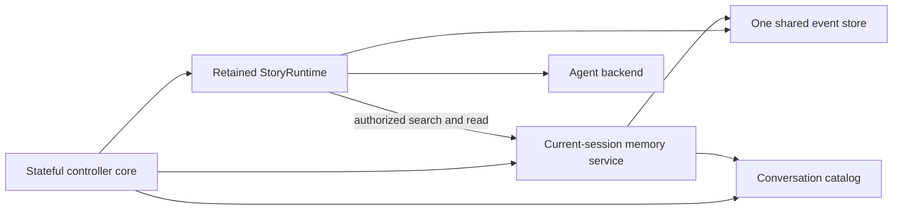

# System design overview

> **Availability:** this page describes implemented runtime ownership,
> dependency direction, filesystem adapters, and the installed interactive
> controller.

Key terms: **controller**—owner of interactive transition order;
**adapter**—provider-neutral implementation; **scope**—what a service may read;
**default**—persisted fallback; **focus**—current process-local scope.

`story-writing-agents` separates workflow, provider invocation, terminal
presentation, and filesystem persistence. In this project, “commit” means
writing approved story text; the runtime never invokes Git.

## Runtime and provider ownership

`StoryRuntime` owns validated debate/advisory sequencing, consensus, retrieval
authority, replies, and artifacts. See the
[Runtime API](../reference/runtime-api.md#one-conversation-turn).

`session_lifecycle` owns immutable provider-neutral lifecycle facts and pure
readiness, with no resource or I/O. `AgentBackend` retains manifests, access
claims, prompt staging, routes, processes, and threads;
`BoundAgent` owns one binding. Codex is implemented; Gemini fails preflight.

`Workspace` owns path-safe persistence, inspection, and atomic replacement. See
[Filesystem safety](../operations/filesystem-safety.md).

## Fixed collaboration model

The lead moderates and finalizes but does not vote. Three specialists audit each
revision; all must approve. Blackboard and owner-isolated history stay separate.

## Interactive ownership

| Owner | Responsibility |
| --- | --- |
| `interactive_commands` | Pure grammar and canonical agent-route metadata |
| `interactive_controller` | Stable `InteractiveController` import facade; no state or I/O |
| `interactive_controller._core` | Sole controller state, dispatch, transition order, I/O sequencing, resources, and cleanup |
| `interactive_controller._session_policy` | Pure lifecycle validation, next actions, and typed failure classification |
| `interactive_controller._conversation_policy` | Pure catalog, reference, search, transcript, and failure interpretation |
| `interactive_controller._runtime_policy` | Pure progress, result, inspection, and failure interpretation |
| `cli_context`, catalog, memory service, event store | Defaults, identity, scoped reads, and authoritative events |
| Line editor and terminal | Context-selected main/composition live editing and safe typed presentation |
| `StoryRuntime`, `AgentBackend` | Orchestration/retrieval authority and provider resources |

The supported import remains `from story_writing_agents.interactive_controller import InteractiveController`.
The facade re-exports the core's same class;
shell behavior and project-root exports are unchanged. Only the core retains
collaborators and mutable process state.

The core gives immutable facts to policy validators and receives validated
values, typed failures/errors, actions, or safe summaries. Leaves retain
nothing, perform no I/O, and have no sibling or core back-reference.

The core shares one filesystem event store with the retained runtime and builds
attachment-scoped memory over it. Runtime alone authorizes provider-requested
search/read; backend receives only the handler and framed observations. The core
builds destination memory before switch commit and clears it on pause, abort,
or cleanup. Direct search/transcript stays local. The core reads the store only
for history/status; it never appends, calls `read_context`, or calls a bound
agent. Lower layers retain storage, runtime, terminal, session, thread, and
provider ownership.

## Dependency direction

Controller dependency is exactly facade → stateful core → three leaves. Leaves
depend only on lower-layer contracts. Lifecycle consumers use canonical
`session_lifecycle`; `models` does not forward its objects.

CLI constructs one shared editor before controller construction and selects
main or composition preview behavior through call-local internal bindings.
Subject and confirmation reads remain ordinary; the terminal routes each input
kind explicitly without prompt inspection. The editor alone owns raw terminal
resources. The core receives typed actions and depends downward on runtime,
presentation, and storage. Retrieval's handler port prevents
backend-to-orchestrator access.

This supports deterministic collaborators, not a dynamic plugin system. Exact
imports live in [Package API](../reference/package-api.md), lifecycle meaning in
[Session lifecycle](session-lifecycle.md), and conversation contracts in
[Conversation search](../reference/conversation-search.md),
[Conversation transcripts](../reference/conversation-transcripts.md), and
[Bounded retrieval](../reference/conversation-retrieval.md).
