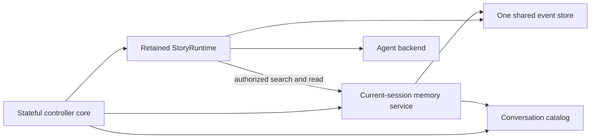

# System design overview

> **Availability:** this page describes implemented runtime ownership,
> dependency direction, filesystem adapters, and the installed interactive
> controller. The controller now uses the package-internal supplied-text viewer
> for `$`/`$$` prompt editing; the viewer still has no standalone command or
> supported public API.

Key terms: **controller**—owner of interactive transition order;
**adapter**—provider-neutral implementation; **scope**—what a service may read;
**default**—persisted fallback; **focus**—current process-local scope.

`story-writing-agents` separates workflow, provider invocation, terminal
presentation, and filesystem persistence. In this project, “commit” means
writing approved story text; the runtime never invokes Git.

## Runtime and provider ownership

`StoryRuntime` owns validated debate/advisory sequencing, consensus, retrieval
authority, replies, artifacts, and per-agent desired/current/retiring binding
selection. It leases the exact selected binding across each provider-bound
operation. See the
[Runtime API](../reference/runtime-api.md#one-conversation-turn).

`session_lifecycle` owns immutable provider-neutral lifecycle facts and pure
readiness, with no resource or I/O. `AgentBackend` retains manifests, access
claims, prompt staging, routes, processes, and threads. It owns private
active-call retention, exact staging retirement, and the optional
provider-enforced reference prelude supplied through the provider-neutral
read-action boundary; a `BoundAgent` is the immutable handle for one definition
and is not the runtime selection owner. Codex is implemented; Gemini fails
preflight.

`Workspace` owns generic path-safe persistence, inspection, and atomic
replacement. The `writing_artifacts` package owns the stricter canonical-output
grammar, provenance, publication, and recovery boundary; generic workspace
writes never manufacture artifact provenance. See
[Filesystem safety](../operations/filesystem-safety.md).

## Writing-artifact ownership

| Module | Responsibility |
| --- | --- |
| `writing_artifacts.__init__` | Side-effect-free facade for immutable artifact values; no repository construction or root-package export. |
| `writing_artifacts.catalog` | Four exact core identities, part-scoped manuscript grammar, kinds, immutable provenance entries, and catalog schema. |
| `writing_artifacts.references` | Immutable path/range, directive-batch, verified-snapshot, and resource-limit values only; parsing belongs to `writing_artifacts.directives`, authorization and provider enforcement belong to the authorization/read-action/backend path, and viewing belongs to the independent `interactive_terminal` supplied-text viewer. |
| `writing_artifacts.read_actions` | Provider-neutral, content-free exact request/action contracts; private synchronous coordinator protocol and closeable content-bearing result contract. |
| `writing_artifacts._storage` | Descriptor-relative, no-follow, unique-regular-file I/O, compare-before-publish replacement, root-identity verification, and artifact advisory locking. |
| `writing_artifacts.repository` | Provenance validation, current catalog projection, strict reads, create-only manuscript commits, journal roll-forward, catalog-last visibility, fail-closed recovery, and concrete one-use reference coordinators/capabilities. |

The package has no controller, terminal, backend, orchestrator, or generic
`Workspace` dependency. The backend imports only the provider-neutral
`read_actions` boundary; the repository remains the sole owner of filesystem
reads, revalidation, capabilities, and evidence. `StoryRuntime` parses and
captures one ordered explicit-reference batch per operation, allocates a fresh
coordinator for every addressed agent/phase, and accepts the operation only
after final revalidation. Prompt assembly consumes only current eligible core
paths; referenced selections are transient untrusted provider context rather
than baseline core context.
The interactive controller validates required manuscript output grammar but
does not own storage or provenance. Exact user-visible states are in
[Canonical writing artifacts](../reference/writing-artifacts.md).

## Fixed collaboration model

The lead moderates and finalizes but does not vote. Three specialists audit each
revision; all must approve. Blackboard and owner-isolated history stay separate.

## Interactive ownership

| Owner | Responsibility |
| --- | --- |
| `interactive_commands` | Pure grammar, canonical agent-route metadata, and cursor-aware completion projection for finite main-command positions |
| `interactive_controller` | Stable `InteractiveController` import facade; no state or I/O |
| `interactive_controller._core` | Sole controller state, dispatch, transition order, I/O sequencing, resources, cleanup, typed semantic output composition, disposable resume-choice snapshots, and fresh post-submit validation/mutation |
| `interactive_controller._session_policy` | Pure lifecycle validation, next actions, and typed failure classification |
| `interactive_controller._conversation_policy` | Pure catalog, reference, search, transcript, and failure interpretation |
| `interactive_controller._runtime_policy` | Pure progress, result, failure interpretation, and frozen validated inspection facts |
| `interactive_settings` | Package-internal immutable current/pending configuration snapshots, safe persona catalog, exact conflict detection, and guarded changed-only persistence with reverse exact-byte rollback |
| `cli_context`, catalog, memory service, event store | Defaults, identity, scoped reads, and authoritative events |
| `interactive_terminal` | Stable package-supported facade, package-internal real-CLI factory, and unlisted internal semantic output, controller-main-input, picker, cancellable-prompt, and supplied-text viewer adapters and identities |
| `interactive_terminal._core` | Established terminal API behavior, explicit ordinary/main/composition/confirmation routing, canonical static/dynamic main-choice adaptation, semantic input-view and lifecycle-event construction, call-local reference scope/catalog/text binding, resource-free semantic output/main/picker/prompt/viewer adapters, and terminal-leaf coordination |
| `interactive_terminal._model`, `_controls`, `_render` | Immutable semantic/history/completion/dynamic-choice/composer/picker foundation; normalized keys including Shift+Arrow; pure line, palette, history, composer, confirmation, prompt, and picker transitions; bounded picker viewport; and pure safe responsive output/input rendering |
| `interactive_terminal._reference_activation` | Private pure provider-span-bounded `$` marker projection, catalog completion, nested picker/viewer requests, exact marker replacement, and content-free fixed failure contracts; no I/O or retained state. |
| `interactive_terminal._viewer_model` | Private immutable strict-UTF-8 supplied document, active/anchor state, bounded viewport, notice, exit-kind, and content-free inclusive-range result contracts; LF-only line derivation with terminal-local 8 MiB source, 65,536-line, and complete 16 MiB fallback-projection limits |
| `interactive_terminal._viewer_controls` | Pure fresh initialization, ordinary and anchored navigation, normalized commit and noncommit exits, exact ASCII fallback grammar, and bounded contiguous viewport projection |
| `interactive_terminal._viewer_render` | Pure bounded-prefix one-row-per-source-line live and complete numbered fallback projections with visible escaping, line numbers, plain/ANSI state cues, cell-aware live ellipsis clipping, and no fallback clipping |
| `interactive_terminal._input_lifecycle` | Irreversible per-driver `UNDECIDED` to `LIVE`/`FALLBACK` selection, exact source/decoder identity, admitted codec/error policy, persistent one-byte incremental decoding, bounded pending suffix, stable EOF, poison/interrupt behavior, and synchronous input exclusion |
| `interactive_terminal._driver` | Sole real-CLI raw streams, capabilities, width/height, byte/key decoding integration, configured-control validation, pending-suffix-first fixed Escape readiness wait, complete-live-frame cleanup, viewer alternate screen, cursor controls, writes, flushes, restoration, one bounded process-local main-history store, and same-latch reference picker/viewer plus dedicated history-free picker/prompt/viewer lifecycles |
| `interactive_line_editor` | Standalone compatibility facade over the same supported main-command reader and one unified per-editor driver/history store |
| `StoryRuntime`, `AgentBackend` | Orchestration/retrieval authority and provider resources |

The supported import remains `from story_writing_agents.interactive_controller import InteractiveController`.
The facade re-exports the core's same class;
shell behavior and project-root exports are unchanged. Only the core retains
collaborators and mutable process state.

The supported terminal import remains
`from story_writing_agents.interactive_terminal import InteractiveTerminal`.
Its package facade preserves the exact existing public objects and signatures;
package leaves are internal. The CLI calls one package-internal factory to
construct a stream-backed terminal around one `RawTerminalDriver`. The
standalone line-editor facade delegates to that same driver implementation and
contains no second raw-terminal lifecycle. Each constructed stream terminal or
standalone editor has one isolated 100-entry process-local main-command store;
the callback-only terminal and controller have none.

The semantic models, responsive plain/fixed-ANSI renderer, and capability
profiles are implemented. Orientation, status/inspection, central errors and
recovery, and accepted management, advisory, retrieval, and consensus output
use them. Full/context help, roster, session/conversation lists, search,
transcript, and focused history now use them too. The controller sends each
dense row as one positioned, one-record `ListView` callback; empty and
interrupted outcomes remain explicit. Composition and confirmation now build
ordered semantic input views, and the four composer lifecycle records use
semantic `open`, `error`, `completed`, and `cancelled` notices. No internal
composer `write_status` site remains. Capable main reads now project canonical
command grammar into a semantic selectable palette; fallback, composition,
confirmation, and subject reads do not. Exact omitted resume commands may add
controller-owned live rows to that capable main palette. The controller owns
their ordering, initial highlight, catalog/lifecycle reads, and fresh validation;
the terminal owns only input state and presentation. There is no public theme API.

The generic picker foundation is also implemented entirely inside the terminal
package. It keeps opaque choice identities out of rendered text, separates
selection from highlight, exposes at most seven choices in a live viewport,
and uses a complete numbered list with exact retry grammar in line fallback.
Its resource-free adapter binds these pure controls and renderers to the sole
driver without history or completion state. Global `/settings` consumes the
picker. A submitted omitted resume command consumes it only after a fresh
lifecycle/catalog read succeeds with eligible rows; empty and failed reads
produce the applicable result or error without a picker. Capable streams render
an opened picker live and transient, while line fallback renders the numbered
form. Dynamic pre-Enter choice commit instead submits an explicit identity and
bypasses the picker. Settings also uses the internal cancellable-prompt seam.
None is supported public API.

The ranged text viewer is another unlisted internal seam, but it is independent
from the picker and composer. Its adapter accepts exact caller-supplied text,
one display name, and an optional one-based initial line. Private pure modules
own immutable document/range/viewport state, independent source/line/complete-
fallback capacities, bounded-prefix live rendering, and untruncated accepted
fallback rendering. One input-lifecycle leaf admits byte-backed live input only
for registry-resolved canonical ASCII, UTF-8, and ISO-8859-1 codecs with the
built-in strict or surrogateescape handler, retains the exact byte source and
decoder across every input route, and irreversibly selects live or fallback on
the first actual read. The sole driver owns Shift+Arrow decoding, exact
configured-control classification, bounded width/height observation, raw mode,
one alternate screen, and cleanup. The result contains only `selected`,
`cancelled`, `interrupted`, or `eof` plus an inclusive tuple for selection.
Selection and cancellation close the viewer after cleanup; every call drops its
source, display, anchor, selection, and viewport state on return or failure.

The installed controller now supplies that caller boundary. It projects only
the cursor-active provider-text span, lists and securely reads eligible
artifacts through the writing-artifact repository, enforces its separate
limit, calls the stateless viewer once per ordered selection, attaches the path
to returned line numbers, and restores the immutable originating draft/cursor.
The private activation leaf owns only pure `$` marker interpretation and edit
results. Normal submission still crosses the parser/runtime boundary exactly
once, where mandatory per-agent reads apply. The viewer itself continues to
discover no file and construct no reference.

Every capable main, subject, composition, confirmation, picker, or prompt read
clears its complete live frame before returning on submit, commit, cancel, interrupt,
or EOF and attempts the same cleanup before propagating a failure. Static
completion-only Enter remains inside the read. Plain
fallback retains printed prompt/input and adds no synthetic final control frame.
Persistent semantic cancellation, validation, discard, error, orientation, and
result output is written after that boundary and remains visible.
Conversation-subject input remains history- and completion-free. It uses the
same cleared live frame after the driver selects `LIVE`, or the ordinary
callback after `FALLBACK`; submitted subject semantics are unchanged.

The controller owns settings focus and semantic presentation. It delegates the
call-local immutable baseline, pending candidate, persona catalog, exact
stale-state checks, deterministic changed-only writes, and rollback to the
package-internal `interactive_settings` module. The active backend and runtime
retain their construction-time configuration snapshot, while session and
explicit runtime overrides remain live. A save affects only a later shell or
backend construction.

The core gives immutable facts to policy validators and receives validated
values, typed failures/errors, actions, or safe summaries. Leaves retain
nothing, perform no I/O, and have no sibling or core back-reference.

The core shares one filesystem event store with the retained runtime and builds
attachment-scoped memory over it. Runtime alone authorizes provider-requested
search/read; backend receives only the handler and framed observations. The core
builds destination memory before switch commit and clears it on pause, abort,
or cleanup. Direct search/transcript stays local. The core reads the store only
for history/status; it never appends, calls `read_context`, or calls a bound
agent. Lower layers retain storage, runtime, terminal, session, thread, and
provider ownership.

## Dependency direction

Controller dependency is exactly facade → stateful core → three leaves. Leaves
depend only on lower-layer contracts. Lifecycle consumers use canonical
`session_lifecycle`; `models` does not forward its objects. The runtime-policy
leaf returns frozen validated inspection facts to the core and does not format
terminal text.

CLI constructs one unified stream-backed terminal before controller
construction. The controller core imports the terminal facade's unlisted
component identities and resource-free semantic adapter; its policy leaves use
facade error contracts rather than terminal package leaves. Terminal core
depends on its pure controls, renderer, model, sole driver, the driver's
one-way input-lifecycle leaf, and canonical command/agent metadata. It binds
static completion plus a call-local controller
choice projection and palette renderer, then composition and empty confirmation
preview providers per read, without retaining prompt mode. Main reads use the
driver's pure selectable
palette/history transition; composition, confirmation, and subject use
history-free semantic input views with call-local injected renderers. The
package-internal picker and cancellable-prompt adapters
likewise supply their transitions and live/fallback renderers call-locally to
the sole driver. The controller uses those seams for `/settings` and for a
submitted omitted resume command whose fresh read returns eligible rows; it
short-circuits empty and failed reads before picker input. It calls
`interactive_settings` directly for validation and persistence; that module
depends only on agents, configuration, errors, and workspace. The controller
sends one typed component per established
callback through the adapter and otherwise depends downward on runtime,
presentation, and storage. Retrieval's handler port prevents
backend-to-orchestrator access.

The viewer implementation path flows only from the terminal facade/core to
`_viewer_controls`, `_viewer_model`, `_viewer_render`, and the existing driver.
Viewer controls and rendering depend only on terminal models; the driver
depends on the viewer model for typed state and results. The sibling private
`_reference_activation` leaf depends on terminal models plus immutable
writing-artifact reference/parser contracts. The controller alone bridges
call-local provider-span, catalog, and verified-text callbacks to terminal
input; the viewer leaves still have no controller, workspace, repository,
runtime, backend, provider, parser, or composer dependency.

This supports deterministic collaborators, not a dynamic plugin system. Exact
imports live in [Package API](../reference/package-api.md), lifecycle meaning in
[Session lifecycle](session-lifecycle.md), and conversation contracts in
[Conversation search](../reference/conversation-search.md),
[Conversation transcripts](../reference/conversation-transcripts.md), and
[Bounded retrieval](../reference/conversation-retrieval.md).
