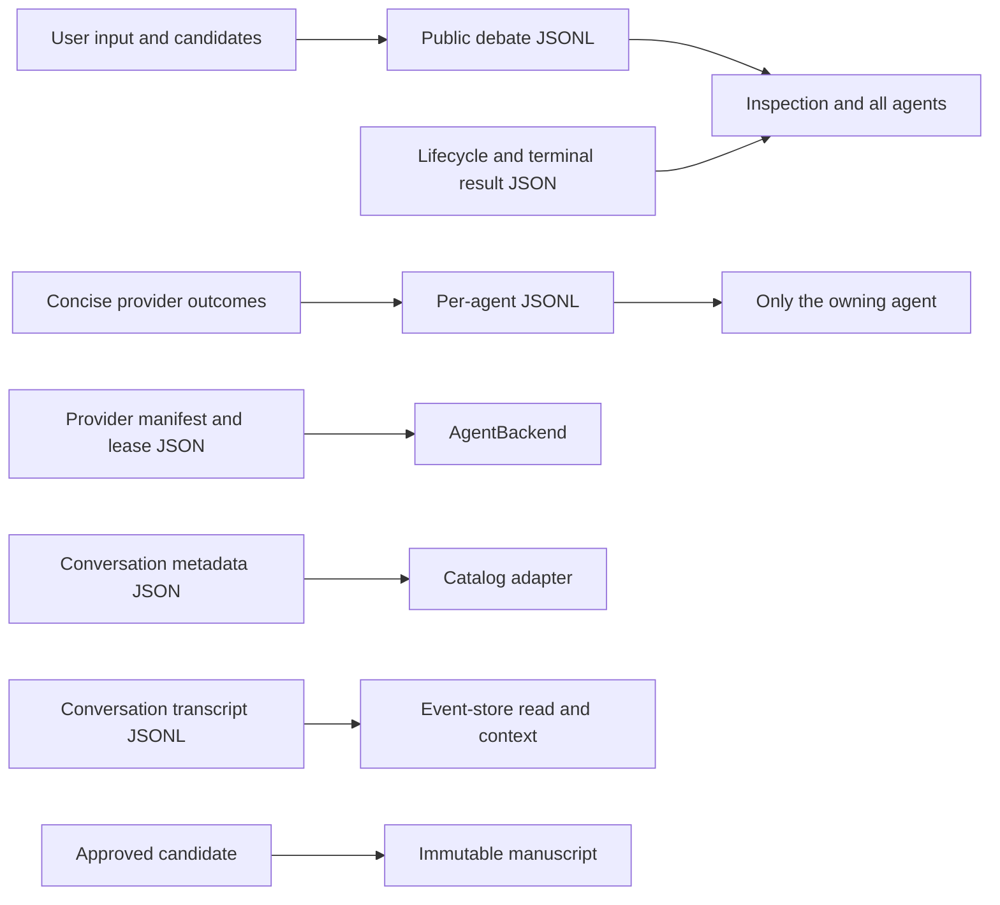

# Persistence design

> **Availability:** filesystem persistence for configuration, sessions,
> debates, agent memory, conversation metadata and transcripts, and manuscripts
> is implemented.

Key terms: **blackboard**—the public debate log; **owner-isolated state**—
history visible only to its agent; **lifecycle**—reservation and terminal status;
**transcript**—one conversation's visible event history; **durability**—which
completed file changes survive interruption.

The workspace intentionally uses inspectable files instead of a database. Each
channel has one owner and audience:

In words: the public blackboard is the complete visible debate record;
per-agent state is a narrower owner-only memory channel; lifecycle/result files
support recovery and inspection; provider state belongs to the backend;
conversation metadata and visible events belong to separate adapters; only
approved content reaches a manuscript.

## Conversation durability

`StoryRuntime.converse()` saves the user event before its one provider call. It
then attempts to save a valid reply as `agent_reply`, or an ordinary post-user
failure as a sanitized `runtime_error`. This order preserves what the user tried
even when provider work does not finish. The event store never calls or retries
the provider.

A hard interruption or failed reply/error/cancellation write can leave only the
user event. That unmatched event stays authoritative but is excluded from later
complete-turn context. The exact operation belongs
to the [Runtime API](../reference/runtime-api.md#one-conversation-turn); operator
response belongs to [Recovery](../operations/recovery-and-limitations.md#conversation-turn-recovery).

## What is retained

The blackboard keeps original input, candidates, verdict notes, critiques,
proposals, visible errors, finalization metadata, and commit record. Terminal
result JSON omits its duplicated message list; inspection combines it with
validated JSONL and lifecycle state. Agent state deliberately avoids copying
the entire prompt, candidate, or core documents, but keeps generic outcomes and
the owner's visible notes, critiques, and proposals, capped per entry. A
provider may still echo sensitive material into those fields.

Session override JSON survives runtime instances. Provider manifests preserve
compatible thread IDs across debates, detach, end, and backend close. CLI
selection survives session end. Conversation metadata retains its exact
display subject even when archived. Its transcript retains every visible event,
including an unmatched user remainder. None of these actions is deletion or
secure erasure.

## Ownership and durability boundaries

The workspace validates and mutates one channel at a time. Debate reservation
belongs to lifecycle state; blackboard and owner histories append separately;
terminal result is a projection rather than a second message store. Approved
artifact coordination crosses core documents and one manuscript, while a
conversation metadata transition is isolated to that identity. The event store
owns transcript append, full read, and bounded context projection. Neither
adapter performs migration, and absent reads create nothing.

The conversation memory service is another projection, not a persistence
owner. It reads the catalog and event-store contracts but stores no search
index, result, citation, page, or cursor and changes no metadata or transcript.
Its exact read contract lives in [Conversation search and cited transcript
pages](../reference/conversation-search.md).

Because these channels are separate files, persistence design does not imply a
database transaction across them. The normative containment, exclusive-create,
atomic-file, write-order, rollback, and interruption guarantees live in
[Filesystem safety](../operations/filesystem-safety.md); recovery behavior lives
in [Recovery and limitations](../operations/recovery-and-limitations.md).

The complete path tree and strict schemas live in
[Session storage](../reference/configuration/session-storage.md). Filesystem
trust boundaries are in [Filesystem safety](../operations/filesystem-safety.md).
The exact event and context contract lives in
[Conversation transcripts](../reference/conversation-transcripts.md).
