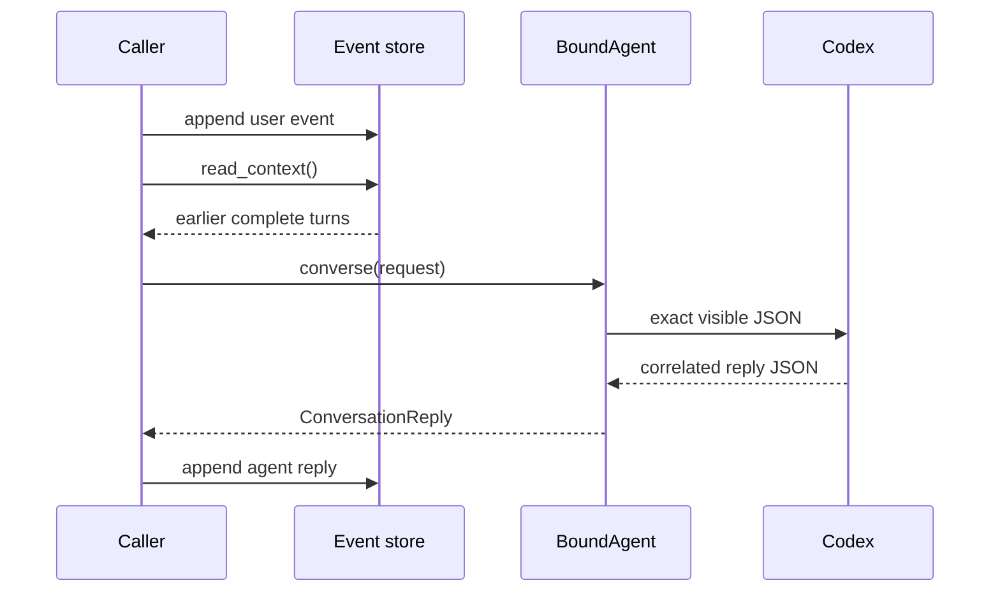

# Prompts and provider boundary

> **Availability:** file-referenced definitions, Codex prompt staging,
> phase-specific debate invocation, one-turn conversation calls, and persistent
> compatible threads are implemented.

Key terms: **agent definition**—stable context for one role; **fingerprint**—a
hash-derived identity for that context; **binding**—the provider object created
for a definition; **staging**—assembling verified context in a temporary area;
**visible context**—the prior events explicitly sent in a request;
**provider-private history**—conversation state retained behind a thread ID.

Stable prompt context and dynamic turn data travel through different channels.
The runtime resolves the role prompt, persona, language, and allowlisted core
documents into one immutable definition. Each file reference contains an
absolute workspace path and SHA-256 digest, not the file text. Verified file
content is staged during binding; request JSON enters separately for each call.

## Least-privilege context

Each role has one editable `config/agents/<agent-id>/AGENTS.md`. The plot
architect receives the global and part outlines; the character custodian gets
character sheets; the execution specialist gets narrative rules; the lead gets
all four. Definitions never include unrelated workspace paths.

The runtime verifies referenced bytes before and after a new bind. A definition
fingerprint covers agent ID, resolved provider and language, component
identities, and hashes. Bindings are cached for one runtime by agent and
fingerprint. Matching concurrent requests share one in-flight bind; cancelling
one waiter does not cancel a bind another still needs, and failed binds are not
cached.

Editing a role prompt, selected persona, language, or allowlisted core document
therefore changes the next applicable definition. The backend makes a new
binding and a changed fingerprint starts a fresh thread for that agent. An
identical binding may serve multiple story sessions, while provider conversation
state remains partitioned by session and agent.

## Conversation turn flow

Suppose a caller is sending `turn_2` in the `opening` conversation to the plot
architect. It first records the user event, derives context from earlier
complete `opening` turns, and calls the already-bound agent. The bound agent
checks the correlated reply; the caller then records that reply itself:

The outer provider payload contains exactly `session_id`, `conversation_id`,
`turn_id`, `agent_id`, `content`, and `context`. Each context item contains only
`turn_id`, `sender`, `recipient`, `kind`, and `content`. Storage schema version,
timestamps, sequence numbers, repeated session or conversation IDs, and window
summary counters are not projected. `converse()` does not read or append the
event store; the caller supplies the window and decides whether to persist the
returned reply.

If the same agent is next asked about an `ending` conversation, its explicit
context contains only validated `ending` events while Codex still resumes the
compatible session-and-agent thread that saw `opening`. Conversation IDs scope
the visible request, not provider-private history.

## Codex process boundary

The backend launches one constrained Codex subprocess from the isolated
staging directory. Stable verified context reaches its temporary top-level
`AGENTS.md`, while request JSON reaches standard input; provider replies return
through schema and phase validation. The exact sandbox, approval, tool,
configuration, and instruction-discovery controls are documented once in
[Privacy and provider exposure](../operations/privacy-and-provider.md).

Debate request JSON contains task, original input, current candidate, public
blackboard snapshot, and only the receiving agent's persisted outcomes.
Conversation request JSON uses the exact projection above. Neither repeats role
prompts, persona text, language directives, or core-document text. Provider
output becomes a reply only after its schema and request correlation checks;
debate replies also receive phase-specific validation.

This boundary does not make the remote model or installed executable trusted.
SHA-256 detects change but does not encrypt or authorize content. The provider
may retain its own transcripts, and session end keeps thread references.

Exact model shapes are in [Agent contracts](../reference/agent-contracts.md);
privacy implications are in [Privacy and provider exposure](../operations/privacy-and-provider.md).
