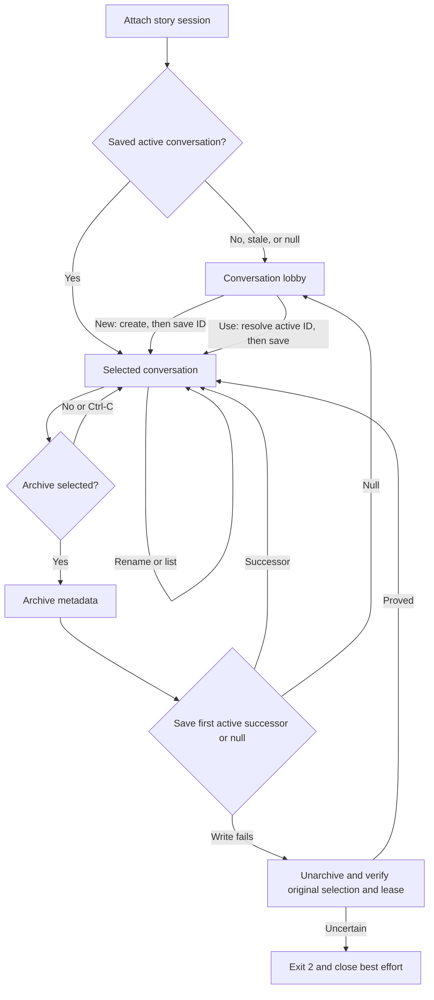

# Session lifecycle design

> **Availability:** the controller manages sessions, conversations, routed
> turns, local/management reads, directives, history, and context
> consensus. Artifact commands remain unavailable.

## Four independent facts

| Fact | Persists? | Meaning |
| --- | --- | --- |
| Session active | Yes, in its manifest | Provider work is allowed. |
| Session selected | Yes, in CLI context | Bare `story` knows which session to try. |
| Session attached | No, through a lease | This backend temporarily owns it. |
| Conversation selected | Yes, per story session | The shell knows the current subject. |

Selection never proves lease ownership. Quit detaches; end makes the session
inactive. Both retain saved selections.

## Entering the lobby

The single-use controller installs an `asyncio.Runner` before the lobby; its
shared event loop serves advisory/consensus operations. It owns final cleanup.
Explicit entry creates, attaches, or resumes a named session without
confirmation. Bare entry opens the lobby, attaches an active selection, or asks
to resume an inactive one with yes as default.

After acquisition, missing, `null`, missing-record, or archived conversation
selection enters the inner lobby; stale IDs are not rewritten. Malformed or
unsafe selection storage is fatal on initial entry.

Acquisition preflights routes/executable discovery but starts no provider.

## Command gates and management state

Help/status and roster/session navigation are global. Target, conversation,
search/transcript, directives, and inspection require attachment; history,
advisory, and consensus also require active selection. Ordinary and `/say` use
the sticky target; `@AGENT` is one-shot. Conversation changes preserve it.

Status refreshes selected metadata and distinguishes saved/attached state. The
per-session latest accepted `started` debate ID is process-local. Provider-free
management preserves all scope/story/provider state except successful directive
overrides. See the [CLI contract](../reference/cli.md#interactive-streams).

## Attach and switch ordering

For an initial attachment or switch to B, the controller:

1. acquires and validates B's active owned lease;
2. loads and validates B's saved conversation, if any;
3. saves B as the story-session selection when it changed;
4. detaches source A when switching; and
5. commits B in memory, resets the visible agent alias to `lead`, and renders.

Failure before step 3 releases B and preserves A. If A cannot detach after B is
saved, B stays selected, no B orientation appears, close is attempted, and the
controller exits `2` with `cleanup_failed`.

## Conversation lifecycle and compensation

`new` writes metadata then selection; save failure leaves the record and prior
choice. `use` saves before memory changes; `subject` renames; `list` reads only.
None changes target.

Nonselected archive neither confirms nor reselects. Selected archive defaults
to no; yes selects the first other active record or `null`. Save failure is
recoverable only if unarchive, original selection, and lease are proved.

## End, detach, and close

`/session end` defaults to no. Yes deactivates/releases the lease, retains saved
session/conversation selections, clears in-process attachment/selection/memory,
resets target to lead, and returns to outer lobby. No/blank/Ctrl-C stays attached; EOF
exits without ending. `/quit`, `/exit`, main EOF, and compose EOF also request
normal cleanup without deactivation.

Cleanup order is `Runner.close()` → known detach → `backend.close()`;
ordinary failure never skips a later stage. Runner close first finalizes residual
tasks and async generators. Normal cleanup clears process-only state while
durable sessions, selections, threads, transcripts, debates, and artifacts stay.
Any ordinary cleanup failure exits `2` with one best-effort `cleanup_failed`.
An interrupted Runner close still attempts detach/backend close, clears attached
conversation/memory state, retains the unproved Runner reference, then
propagates. See [Backend and sessions](../reference/backend-and-sessions.md) and
[Session storage](../reference/configuration/session-storage.md).
