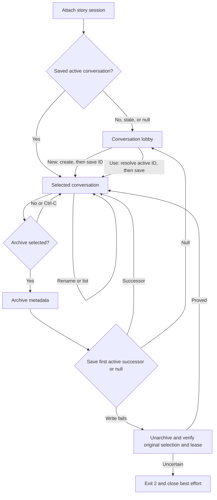

# Session lifecycle design

> **Availability:** the controller manages sessions, conversations, routed
> turns, local/management reads, directives, history, and selected-context
> consensus. Standalone artifact commands remain unavailable.

## Four independent facts

| Fact | Persists? | Meaning |
| --- | --- | --- |
| Session active | Yes, in its manifest | Provider work is allowed. |
| Session selected | Yes, in CLI context | Bare `story` knows which session to try. |
| Session attached | No, through a lease | This backend temporarily owns it. |
| Conversation selected | Yes, per story session | The shell knows the current subject. |

Selection never proves lease ownership. Quit detaches; end makes the session
inactive. Both retain saved selections.

## Entering the lobby

The single-use controller owns final detach and close. Explicit entry creates,
attaches, or resumes the named session without confirmation. Bare entry opens
the outer lobby, attaches an active selection, or asks to resume an inactive one
with yes as default.

After acquisition, missing, `null`, missing-record, or archived conversation
selection enters the inner lobby; stale IDs are not rewritten. Malformed or
unsafe selection storage is fatal on initial entry.

Acquisition preflights routes/executable discovery but starts no provider.

## Command gates and management state

Registry `/help` (and `/?`) plus `/status` are global. Roster/session navigation
is global; target, conversation, search/transcript, directive, and inspection
actions require attachment. `/history`, advisory content, and consensus require
an active selection. Ordinary and `/say` use the sticky target; `@AGENT` is
one-shot. Conversation changes preserve the target.

Status distinguishes saved from attached session and refreshes selected
metadata before reporting shell, transcript/context, search, and last-run facts.
The controller retains a process-local per-session latest accepted `started`
debate ID; it survives session switches but not process restart. Management is
provider-free and preserves attachment, selection, target, transcript, catalog,
artifact, and provider state. Only successful directives replace overrides.
See the [CLI management contract](../reference/cli.md#interactive-streams).

## Attach and switch ordering

For an initial attachment or switch to destination B, the controller:

1. acquires and validates B's active owned lease;
2. loads and validates B's saved conversation, if any;
3. saves B as the story-session selection when it changed;
4. detaches source A when switching; and
5. commits B in memory, resets the visible agent alias to `lead`, and renders.

Failure before step 3 releases B and preserves A. If A cannot detach after B is
saved, B stays selected, no B orientation appears, close is attempted, and the
controller exits `2` with `cleanup_failed`.

## Conversation lifecycle and compensation

`new` writes metadata, then selection; save failure leaves the record and prior
choice. `use` saves before memory changes. `subject` renames; `list` is read-only.
None changes the target.

Nonselected archive neither confirms nor reselects. Selected archive defaults
to no; yes selects the first other active record or `null`. Save failure is
recoverable only if unarchive, original selection, and lease are proved.

## End, detach, and close

`/session end` defaults to no. Yes deactivates, releases the lease, retains both
selections, clears in-process conversation state, resets the target to lead,
and returns to the outer lobby. No, blank, or Ctrl-C keeps the attachment; EOF
exits without ending.

`/quit`, `/exit`, and main-prompt EOF detach without deactivation, then close
the backend. Detach or close failure changes the final status to `2`. Exact
lease rules are in [Backend and sessions](../reference/backend-and-sessions.md);
schemas are in [Session storage](../reference/configuration/session-storage.md).
