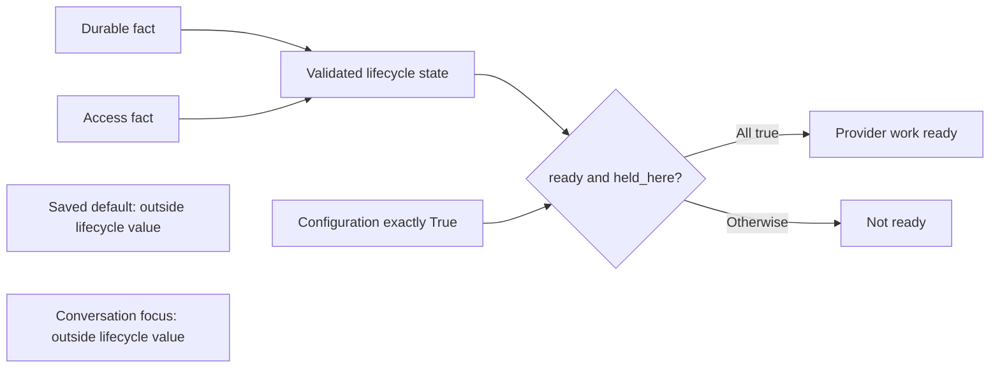

# Session lifecycle design

> **Availability:** the controller manages sessions, conversations, routed
> turns, local/management reads, directives, history, and context consensus.
> Artifact commands remain unavailable.

Key terms: **durable state** is `absent`, `ready`, or `paused`; **access state**
records claimability or lease ownership; **saved default** is the persisted CLI
pointer; **attachment** is this backend's lease; **focus** is the controller's
selected conversation. These are separate facts.

After confirmed `/session end`, `draft` remains the saved default while the
shell has no attachment or focus. Legacy `selected=True` therefore proves
neither `held_here` access nor a focused conversation.

## Canonical lifecycle state

`SessionLifecycleState` is frozen, slotted, and keyword-only. It carries a safe
ID, durable/access states, an owner host/PID pair, and timestamp pair. Exactly
these combinations are valid:

| Durable state | Valid access states | Owner host and PID | Timestamps |
| --- | --- | --- | --- |
| `absent` | `claimable` only | Both absent | Both absent |
| `ready` | Any access state | Optional pair for `claimable`; required pair otherwise | Required, offset-aware, ordered pair |
| `paused` | Any access state | Optional pair for `claimable`; required pair otherwise | Required, offset-aware, ordered pair |

Access values are `claimable`, `held_here`, `blocked_by_live_local_owner`, and
`ownership_unknown`. Paused sessions permit all four. An update timestamp
cannot precede creation.

## Facts and provider readiness

`provider_work_is_ready()` is true only for validated `ready` + `held_here` +
exact `True` configuration readiness. It performs no I/O or acquisition.

Users can import, validate, project, and query facts. They cannot thereby claim,
attach, detach, mutate selections/focus, read storage/configuration, start a
provider, or gain shell behavior. Issue #53 does not yet drive Issue #54
backend transitions or Issue #55 shell copy/navigation. Exact APIs are in
[Backend and sessions](../reference/backend-and-sessions.md#lifecycle-value-contracts).

## Entering and command gates

The controller installs one `asyncio.Runner` before the lobby and owns cleanup.
Explicit entry creates, attaches, or resumes a name. Bare entry opens the
lobby, attaches an active saved default, or asks to resume a paused one.

An absent, `null`, missing, or archived conversation selection enters the inner
lobby without rewriting stale IDs; malformed initial selection is fatal.
Help/status and navigation are global. Content requires attachment; provider
work also requires an active focused conversation.

## Attach and switch ordering

For initial attachment or a switch to B, the controller:

1. acquires and validates B's active owned lease;
2. loads and validates B's saved conversation, if any;
3. saves B as the session default when changed;
4. detaches source A when switching; then
5. commits B in memory, resets the visible alias to `lead`, and renders.

Failure before step 3 releases B and preserves A. If A cannot detach afterward,
B stays saved, no B orientation appears, close is attempted, and exit is `2`
with `cleanup_failed`.

## Conversation lifecycle and compensation

Attachment restores an active saved conversation or opens the inner lobby.
`new` writes metadata before selection; save failure leaves the record and
prior choice. `use` saves before memory changes; rename/list do not retarget.

Archiving another record neither confirms nor reselects. Focused archive
defaults to no; yes saves the first other active ID or `null`. Save failure must
unarchive and prove the original selection and lease or exit `2`.

## End, detach, and close

Confirmed `/session end` pauses/releases, retains saved defaults, clears process
scope, resets `lead`, and returns to the lobby. No, blank, or Ctrl-C stays
attached; confirmation EOF exits without ending. `/quit`, `/exit`, and
main/compose EOF clean up without pausing.

Cleanup attempts `Runner.close()` → detach → `backend.close()` without skipping
later stages. Durable data remains. Ordinary failure exits `2` with one
best-effort `cleanup_failed`; interrupted Runner close attempts later cleanup,
retains its unproved reference, and propagates. See
[Session storage](../reference/configuration/session-storage.md).
