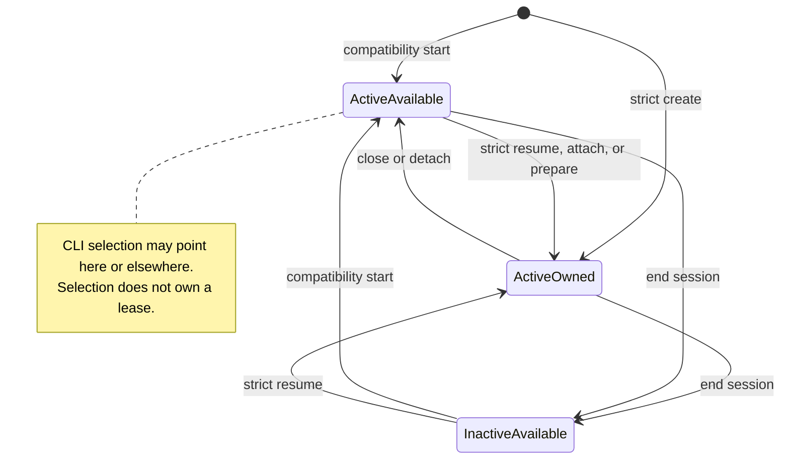

# Session lifecycle design

> **Availability:** durable provider sessions and local leases are implemented.
> CLI start/end use compatibility behavior; strict lifecycle is Python-only.

Key terms: **active**—durable permission for provider work; **selected**—the
CLI's saved default; **attached**—a backend currently holding the lease;
**claim guard**—the local lock that serializes lease claims.

One story session has three independent dimensions. Durable `active` allows
provider work. Workspace-local CLI selection supplies a default name. A lease
sidecar records temporary backend attachment to the session's threads.

In words: compatibility start—the operation used by the installed CLI—creates
or reactivates a session, then releases its transient lease, leaving the
session active and available. Strict create and resume preflight and retain a
lease, so they return active and owned. Attach and prepare likewise retain an
active session's lease. Detach or close releases ownership without ending;
end writes the manifest inactive before releasing either an owned or transient
lease. Thread IDs remain available for compatible later work, and CLI
selection stays independent throughout.

## Claim ordering

A persistent workspace-global advisory guard serializes the short sidecar
create-or-reclaim transaction among cooperating processes. The per-session
sidecar records owner token, host, PID, and acquisition time. The guard is not
session ownership, authentication, or liveness evidence and must remain at a
stable path.

Strict create, resume, and attach preflight every provider route and executable,
claim a lease, then recheck manifest preconditions before returning or writing.
Attach rejects an already-inactive manifest before it creates the guard or
claims. If another operation makes the session inactive after claim, recheck
fails and releases the newly acquired lease. End atomically writes inactive
before releasing its owned or transient lease.

Within one backend, a session/provider/agent lock prevents two bindings from
racing the same provider thread. A failure releases attachment acquired by
that call. A failure while using a lease already owned by the backend retains
it for recovery. Detach and close never deactivate or delete thread metadata.

## Lease observation boundary

Lifecycle decisions treat lease status conservatively: a read observes without
mutating ownership, and an uncertain owner blocks a new attachment. Exact
state classification, platform behavior, and reclamation rules belong to the
[backend session reference](../reference/backend-and-sessions.md).

For a future interactive session switch, safe ordering is destination attach,
selection persistence, then source detach. A failed destination must preserve
the prior selection and attachment. No such switch controller is installed.

Exact methods and states are in [Backend and sessions](../reference/backend-and-sessions.md);
schemas are in [Session storage](../reference/configuration/session-storage.md).
