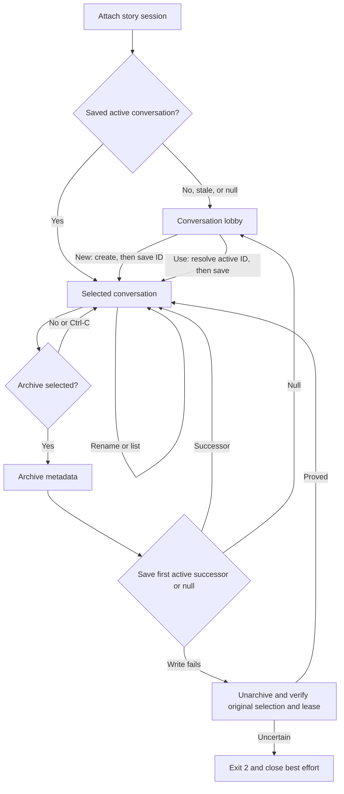

# Session lifecycle design

> **Availability:** the TTY controller manages nested story-session and subject-
> conversation lobbies without provider, transcript, search, or artifact work.

Key terms: **active**—provider work is allowed; **attached**—this process owns
the session lease; **selected conversation**—one session's saved active record;
**compensation**—attempting to restore and prove earlier state.

## Four independent facts

| Fact | Persists? | Meaning |
| --- | --- | --- |
| Session active | Yes, in its manifest | Provider work is allowed. |
| Session selected | Yes, in CLI context | Bare `story` knows which session to try. |
| Session attached | No, through a lease | This backend temporarily owns it. |
| Conversation selected | Yes, per story session | The nested lobby knows which subject is current. |

Selection never proves lease ownership. Quit detaches; end makes the session
inactive. Both retain saved selections.

## Entering the lobby

The single-use controller owns final detach and close. Explicit entry creates,
attaches, or resumes the named session without confirmation. Bare entry opens
the outer lobby with no saved session, attaches an active one, or asks to resume
an inactive one with yes as default.

After acquisition, missing, `null`, missing-record, or archived conversation
selection enters the inner lobby; stale IDs are not rewritten. Malformed or
unsafe selection storage is fatal on initial entry.

Session acquisition preflights routes and executable discovery but starts no
provider. Conversation commands, session list, and session end are provider-free.

## Attach and switch ordering

For an initial attachment or switch to destination B, the controller:

1. acquires and validates B's active owned lease;
2. loads and validates B's saved conversation, if any;
3. saves B as the story-session selection when it changed;
4. detaches source A when switching; and
5. commits B in memory, resets the visible agent alias to `lead`, and renders.

Failure before completing step 3 releases B and preserves A. If A cannot detach
after B was saved, B stays selected, no B orientation appears, close is
attempted, and the controller exits `2` with `cleanup_failed`.

## Conversation lifecycle and compensation

`new` writes exact display metadata, then selection; save failure leaves the new
record and prior effective choice. `use` saves a resolved active ID before
memory changes. `subject` renames the selected active record; `list` is read-only.

Nonselected archive needs no confirmation and does not reselect. Selected
archive defaults to no; yes selects the first other active catalog record or
`null`. Save failure recovers only if unarchive, original durable selection,
and the owned active lease are proved; otherwise it is fatal.

## End, detach, and close

`/session end` defaults to no. Yes deactivates, releases the lease, retains both
selections, clears in-process conversation state, and returns to the outer
lobby. No, blank, or Ctrl-C keeps the attachment; EOF exits without ending.

`/quit`, `/exit`, and main-prompt EOF detach without deactivation, then close
the backend. Detach or close failure changes the final status to `2`. Exact
lease rules are in [Backend and sessions](../reference/backend-and-sessions.md);
schemas are in [Session storage](../reference/configuration/session-storage.md).
