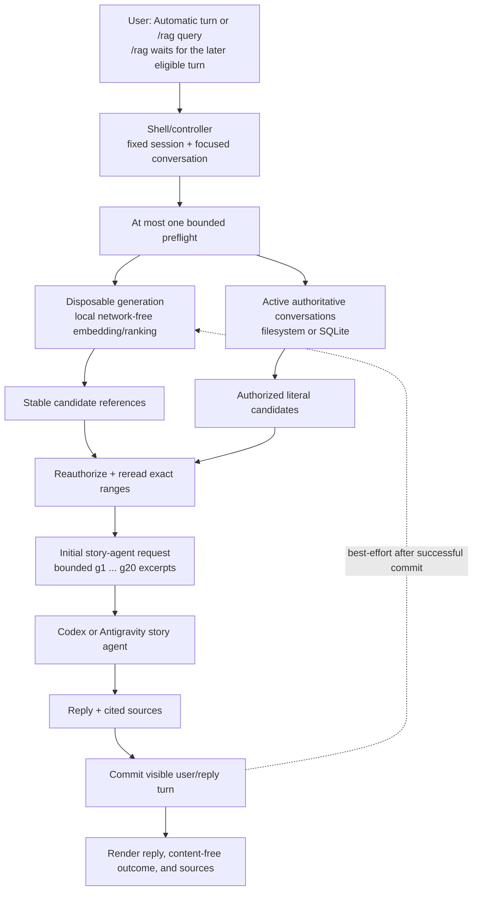

# Optional conversation RAG integration

> **Current availability:** Issues #262, #283, #263, #348, and #349 provide a direct
> Python boundary, a fixed pure local provider, a disposable per-session
> generation store, provider/store-neutral runtime authorization, and six
> noninteractive `story rag` lifecycle/search commands. The shell also provides
> storage-backed `/settings` provider/automatic controls, next-startup local
> composition, eligible automatic preflight, and private one-turn `/rag QUERY`
> arming. Local provider use needs the pinned `generic-rag` package and explicit
> workspace opt-in. Existing literal `/search` is unchanged.

Key terms: **authoritative source**—the current conversation store whose bytes
must be reread before use; **derived projection**—disposable fragments and
vectors; **stable source reference**—session/conversation/turn identities,
revision, fragment, and range without trusted provider text; **preflight**—one
bounded retrieval attempt before an eligible agent turn; **local RAG
provider**—the network-free process-local embedder/ranker that proposes
candidates; **story agent**—the separately configured Codex or Antigravity
agent that can receive only the bounded excerpts Story reauthorizes and
rereads.

<a id="rag-mental-model"></a>

## Start with the mental model

Conversation RAG is optional semantic discovery over conversations the current
session is already allowed to read. It is not transcript authority, durable
agent memory, a conversation-storage backend, or permission to search another
session. Filesystem or SQLite remains the one active authoritative store.

The derived generation can help find a candidate, but it can never make that
candidate true. Before an excerpt can reach a story agent, the runtime uses its
stable reference to authorize the current session again and reread the exact
range from the active conversation store. Changed, missing, out-of-scope, or
otherwise invalid references are rejected and derived state is marked stale
best-effort.

The local RAG provider and the story agent are different components. Local RAG
embeds and ranks inside this process without a runtime network call or
credential flow. A later Codex or Antigravity story-agent request can be
external and can contain the bounded authoritative excerpts selected by the
preflight. The private RAG query itself is not added to that request.

<a id="rag-lifecycle"></a>

### One eligible turn from query to projection



Solid arrows show the attempted turn and its authority checks. The dotted
arrow is the isolated post-commit projection update: failure can leave derived
state stale, but it does not roll back the visible conversation turn. When RAG
is disabled or an automatic turn has no usable query, the preflight branch is
absent and the ordinary turn keeps its established behavior. For `/rag`, the
first arrow spans arming plus the later eligible turn; the command itself stops
before preflight. SQLite and RAG remain independent: SQLite can supply the
active service bundle, while RAG owns only a separate disposable per-session
generation.

<a id="rag-roles"></a>

### Who does what

| Participant | Responsibility | Explicit limit |
| --- | --- | --- |
| User | Installs the optional boundary when approved, opts the workspace in, chooses Automatic or arms `/rag`, and decides whether content may reach a story provider. | A query cannot widen the attached session, focused conversation, artifact authorization, or fixed budgets. |
| Shell/controller | Enforces attachment, active focus, eligible turn type, exact `/rag` scope, one-turn consumption, and content-free terminal status. | `/rag` performs no retrieval, saves no query, and never changes automatic policy. |
| Story runtime | Runs at most one preflight, merges literal-first candidates, reauthorizes stable references, rereads exact ranges, validates final citations, commits the visible turn, then attempts projection. | It does not trust derived text/scores, recurse into retrieval, or expand debate/consensus scope. |
| Active conversation storage | Supplies the complete catalog, visible events, literal search, and coordination authority from filesystem or SQLite. | Only one backend is authoritative; RAG does not select, transfer, provision, or validate it. |
| Local RAG service | Builds disposable projections and proposes bounded semantic candidates through the fixed local embedder/ranker. | It has no runtime network, credentials, story-provider lifecycle, transcript authority, or raw-score output. |
| Codex or Antigravity story agent | Receives the visible story message plus only the bounded, freshly reread excerpts and stable `g1` through `g20` labels on the initial request. | It receives no vector handle, RAG query, credential, or permission to retrieve another scope. |
| Renderer | Shows the story reply, content-free outcome/reason, and proven sources. | It does not print excerpt bodies as interactive diagnostics; direct `story rag search` is the separate content-bearing output. |

## Install the base or optional boundary

The ordinary installation remains RAG-free. Project runtime dependencies are
empty, and this command does not install or import `generic-rag`:

```bash
python -m pip install --editable .
```

For approved internal, non-redistributing evaluation, initialize the pinned
submodule. For a fresh clone:

```bash
git clone --recurse-submodules https://github.com/Kims-DeveloperGroup/story-writing-agents.git
cd story-writing-agents
```

For an existing checkout:

```bash
git submodule sync -- vendor/generic-rag
git submodule update --init --checkout vendor/generic-rag
```

Install the optional dependency through the declared extra:

```bash
python -m pip install --editable '.[rag]'
```

The `rag` extra is a direct VCS requirement pinned to an HTTPS GitHub URL. Its
first installation normally needs `git`, network access, and repository access.
The submodule is review/development evidence; pip resolves the VCS URL rather
than using `vendor/generic-rag` as its dependency source. A populated local
Git/pip cache can avoid a new fetch, but an offline install from an empty cache
is not supported. Installing the extra does not enable runtime RAG by itself.
The noninteractive CLI composes its own local store, state, and runtime only
after an operation needs them; low-level direct composition can still use a
caller-owned store and lexical retriever. See the
[direct-module API](../reference/package-api.md#optional-conversation-rag-boundary).

## Verify the pin offline

The approved commit is
`c77456321c614518e420e45c033e3f71dc5363b8`. Once the objects and metadata are
present, these checks make no network request:

```bash
rag_expected_pin=c77456321c614518e420e45c033e3f71dc5363b8
git ls-files --stage -- vendor/generic-rag
git submodule status --cached vendor/generic-rag
git submodule status vendor/generic-rag
test "$(git -C vendor/generic-rag rev-parse HEAD)" = "$rag_expected_pin"
git -C vendor/generic-rag cat-file -e "${rag_expected_pin}^{commit}"
git -C vendor/generic-rag status --short
grep -nF "$rag_expected_pin" pyproject.toml uv.lock
```

The index row must use mode `160000` and the approved commit. An ordinary
submodule-status row begins with a space when it matches; `+` is a mismatch and
`-` is uninitialized. A clean nested status prints nothing. `pyproject.toml`
must pin the same full commit, while `uv.lock` must record it in the resolved
Git source and requirement metadata. With the required uv cache available,
`uv lock --check --offline` adds a local metadata check. The installed
distribution reports version `0.1.0`; composition checks that version and a
fixed capability manifest.

## Update the pin as one controlled change

A pin update changes a dependency and cross-repository API boundary. Give it an
approved Issue and dependency/modularity review, then:

1. Review the exact full commit, provenance, Python compatibility, dependency
   direction, security history, tests, API, and license. Confirm `generic-rag`
   still has no dependency on this project.
2. Fetch the generic repository and detach the submodule at that commit. Do not
   follow a floating branch or tag.
3. Update the exact VCS commit in `pyproject.toml`. Change the supported version
   or capability manifest only if the reviewed API requires it.
4. Regenerate `uv.lock` under
   [the dependency policy](../../DEPENDENCY_POLICY.md); never edit it manually.
5. Repeat the agreement checks, then verify the RAG-free base, the VCS-backed
   extra, isolated imports, provider-free and adapter tests, and built artifacts.
   Story distributions must not copy the submodule tree.

Commit the gitlink, `pyproject.toml`, and generated lock change together.

## Current boundary and trust model

| Direct module | Current responsibility | Dependency behavior |
| --- | --- | --- |
| `story_writing_agents.conversation_rag` | Frozen story-owned values, fixed budgets, collaborator protocols, outcomes/reasons, and content-free failures | Standard library only; safe in the base install |
| `story_writing_agents.conversation_rag_local` | Pure deterministic local embedding and vector ranking | Imports only story contracts/literal normalization; no generic package, workspace, I/O, network, credentials, subprocess, or environment discovery |
| `story_writing_agents.conversation_rag_store` | Identity-bound disposable generation construction, verification, active/status pointers, reading, and confirmed purge | Imports no provider or generic package; construction performs no I/O |
| `story_writing_agents.generic_rag_adapter` | Exact translation to/from `generic-rag` 0.1.0 | Sole production module importing both projects; direct import needs the optional package |
| `story_writing_agents.conversation_rag_composition` | Deferred generic composition plus fixed local-provider/store/runtime-state composition, capability checks, fallback mapping, and sanitized diagnostics | Safe to import without the optional package; compatibility or explicit composition performs the version/capability check |
| `story_writing_agents.conversation_rag_runtime` | Read-only authorized inspection, active-turn projection, literal-first merge, direct authorized search, authoritative reread, citations, bounded context, and restart-safe runtime-state coordination | Imports only story-owned contracts and conversation-storage ports; owns no store, provider, settings, network, or credentials |
| `story_writing_agents.conversation_rag_cli` | Immutable six-operation request/report domain and local lifecycle/search dispatch | Direct-only module; owns no interactive controller, SQLite adapter, network provider, or generic package source |

The root facade remains unchanged at 120 exports. The provider allowlist is
exactly `("local",)`. Composition does not discover plugins, inspect provider
configuration, create credentials, or own an external provider lifecycle.

| Fixed boundary | Limit |
| --- | ---: |
| Returned candidates | 20 |
| Conversations | 256 |
| Events | 10,000 |
| Fragment width / overlap | 800 / 80 codepoints |
| Embedding batch | 32 fragments |

Provider candidate text is untrusted adapter input. Story-facing retrieval
returns stable source references and ranks, not provider text or scores. A
configured runtime reauthorizes and rereads each range before agent use.
Callers own the embedder, vector writer/resetter/reader, lexical retriever, and
runtime-state port for their full lifetimes; adapters borrow them only during an
operation. Ordinary failures cross the boundary as fixed content-free
categories. `KeyboardInterrupt` and `SystemExit` propagate.

## Current local provider

`conversation_rag_local` exports provider `local`, model
`story-conversation-rag-local-hash-v1`, and exactly 256 dimensions. The
embedder first pins later Unicode assignments against the standard library's
Unicode 3.2 database, applies the shared strict NFKC/casefold/control/whitespace
normalization, and hashes whole-token plus boundary-padded codepoint 1/2/3-gram
features through a fixed length-framed SHA-256 domain. Integer accumulation and
L2 normalization produce deterministic finite vectors; normalized empty input
produces the zero vector.

The ranker scans at most 65,536 exact 256-coordinate records, removes identical
duplicates, rejects conflicts or cross-session records, retains only positive
similarity, and orders ties by the complete stable source key before the
request's at-most-20 limit. It never returns scores to the story-facing result.

This is intentionally a weak, dependency-free baseline. It offers deterministic
local feature matching, not a semantic-quality guarantee, and must not be
described as equivalent to a learned embedding model.

## Current derived generation store

`ConversationRagGenerationStore(workspace)` retains the identity-bound
`Workspace` without I/O. Its first stateful operation uses the fixed subtree:

```text
agent_states/orchestrator_state/conversation_rag/
├── .lock
└── sessions/
    └── SESSION_ID/
        ├── .lock
        ├── active.json
        ├── status.json
        └── generations/
            └── gen-SHA256/
                ├── generation.json
                ├── generic-manifest.json
                ├── source-map.jsonl
                └── vectors.jsonl
```

Owned directories require mode `0700`; regular files require `0600`. The store
uses descriptor-relative, no-follow operations, meaningful identity checks,
process-local and bounded POSIX advisory locks, canonical bounded JSON/JSONL,
complete digest/count/source-range reconstruction, and finite-vector
verification. Unsupported filesystem primitives fail closed rather than using
a pathname fallback. Deep JSON, non-finite values, numeric overflow, malformed
canonical bytes, unsafe names, and inconsistent persisted records become fixed
content-free corrupt/unsafe outcomes. Status, snapshots, exceptions, and
diagnostics contain no query or source text; `source-map.jsonl` deliberately
does contain derived plaintext source fragments, so protect this subtree as
conversation data.

Two schema identities have different owners. The fixed
`story-conversation-rag-store-v1` value versions only the persisted envelopes in
the active/status pointers and generation metadata. The caller's
`ConversationRagProjectionRequest.schema_id` identifies the projected content;
the store preserves it separately as `projection_schema_id` and in the
checkpoint. Direct callers inspecting a nonlegacy projection must pass that
exact value through the keyword-only `expected_projection_schema_id` argument.
Omitting it keeps the original store-v1 projection expectation and fails closed
against a generation built for another projection schema.

Projection writes an inactive `build-*` generation, completely verifies it,
renames it to its content-derived generation ID, reopens and verifies it, then
writes advisory `status.json`. `active.json` is the sole commit record and its
atomic rename is the final callable publication operation after the complete
temporary pointer and session directory have been synchronized. There is no
post-rename synchronization claim: an immediate system crash may retain either
the old or new valid pointer. A reported failure before that commit preserves
the old pointer byte-for-byte. Partial builds and inactive generations are
orphans; inspection reports but never removes them, while a later safe mutation
validates and cleans them.

Rebuild is deterministic and restartable from the beginning, not resumable.
Inspection status describes compatibility with the requested provider, model,
and projection schema; projection state describes whether a checkpoint was
verified. A structurally verified identity mismatch is therefore
`incompatible` with a `present` checkpoint and safe generation/count metadata,
which lets an authorized caller request a rebuild. An invalid or unverifiable
store envelope exposes no trusted checkpoint. Advisory `ready`, `stale`, or
`provider_failed` status never overrides either identity result.

Existing generations whose projected content used the store-v1 value remain
ready for legacy callers. A caller expecting a different schema sees them as
incompatible; the store does not relabel or migrate their bytes. An explicit
rebuild writes and verifies a new inactive generation before atomically
publishing it. Failure before publication preserves the previous active pointer.
Missing, stale, corrupt, incompatible, and provider-failed state maps through
local composition to `literal_fallback` with a fixed reason and no candidate
text. `purge(session_id, confirmed=True)` prevalidates and deletes only that
session's active/status and generation contents; its lock/directories remain.
It never deletes authoritative conversations, SQLite/filesystem conversation
storage, configuration, manuscripts, or writing artifacts.

## Use the current direct composition

The current composition entry point is direct Python API:

```python
from story_writing_agents.conversation_rag_composition import (
    compose_local_conversation_rag,
)
from story_writing_agents.conversation_rag_store import (
    ConversationRagGenerationStore,
)

store = ConversationRagGenerationStore(workspace)
rag = compose_local_conversation_rag(store, lexical_retriever)
```

`workspace` must be an initialized `Workspace`; `lexical_retriever` is a
caller-owned implementation of `ConversationRagLexicalRetriever`. Explicit
composition immediately validates installed `generic-rag` 0.1.0 and its fixed
capabilities, then creates a call-local generic adapter for each projection or
retrieval that reaches generic work. Among caller-supplied objects, the
composition retains the store and lexical retriever; it also owns the stateless
fixed embedder/ranker. Projection uses the request's schema; retrieval with a
present state inspects against that checkpoint's schema. A different stored
schema becomes an `incompatible` literal fallback, while drift from the same
schema checkpoint becomes a `stale` fallback.
Missing/incompatible optional-package state raises the sanitized composition
error before storage is touched. The concrete local runtime bundle is also
available when the caller wants the fixed store-backed state adapter:

```python
from story_writing_agents.conversation_rag_composition import (
    compose_local_conversation_rag_runtime,
)

bundle = compose_local_conversation_rag_runtime(
    workspace,
    automatic_enabled=False,
)
runtime = StoryRuntime(
    workspace,
    conversation_storage_services=conversation_storage_services,
    conversation_rag_service=bundle.service,
)
```

The bundle retains its service, generation store, and local state adapter.
Construction checks the exact optional package and capabilities but neither
changes persisted opt-in settings nor projects a session by itself. Direct
applications still own this composition. The installed shell independently
uses the persisted construction snapshot described below.

## Use the current programmatic runtime integration

The direct runtime boundary exports ten names and remains outside the
120-name package-root facade:

```python
from story_writing_agents.conversation_rag_runtime import (
    CONVERSATION_RAG_RUNTIME_POLICY,
    CONVERSATION_RAG_RUNTIME_SCHEMA_ID,
    ConversationRagRuntimeInspection,
    ConversationRagRuntimeInspectionStatus,
    ConversationRagRuntimeError,
    ConversationRagRuntimePolicy,
    ConversationRagRuntimeService,
    ConversationRagRuntimeState,
    ConversationRagRuntimeStateSnapshot,
    inspect_authorized_conversation_rag,
)
```

An application constructs `ConversationRagRuntimeService(low_level_service,
state_port, automatic_enabled=False)`. The low-level object implements the four
`ConversationRagService` operations. The application-owned state port exposes
the same workspace key and embedding identity plus synchronous
`inspect_projection_state(session_id)` and
`mark_projection_stale(session_id)` operations. An application may provide its
own state port or retain the concrete local bundle above. The installed shell
uses the fixed concrete local bundle; it does not make that composition a
package-root API.

`StoryRuntime(..., conversation_rag_service=service)` accepts only that exact
runtime-service type. It uses the default composed filesystem
`ConversationStorageServices` bundle when no conversation-storage argument is
given, or an explicitly supplied complete bundle. RAG cannot be combined with
the legacy raw `conversation_event_store` compatibility argument because that
argument has no catalog, search, provenance, or mutation-coordinator authority.

The additive retrieval call is:

```python
await runtime.converse_with_retrieval(
    session_id,
    conversation_id,
    agent_id,
    text,
    memory_service=memory_service,
    progress_sink=None,
    rag_query=None,
)
```

Automatic preflight is off by default. A non-`None` `rag_query` forces one
attempt and takes precedence over automatic query derivation. If no RAG service
is configured, that forced attempt returns the fixed disabled literal-fallback
outcome; with no forced query, no attempt occurs and the established request and
result shapes omit RAG values. An application may opt into automatic preflight
only when constructing the runtime service with `automatic_enabled=True`; the
normalized current turn is then capped at 200 codepoints for the query.

`ConversationRagRuntimeService.project_authorized()` is also available for an
explicit programmatic projection or rebuild, and `search_authorized()` runs one
forced bounded search without consulting automatic policy.
`inspect_authorized_conversation_rag()` performs an optimistic double read of
the authoritative target and indexed state and reports their relationship
without acquiring the mutation coordinator or creating storage/RAG paths.
A configured `StoryRuntime` automatically calls `project_authorized()` after
each successfully committed ordinary or retrieval reply, even when that turn
did not run a preflight. Ordinary projection failure is isolated from the
committed reply and marks state stale best-effort;
`KeyboardInterrupt`, `SystemExit`, and cancellation controls propagate after
the reply commit.

## Runtime and agent utilization

The programmatic integration uses RAG as a bounded preflight, never as memory
authority:

1. Automatic retrieval starts off. A Python caller can pass `rag_query=QUERY`
   to request one preflight; enabled automatic policy may run at most one before
   an eligible retrieval turn. Retrieval cannot invoke itself recursively.
2. The runtime authorizes the workspace/session and sends only normalized scope
   and fixed budgets. Agents receive no vector handle, credential, or permission
   to widen scope.
3. Exact subject/literal candidates retain precedence; semantic candidates add
   bounded discovery under deterministic candidate, conversation, event,
   excerpt, and token limits.
4. The runtime rejects provider text as authority, reauthorizes every stable
   reference, and rereads the exact authoritative range.
5. Only bounded authoritative excerpts, stable labels, and citation ranges enter
   agent context; the agent retains citations in its answer.
6. After a visible complete user/agent-reply turn commits, best-effort projection
   updates disposable state. Failure marks it stale without rolling back or
   blocking authoritative append/read.
7. Semantic retrieval reports `complete`, `partial`, or `literal_fallback` with
   a sanitized reason. Disabled, unavailable, stale, corrupt, incompatible, or
   failed state degrades explicitly to authorized literal retrieval.

Only active conversations and complete visible `user_message`/`agent_reply`
pairs enter the fixed `story-conversation-rag-visible-turn-v1` projection. Each
document is framed as `Subject`, `User`, and addressed `Agent` content with
length-framed SHA-256 identity and revision values. A preflight merges exact
literal hits first, accepts at most one semantic excerpt per current document,
reauthorizes every stable reference against a fresh complete target, and emits
at most 20 `g1` through `g20` citations. Each excerpt is at most 800 codepoints;
the complete context is at most 32,768 UTF-8 bytes. Rejected or changed semantic
references mark derived state stale best-effort rather than trusting old text.

The initial retrieval-provider request receives attempted `rag_context` with a
content-free outcome/reason and bounded authoritative excerpts explicitly
labeled as untrusted story data. Continuation requests omit that context. The
Python result carries the optional content-free `rag_outcome`; no-attempt turns
leave it `None`. Its ordered `rag_sources` is the exact subset of final sources
that the same preflight authorized. A RAG-only citation needs no literal-search
progress; every non-RAG source still requires completed, correlated search or
read progress. Mixed answers preserve both rules. See the exact
[payload and citation contract](../reference/conversation-retrieval.md#optional-conversation-rag-preflight).

## Use the current noninteractive workflows

RAG starts disabled in every new workspace. These six commands are installed;
`--workspace PATH` may name an initialized workspace and otherwise the nearest
ancestor is used. Status, rebuild, search, and purge take optional
`--session ID`; without it they use the saved default session. Enable and
disable are workspace-scoped and accept no session.

| Command | Current behavior |
| --- | --- |
| `story rag status [--session ID] [--workspace PATH]` | Compare one session's authoritative active-store target with its derived generation. This is a genuinely no-write optimistic inspection: it does not create the storage-coordinator lock, RAG directories, or configuration bytes. Disabled, unavailable, missing, stale, failed, corrupt, and incompatible observations are successful status results, not command failures. See [fresh status](#scenario-1-inspect-a-fresh-disabled-workspace). |
| `story rag enable --provider local [--workspace PATH]` | Check the exact installed package version and capability manifest before atomically saving the allowlisted provider. A missing or incompatible dependency leaves configuration bytes unchanged. Enabling does not build data, enable automatic shell use, authenticate an agent provider, or make a network call. See [enable and rebuild](#scenario-2-install-enable-and-rebuild). |
| `story rag rebuild --yes [--session ID] [--workspace PATH]` | Require explicit confirmation, run the established desired-storage activation check, then rebuild the complete authorized active target into an inactive generation and publish only after verification. It restarts rather than resumes partial work. See [enable and rebuild](#scenario-2-install-enable-and-rebuild). |
| `story rag search QUERY [--session ID] [--workspace PATH]` | Run one forced bounded literal-first/local-vector search through the freshly activated configured authority, reauthorize and reread every retained range, and return citations plus authoritative excerpt text without invoking a story agent. Quote a query containing spaces; empty or whitespace-only text is invalid. See [direct search](#scenario-3-search-without-calling-a-story-agent). |
| `story rag disable [--workspace PATH]` | Atomically clear the provider and force the persisted automatic flag to `false`. It does not delete derived generations or authoritative conversations. See [disable versus purge](#scenario-9-disable-or-purge-derived-state). |
| `story rag purge --yes [--session ID] [--workspace PATH]` | Require explicit confirmation and remove only the addressed session's validated derived active/status/generation contents. It works independently of provider enablement and authoritative-storage activation. See [disable versus purge](#scenario-9-disable-or-purge-derived-state). |

A typical explicit local workflow is:

```bash
story rag status --session novel
story rag enable --provider local
story rag rebuild --session novel --yes
story rag search 'the lighthouse bargain' --session novel
story rag disable
# Optional, separate deletion of disposable derived state:
story rag purge --session novel --yes
```

Confirmed rebuild and search use the same configured-storage activation
preflight as a new shell. They never install/provision SQLite or transfer data;
a desired backend must already be ready and canonically equal before activation
can advance. Status instead reads only the persisted active backend and repeats
both authority and RAG-state reads to reject drift. Purge touches no
authoritative storage. See the exact machine contract in
[CLI reference](../reference/cli.md#conversation-rag-operations).

`config/system_defaults.json` persists `conversation_rag_provider` as `null` or
`"local"` and `conversation_rag_automatic` as an exact boolean. Both default to
disabled (`null`/`false`), and `true` is valid only with provider `local`.
Commands can enable/disable the provider but intentionally provide no automatic
toggle. Interactive `/settings` supplies that toggle as described below. A
legacy configuration missing either key reads as disabled without a rewrite;
the next successful complete configuration save emits both keys in the
canonical twelve-key object.

Every valid invocation writes one compact, key-sorted schema-v1 JSON line to
standard output and creates no runtime debug record. Successful operations exit
`0`; sanitized semantic/precondition failures and argparse errors exit `2`.
Search is the intentional content-bearing exception: its output can contain
bounded authoritative excerpt text and stable source/reference coordinates.
It never echoes the query, provider text or score, subject, path, credential,
or exception. Protect search output and terminal scrollback as conversation
data.

The runtime provider is fixed, local, and network-free. There is no external
provider discovery, silent transmission, credential persistence, SQLite/MySQL
adapter coupling, or MySQL implementation. Installing the optional VCS extra
can itself require network/repository access as described above; running the
installed local provider does not. Generic algorithm changes remain owned by
the independent `generic-rag` repository rather than this integration.

The following report blocks are representative `ConversationRagCliReport`
schema-v1 output. Each is the exact compact, key-sorted serializer shape with
18 top-level keys. Hashes, IDs, counts, byte sizes, and excerpt content are
illustrative and vary with the workspace; the field names, nullability, enum
vocabulary, ordering, and omission-free shape are stable.

<a id="scenario-1-inspect-a-fresh-disabled-workspace"></a>

### Scenario 1: inspect a fresh disabled workspace

Input:

```bash
story rag status --session novel
```

| Stage | What happens |
| --- | --- |
| Participating components | The CLI reads the persisted active storage choice, performs an optimistic authoritative snapshot, inspects optional-package compatibility, and observes any existing RAG state. No story agent runs. |
| Stored or transient data | Reads existing configuration and conversations only. It creates no storage-coordinator lock, configuration write, RAG directory, generation, or runtime debug record. |
| Output and next action | Exit `0` with a content-free status. Here RAG is disabled and the optional package is missing; install the reviewed extra only if local RAG is wanted. |

```json
{"authoritative_checkpoint":"sha256:aaaaaaaaaaaaaaaaaaaaaaaaaaaaaaaaaaaaaaaaaaaaaaaaaaaaaaaaaaaaaaaa","automatic":false,"compatibility":"dependency_missing","configuration":"not_applicable","counts":{"authoritative":{"conversations":0,"documents":0,"events":0,"source_utf8_bytes":0},"indexed":{"conversations":0,"documents":0,"events":0,"fragments":0,"generation_bytes":0,"generations":0,"orphan_generations":0,"payload_bytes":0,"source_utf8_bytes":0}},"excerpts":[],"failure":null,"indexed_checkpoint":null,"operation":"status","outcome":"completed","provider":null,"purged":{"generations":0,"orphan_generations":0},"rebuild_required":true,"retrieval_outcome":null,"retrieval_reason":null,"schema_version":1,"state":"disabled","truncated":null}
```

<a id="scenario-2-install-enable-and-rebuild"></a>

### Scenario 2: install, enable, and rebuild

Install the reviewed optional boundary, persist Local, then confirm a complete
restart-from-the-beginning projection:

```bash
python -m pip install --editable '.[rag]'
story rag enable --provider local
story rag rebuild --session novel --yes
```

| Stage | What happens |
| --- | --- |
| Participating components | Pip resolves the pinned extra; enable validates the installed version/capabilities and saves configuration; rebuild verifies the selected storage backend, reads its active conversations, builds through the local provider, verifies an inactive generation, and atomically publishes it. No story agent runs. |
| Stored or transient data | Installation changes the Python environment and may use network/cache data. Enable changes only `config/system_defaults.json`. Rebuild writes a new disposable generation and pointers; it does not alter authoritative conversations. |
| Output and next action | Enable reports `configuration:"saved"`. Rebuild reports `state:"ready"`; future automatic or forced preflights may use the generation after the applicable shell composition. Interrupted or failed builds are not resumed—repeat rebuild from the start. |

Representative enable output:

```json
{"authoritative_checkpoint":null,"automatic":false,"compatibility":"compatible","configuration":"saved","counts":{"authoritative":{"conversations":0,"documents":0,"events":0,"source_utf8_bytes":0},"indexed":{"conversations":0,"documents":0,"events":0,"fragments":0,"generation_bytes":0,"generations":0,"orphan_generations":0,"payload_bytes":0,"source_utf8_bytes":0}},"excerpts":[],"failure":null,"indexed_checkpoint":null,"operation":"enable","outcome":"completed","provider":"local","purged":{"generations":0,"orphan_generations":0},"rebuild_required":null,"retrieval_outcome":null,"retrieval_reason":null,"schema_version":1,"state":null,"truncated":null}
```

Representative ready rebuild output:

```json
{"authoritative_checkpoint":"sha256:aaaaaaaaaaaaaaaaaaaaaaaaaaaaaaaaaaaaaaaaaaaaaaaaaaaaaaaaaaaaaaaa","automatic":false,"compatibility":"compatible","configuration":"not_applicable","counts":{"authoritative":{"conversations":1,"documents":1,"events":2,"source_utf8_bytes":35},"indexed":{"conversations":1,"documents":1,"events":2,"fragments":1,"generation_bytes":1024,"generations":1,"orphan_generations":0,"payload_bytes":512,"source_utf8_bytes":35}},"excerpts":[],"failure":null,"indexed_checkpoint":"sha256:aaaaaaaaaaaaaaaaaaaaaaaaaaaaaaaaaaaaaaaaaaaaaaaaaaaaaaaaaaaaaaaa","operation":"rebuild","outcome":"completed","provider":"local","purged":{"generations":0,"orphan_generations":0},"rebuild_required":false,"retrieval_outcome":null,"retrieval_reason":null,"schema_version":1,"state":"ready","truncated":null}
```

<a id="scenario-3-search-without-calling-a-story-agent"></a>

### Scenario 3: search without calling a story agent

Input:

```bash
story rag search 'council vessel' --session novel
```

| Stage | What happens |
| --- | --- |
| Participating components | The CLI activates the already-selected storage services, the local RAG service proposes bounded candidates, and the runtime reauthorizes and rereads exact ranges from the active filesystem or SQLite conversations. Codex and Antigravity are not called. |
| Stored or transient data | The query is transient and is absent from configuration, transcripts, RAG state, and debug records. The returned excerpt is authoritative conversation plaintext. |
| Output and next action | Exit `0` with citations, coordinates, and bounded excerpt bodies. The query itself is not echoed. Standard output, redirected files, pipes, terminal scrollback, and caller logs can retain the content-bearing result, so protect them as conversation data. |

```json
{"authoritative_checkpoint":null,"automatic":false,"compatibility":"compatible","configuration":"not_applicable","counts":{"authoritative":{"conversations":0,"documents":0,"events":0,"source_utf8_bytes":0},"indexed":{"conversations":0,"documents":0,"events":0,"fragments":0,"generation_bytes":0,"generations":0,"orphan_generations":0,"payload_bytes":0,"source_utf8_bytes":0}},"excerpts":[{"citation_id":"g1","content":"The council vessel arrives at dawn.","reference":{"document_id":"document_arrival","end_codepoint":35,"fragment_id":"sha256:cccccccccccccccccccccccccccccccccccccccccccccccccccccccccccccccc","revision_id":"sha256:bbbbbbbbbbbbbbbbbbbbbbbbbbbbbbbbbbbbbbbbbbbbbbbbbbbbbbbbbbbbbbbb","start_codepoint":0},"source":{"conversation_id":"c_0123456789abcdef0123456789abcdef","event_kind":"user_message","sequence":1,"session_id":"novel","turn_id":"turn_arrival"}}],"failure":null,"indexed_checkpoint":null,"operation":"search","outcome":"completed","provider":"local","purged":{"generations":0,"orphan_generations":0},"rebuild_required":null,"retrieval_outcome":"complete","retrieval_reason":"none","schema_version":1,"state":"ready","truncated":false}
```

<a id="interactive-conversation-rag"></a>

## Use RAG in the interactive shell

<a id="scenario-4-save-the-next-shell-policy"></a>

### Scenario 4: save the next-shell policy in `/settings`

`config/system_defaults.json`, edited through the existing guarded `/settings`
workflow, is the shell's storage-backed source of truth. Choose **Conversation
RAG**, then edit these independent Current/Pending values:

| Field | Choices and invariant |
| --- | --- |
| Provider | **Disabled** persists `null` and forces Automatic **Off**. **Local** persists `"local"` but does not turn Automatic on. |
| Automatic | **Off** is the default. **On** is accepted only while the pending provider is **Local**. |

Input sequence:

```text
/settings
Conversation RAG
Provider → Local
Automatic → On
Apply Changes → YES
```

| Stage | What happens |
| --- | --- |
| Participating components | The Settings editor validates pending values and the configuration manager performs exact-byte compare-and-set plus atomic replacement. The current RAG service, storage runtime, and story agents do not participate. |
| Stored or transient data | Pending values are transient until confirmation. Apply persists provider `"local"` and automatic `true` in `config/system_defaults.json`; it creates no RAG generation, conversation-storage lock, agent-provider credential, or debug record. |
| Output and next action | The current shell remains unchanged. Restart Story to compose Local with Automatic On from the new construction snapshot. |

Values remain pending until top-level **Apply Changes** is confirmed. Reverting
both values returns to clean state; dirty **Discard Changes**, root Escape,
Ctrl-C, or EOF follows the existing Settings cancellation transaction and
leaves the captured configuration bytes unchanged. Apply uses the same
exact-byte compare-and-set guard and canonical atomic replacement as every
other setting. A concurrent byte change fails closed instead of merging an old
RAG choice.

Opening or editing the Conversation RAG fields never probes or installs the
optional package, uses the network, or prompts for a credential. The full
mixed Settings path retains its independent agent-provider authentication and
conversation-storage readiness gates. A RAG-only Apply does not enter that
path: it prepares, verifies, and commits only the system configuration, with no
authentication, storage selection/readiness, backend/runtime prepare, commit,
discard, or activation, route/thread work, composition, optional-package probe
or installation, provider catalog, subprocess, socket, or network work. A
RAG-only Apply emits exactly:

```text
[saved for next shell] Conversation RAG settings were saved for the next shell. This running shell retains its current Conversation RAG service and automatic policy.
```

### What happens at the next shell startup

After configured conversation storage has produced one complete authority
bundle, the controller reads the backend construction-time configuration
snapshot once:

- **Disabled** creates no RAG factory, performs no optional-package probe or
  import, and writes no RAG/configuration state.
- **Local** composes exactly one local runtime service with the persisted
  Automatic value and injects it beside that complete storage bundle.
- A missing, wrong-version, or capability-incompatible optional package leaves
  configuration unchanged and opens a usable RAG-free shell, including
  `/settings`. It emits exactly one fixed actionable warning: verify the pinned
  `rag` extra and restart. Reinstall the reviewed pin with
  `python -m pip install --editable '.[rag]'`; startup never installs it.

Exact missing-extra startup output:

```text
[conversation RAG] Conversation RAG is unavailable for this shell. Verify the pinned rag extra and restart; settings remain available and configuration was not changed.
```

The legacy Python controller path that supplies only a raw conversation catalog
has no complete catalog/search/provenance/coordinator authority and therefore
does not compose RAG. Normal installed-shell construction supplies the complete
bundle.

<a id="scenario-5-use-automatic-preflight"></a>

### Scenario 5: use automatic preflight on eligible turns

With Automatic **Off**, ordinary focused turns keep their established behavior.
With Automatic **On**, each eligible ordinary, `/say`, or routed `@agent` turn
may run the existing bounded authorized preflight once before the addressed
story agent. This does not add retrieval to `/run`, debate, consensus, local
management commands, or any other scope.

For example:

```text
@plot Which earlier harbor decision constrains this scene?
```

| Stage | What happens |
| --- | --- |
| Participating components | The controller supplies the persisted Automatic policy; the runtime derives one normalized query from this eligible story message, tries at most one bounded preflight, rereads retained ranges, and sends the initial request to `plot`. |
| Stored or transient data | The derived query and raw candidates/scores remain transient. The ordinary user message and reply persist normally; bounded reread excerpts can also appear in the persistent diagnostic agent-exchange request and in the external story provider's own retention domain. |
| Output and next action | The user receives the story reply, a content-free outcome/reason, and proven sources. A failed preflight degrades explicitly rather than expanding scope or preventing the ordinary turn solely because semantic state is unavailable. |

<a id="scenario-6-arm-one-private-query"></a>

### Scenario 6: arm one private `/rag` query

To override automatic policy for one turn, first arm a private query:

```text
/rag council vessel
@plot Which earlier decision constrains the harbor scene?
```

The control emits exactly this fixed acknowledgment without repeating the
query:

```text
[conversation RAG] Conversation RAG is armed for the next ordinary, /say, or routed story turn in this conversation.
```

For a representative complete attempt, the later turn adds this content-free
record before the reply and renders proven sources after it. Subject,
conversation ID, and sequence are dynamic; excerpt bodies are absent:

```text
[context] [success]
  Conversation RAG: complete
  Reason: none
[context] Source 1
  Subject: Harbor timing
  Conversation: c_0123456789
  Sequence: 1
```

| Stage | What happens |
| --- | --- |
| Participating components | `/rag` only asks the controller to hold a normalized private query. On the next eligible routed turn, the controller passes it once to the runtime, which performs the same bounded preflight before `plot` receives the initial request. |
| Stored or transient data | The pending query is process-local and never enters configuration, transcript events, runtime debug, semantic result output, or the story-agent request. Bounded reread excerpts can enter the diagnostic initial request and external provider request; the later user message/reply persist normally. |
| Output and next action | The acknowledgment confirms arming, not retrieval. The later result exposes only fixed outcome/reason and source identities in addition to the ordinary reply. |

`/rag QUERY` is alias-free. `QUERY` must be nonblank, free of Unicode control or
format characters, and no longer than 200 codepoints before and after the
established normalization. The command requires an attached session and a
focused active conversation. It performs no retrieval itself, does not change
the saved Automatic value, does not echo or persist the query, and does not
replace literal `/search`.

The pending query is process-local and bound to the exact session/conversation:

- arming again replaces the older query;
- local and otherwise ineligible commands retain it;
- the next eligible ordinary, `/say`, or routed turn consumes it once;
- changing session or conversation scope, pausing/detaching, quitting, or
  controller cleanup clears it;
- cancellation before the runtime coroutine enters retains it for the next
  eligible turn; once that coroutine enters, the query is consumed even if the
  turn later fails or is cancelled.

Automatic and `/rag` use the same authorized preflight but different query
lifecycles:

| Question | Automatic | `/rag QUERY` |
| --- | --- | --- |
| Default | Off | No pending query |
| Persistence | Boolean in system configuration | Never persisted; process-local only |
| Query | Current story text is normalized and capped at 200 codepoints | Command text must be nonblank/control-free and no more than 200 codepoints before and after normalization |
| Trigger | Each eligible ordinary, `/say`, or routed turn while enabled | Only the next eligible turn in the exact armed session/conversation |
| Precedence | Suppressed for a turn carrying a forced query | Forced query replaces automatic derivation for that turn |
| Consumption | No pending one-turn state | Retained across ineligible commands; consumed when the eligible runtime coroutine enters |
| Echo or exposure | The ordinary story message is already visible and persisted; no separate query field is emitted | The query is not echoed or sent to the story agent, but the active line editor necessarily shows what the user types |

<a id="scenario-7-combine-rag-with-artifact-references"></a>

### Scenario 7: combine forced RAG with distinct artifact references

Artifact references belong in the subsequent eligible story message, never in
the `/rag` control:

```text
/rag council vessel
@plot Reconcile ${core_documents/global_outline.md} with ${manuscript/part-01/opening.md}#L20-L32 while answering the earlier harbor question.
```

| Stage | What happens |
| --- | --- |
| Participating components | The controller consumes one forced query; artifact-reference authorization independently reads the two named paths; the RAG runtime independently reauthorizes conversation ranges; the initial `plot` request can carry both bounded artifact and RAG context. |
| Stored or transient data | The `/rag` query remains transient. The later story message, including its literal artifact references, and the reply persist normally. Merely referencing writing artifacts does not project their contents into Conversation RAG. |
| Output and next action | One forced RAG attempt can coexist with the whole-file outline and ranged opening excerpt because they name distinct paths. Artifact citations retain their own authorization identities; RAG excerpts retain independent `g1` through `g20` identities. |

This combination does not relax artifact validation. The parser still rejects
a whole-file and ranged reference to the same path, exact duplicates, and
overlapping same-path ranges. If such an invalid same-path combination raises a
`ReferenceOperationFailure`, moving one reference into `/rag` is not a fix:
`/rag` accepts query text, not an artifact reference. Use distinct authorized
paths or a single nonoverlapping reference form as shown above.

### What agents and users receive

Agents receive only the fixed bounded, reauthorized excerpt bodies and stable
`g1` through `g20` citations on the initial substantive request. Provider text,
scores, vector handles, credentials, and permission to expand the active
session are absent. The user sees the story reply, the content-free RAG
outcome/reason, and exact cited sources. Excerpt bodies are not exposed as
diagnostics or copied into the semantic result; Python callers can distinguish
the exact preflight-authorized subset through `rag_sources`.

The `/rag` query, excerpt/source text bodies, credentials, and raw provider or
composition diagnostics are absent from configuration, conversation
transcripts, runtime debug records, and semantic result output. The subsequent
ordinary story message and agent reply retain their established transcript
persistence. The separate bounded agent-exchange diagnostic store can persist
the exact initial story-provider request, including authorized excerpt bodies,
but not the private RAG query. The external story provider receives that same
initial request under its own exposure and retention terms. Direct
`story rag search` also prints excerpt bodies. Protect all three content-bearing
surfaces as conversation data.

While entering `/rag`, the terminal editor necessarily displays the typed line;
its process-local command history may recall it, and ordinary line fallback or
terminal infrastructure may retain visible input in scrollback. Those local
terminal surfaces are not durable story storage or a secrecy boundary.

The fixed local provider makes no runtime network call and has no credential
flow. Existing commands, `/search`, provider/model overrides, storage adapters,
debate/consensus, provider-free imports, package-root exports, and the generic
repository source remain unchanged. This interactive slice adds no SQLite or
MySQL behavior. `generic-rag` remains an independently packaged pinned submodule
with zero imports from this story project; story-specific composition and
authorization stay in this repository.

<a id="scenario-8-use-safe-literal-fallback"></a>

### Scenario 8: use safe literal fallback when semantic state is stale

Input:

```bash
story rag search 'council vessel' --session novel
```

| Stage | What happens |
| --- | --- |
| Participating components | Inspection detects that the active conversations no longer match the derived checkpoint. Semantic candidates are not trusted; the runtime can still run bounded authorized literal retrieval and reread its current ranges. No story agent runs for this direct search. |
| Stored or transient data | The old generation remains disposable and is marked stale best-effort. The query stays transient. Only current authoritative literal text can enter the result. |
| Output and next action | This safe fallback is a completed command, not a failed command. The report says `literal_fallback` with reason `stale`; rebuild when semantic discovery is needed again. |

```json
{"authoritative_checkpoint":null,"automatic":false,"compatibility":"compatible","configuration":"not_applicable","counts":{"authoritative":{"conversations":0,"documents":0,"events":0,"source_utf8_bytes":0},"indexed":{"conversations":0,"documents":0,"events":0,"fragments":0,"generation_bytes":0,"generations":0,"orphan_generations":0,"payload_bytes":0,"source_utf8_bytes":0}},"excerpts":[{"citation_id":"g1","content":"The council vessel arrives at dawn.","reference":{"document_id":"document_arrival","end_codepoint":35,"fragment_id":"literal-dddddddddddddddddddddddddddddddddddddddddddddddddddddddddddddddd","revision_id":"sha256:bbbbbbbbbbbbbbbbbbbbbbbbbbbbbbbbbbbbbbbbbbbbbbbbbbbbbbbbbbbbbbbb","start_codepoint":0},"source":{"conversation_id":"c_0123456789abcdef0123456789abcdef","event_kind":"user_message","sequence":1,"session_id":"novel","turn_id":"turn_arrival"}}],"failure":null,"indexed_checkpoint":null,"operation":"search","outcome":"completed","provider":"local","purged":{"generations":0,"orphan_generations":0},"rebuild_required":null,"retrieval_outcome":"literal_fallback","retrieval_reason":"stale","schema_version":1,"state":"stale","truncated":false}
```

An interactive turn presents the same fact without excerpt bodies:

```text
[context] [warning]
  Conversation RAG: literal_fallback
  Reason: stale
```

<a id="scenario-9-disable-or-purge-derived-state"></a>

### Scenario 9: disable or purge derived state

Choose the operation that matches the goal:

```bash
# Stop future configured composition and force Automatic Off.
story rag disable

# Separately delete the validated derived contents for one session.
story rag purge --session novel --yes
```

| Goal | Participating components | Stored data and result |
| --- | --- | --- |
| Disable | The configuration manager atomically saves provider `null` and automatic `false`. | Authoritative conversations and every derived generation remain. A new shell is RAG-free; disabling is retention, not deletion. |
| Purge | The generation store requires confirmation, validates the addressed session subtree, and deletes its active/status/generation contents independently of provider enablement. | Authoritative filesystem/SQLite conversations, configuration, manuscripts, and writing artifacts remain. Session lock files/directories remain, and filesystem snapshots, backups, caches, or previously copied output may retain data. Purge is not secure erase. |

Representative disable output:

```json
{"authoritative_checkpoint":null,"automatic":false,"compatibility":null,"configuration":"saved","counts":{"authoritative":{"conversations":0,"documents":0,"events":0,"source_utf8_bytes":0},"indexed":{"conversations":0,"documents":0,"events":0,"fragments":0,"generation_bytes":0,"generations":0,"orphan_generations":0,"payload_bytes":0,"source_utf8_bytes":0}},"excerpts":[],"failure":null,"indexed_checkpoint":null,"operation":"disable","outcome":"completed","provider":null,"purged":{"generations":0,"orphan_generations":0},"rebuild_required":null,"retrieval_outcome":null,"retrieval_reason":null,"schema_version":1,"state":"disabled","truncated":null}
```

Representative output after purging one active generation and no orphan:

```json
{"authoritative_checkpoint":null,"automatic":null,"compatibility":null,"configuration":"not_applicable","counts":{"authoritative":{"conversations":0,"documents":0,"events":0,"source_utf8_bytes":0},"indexed":{"conversations":0,"documents":0,"events":0,"fragments":0,"generation_bytes":0,"generations":0,"orphan_generations":0,"payload_bytes":0,"source_utf8_bytes":0}},"excerpts":[],"failure":null,"indexed_checkpoint":null,"operation":"purge","outcome":"completed","provider":null,"purged":{"generations":1,"orphan_generations":0},"rebuild_required":true,"retrieval_outcome":null,"retrieval_reason":null,"schema_version":1,"state":"missing","truncated":null}
```

<a id="rag-data-lifecycle"></a>

## Know what is authoritative, derived, transient, and exposed

| Data | Location or lifetime | Meaning and exposure |
| --- | --- | --- |
| Active conversations | The selected filesystem or SQLite backend | Sole transcript authority. RAG never replaces it, and current ranges are reread here before use. |
| Provider and Automatic policy | `config/system_defaults.json` | Durable next-shell construction inputs: provider `null`/`"local"` and automatic `false`/`true`. No query, credential, excerpt, vector, or provider diagnostic belongs here. |
| Active and status pointers | `active.json` and `status.json` under the session RAG subtree | Disposable generation selection and advisory state. They contain identities, digests, counts, and fixed diagnostics, not query/source bodies. |
| Generation metadata | `generation.json` and `generic-manifest.json` | Disposable schema/provider/model identities, digests, bounds, and counts. It is derived, not evidence that source text is still current. |
| Derived source map | `source-map.jsonl` | Plaintext conversation fragments plus stable source identities and ranges. It is disposable but is still sensitive conversation data. |
| Derived vectors | `vectors.jsonl` | Local numeric coordinates tied to fragment identities. Treat the entire generation subtree as sensitive even though vector rows are not transcript authority. |
| Pending `/rag` query | One process-local controller value | Scoped to the attached session and focused conversation; replaced, retained, consumed, or cleared by the documented lifecycle. Never written to Story configuration, transcripts, RAG files, debug records, agent exchange, or semantic output. |
| Retrieval result and terminal | One runtime result and its rendered view | Interactive output contains the reply, content-free outcome/reason, and sources; direct CLI search additionally contains excerpt bodies. Pipes, redirects, scrollback, and caller logs can retain displayed data. |
| Visible story turn | Authoritative conversation transcript after successful commit | The later ordinary user message and agent reply persist normally. They can naturally restate material even though the private query itself is absent. |
| Diagnostic provider exchange | `debug_logs/agent_exchanges/`, subject to its bounded independent retention | The exact initial story-provider request can contain bounded reread excerpts; continuation requests omit RAG context. The private query is absent. Capture is fail-open, so absence is not proof no provider call occurred. |
| External story-provider request | Codex or Antigravity provider boundary | The initial request can expose bounded reread excerpts to the configured provider and its retention policy. Local embedding/ranking remains network-free; these are separate flows. |
| Status/rebuild diagnostics | One compact CLI report on standard output | Content-free checkpoints, counts, compatibility, state, and fixed failure vocabulary; no query/source body/raw provider diagnostic. Terminal or redirected output can still persist these facts. |
| Purge residue | Remaining lock/directories and any copies outside the validated subtree | Purge removes validated derived contents only. Backups, snapshots, caches, diagnostic exchanges, provider retention, terminal output, and authoritative conversations are independent and may remain. |

The fixed projection admits only active conversations with complete visible
`user_message`/`agent_reply` pairs. It deliberately does **not** project:

- archived conversations, unmatched user turns, or `runtime_error` events;
- hidden provider state, credentials/authentication, provider-private memory,
  RAG queries, or raw candidates/scores;
- writing artifacts merely referenced by a later message, debates, consensus
  drafts, manuscripts, or core documents.

RAG participates only in its six lifecycle/search commands, next-shell Local
composition, eligible automatic or forced preflight, and best-effort
post-commit projection. It is not involved in `/run`, debate, consensus,
literal `/search`, `init`, artifact indexing, conversation-storage transfer,
SQLite readiness/provisioning, hidden provider history or credentials, or
MySQL. The active storage adapter supplies authority through the same complete
bundle; neither backend-specific FTS hints nor RAG candidates decide truth.

## Redistribution restriction

At this pin, the generic repository has no explicit redistribution license: its
root has no `LICENSE` or `COPYING` file and its documentation grants no such
permission. Project policy therefore limits this integration to approved
internal, non-redistributing use. Do not publish or redistribute `generic-rag`
source, vendored bundles, wheels, containers, archives, or any artifact that
contains its source until an explicit compatible license is reviewed and
accepted. A pin change alone does not remove this restriction.
