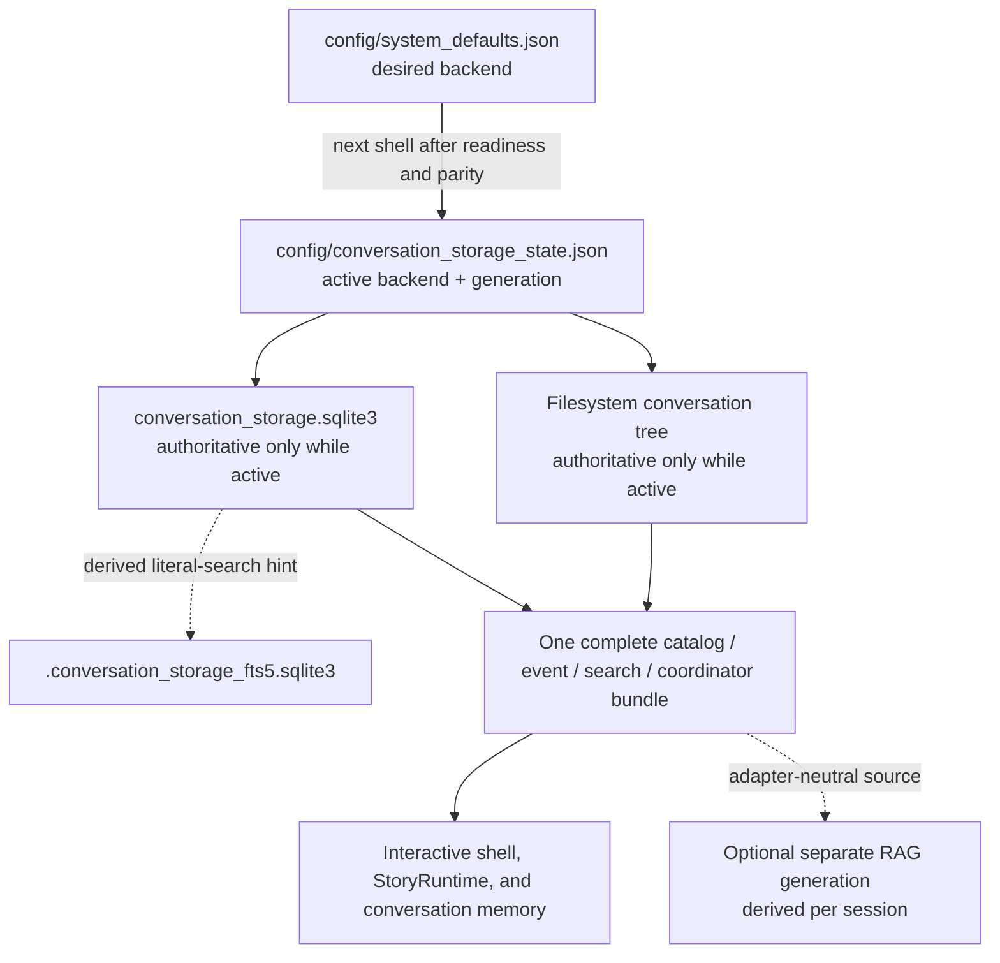

# SQLite conversation storage

SQLite is an optional way to keep Story's conversation catalog and schema-v2
collaboration history in one workspace database. Filesystem storage remains the default,
and changing storage does not change how `/conversation`, `/search`, or
`/transcript` work. Ordinary story turns are unavailable in this stage.

The database format is exact schema version `2`. The selected service bundle
uses its `collaboration_events` authority for `/history`, `/search`,
`/transcript`, and `/status`. Catalog management and those reads are available;
the shell still cannot create provider-bound collaboration events.

For a new workspace with no conversations, the shortest safe path is:

```bash
story storage use sqlite
story
```

The first command checks the SQLite support used by the active Python
interpreter, creates an empty SQLite conversation database when needed, and
saves SQLite as the **desired backend**. The next `story` launch performs a
fresh check and makes it the **active backend**. If conversations already exist,
Story stops with `transfer_required`; follow the transfer scenario below
instead of deleting or moving files by hand.

This guide explains that workflow from a user's point of view. The
[CLI reference](../reference/cli.md#conversation-storage-selection) remains the
normative command and report contract.

<a id="sqlite-storage-mental-model"></a>

## Understand the storage model

These terms describe different parts of one switch:

| Term | Plain-language meaning |
| --- | --- |
| Desired backend | The workspace preference saved for a future shell. Selecting SQLite changes this value only after all checks pass. |
| Active backend | The one store that a shell currently reads and writes. Only one backend is active. |
| Authority | The active store is the truth for conversation subjects, statuses, and schema-v2 collaboration events. A second copy is not a live replica. |
| Provisioning | Creating and validating a new, empty SQLite database. Provisioning never copies conversations. |
| Transfer | Copying canonical v2 collaboration conversations from the active store to the other ready store, then proving exact parity. Transfer never selects or activates the destination. |
| Adapter/service bundle | The catalog, schema-v2 event store, aggregate event-field search, and mutation coordinator that all operate on the same backend. The shell passes one complete bundle to conversation features. |
| Derived FTS hint | An optional disposable SQLite full-text-search companion that can suggest search candidates. It never decides truth or readiness; exact search falls back to the authoritative database. |
| Concrete v2 collaboration store | A direct-module-only adapter placed behind the selected service bundle. It is not re-exported by package facades. |

The desired and active records are deliberately separate. This lets Story
prepare and verify a change without switching a running shell:



The filesystem conversation tree and SQLite files can coexist. Coexistence is
not dual write or automatic synchronization. MySQL is not a supported
conversation-storage backend.

<a id="sqlite-storage-readiness"></a>

## Scenario 1: check readiness and select SQLite for an empty workspace

Start from an initialized workspace:

```bash
story init ./my-story
cd ./my-story
story storage use sqlite
```

| Input | Participating component | Stored or transient data | Output and next action |
| --- | --- | --- | --- |
| `story storage use sqlite` | Provider-free storage selection, runtime probe, and SQLite provisioning | The probe and report are transient. When SQLite is ready and the active filesystem store is empty, Story may create the fixed empty database and save the desired backend. It does not change active state. | A completed report says `activation:"next_shell"`. Start a new shell with `story`. |

On a fresh empty workspace with a ready Python interpreter, a representative
exact report is:

```json
{"activation":"next_shell","configuration":"saved","desired_backend":"sqlite","failure":null,"installation":"not_required","operation":"use","outcome":"completed","parity":"not_required","provisioning":"completed","schema_version":1}
```

Readiness means all of the following are true for the **active Python
interpreter**:

- its standard-library `sqlite3` module imports;
- the linked SQLite runtime is version 3.7.16 or newer;
- an in-memory connection opens and closes;
- foreign keys can be enabled; and
- a query executes successfully.

The standalone `sqlite3` executable and FTS5 support are not readiness checks.
Preflight is observational. Startup never installs host packages or provisions
an absent database.

### When SQLite is missing

Without installation consent, a recognized missing prerequisite produces one
content-free report such as:

```json
{"activation":"unchanged","configuration":"preserved","desired_backend":"sqlite","failure":"installation_required","installation":"not_run","operation":"use","outcome":"failed","parity":"unverified","provisioning":"not_run","schema_version":1}
```

Review the one supported command for the detected host before authorizing it:

| Recognized host | Only command Story can run |
| --- | --- |
| macOS with `brew` discoverable | `brew install sqlite` |
| Debian or Ubuntu by exact `/etc/os-release` `ID` | `apt-get install sqlite3 libsqlite3-dev` |
| Fedora or RHEL by exact `/etc/os-release` `ID` | `dnf install sqlite sqlite-devel` |

If that host mutation is appropriate, explicitly authorize both flags:

```bash
story storage use sqlite --install-missing --yes
```

The command-line path never prompts. It runs at most one exact allowlisted
command with the real terminal and inherited environment, adds no `sudo`,
automatic-yes argument, shell, retry, or timeout, and reprobes the same Python
interpreter afterward. Recognized CI environments refuse installation. An
unsupported host does not get a guessed command. An installer exit of zero is
not enough: if the interpreter still fails the complete probe, Story reports
`interpreter_unavailable` and preserves configuration.

Provisioning happens only after functional readiness and only for an absent
SQLite database. It creates an empty target; it does not install SQLite,
transfer the filesystem store, select the backend, or activate it. A host
package or empty database created before a later failure can remain.

<a id="sqlite-storage-settings"></a>

## Scenario 2: choose storage through `/settings`

Use the shell's settings form when you prefer an interactive confirmation:

```text
story[lobby]> /settings
```

Choose `Conversation storage`, choose `SQLite`, return to the Settings root,
then choose `Apply Changes (*Required)` and confirm. The editor changes only
the pending in-memory value until Apply Changes succeeds.
After the first valid SQLite choice, the retained value editor stays open;
choose the now-selected SQLite value again or press Escape to return without
discarding that pending choice.

| Input | Participating component | Stored or transient data | Output and next action |
| --- | --- | --- | --- |
| `/settings` → Conversation storage → SQLite → Apply Changes | Settings transaction plus provider-free storage selection | Pending form state is transient. A successful apply saves only the desired backend; the current shell keeps its original service bundle. | `[saved] Restart is required for sqlite.` Exit normally and start a new shell. |

If installation is needed, Settings previews the exact allowlisted command in
this panel and confirmation:

```text
SQLite prerequisite installation
This command changes host packages and runs in the workspace with the real terminal attached.
Install SQLite prerequisite?
Choose the exact YES to run the command.
```

`NO` is highlighted. Only exact `YES` runs the command. Decline, CI refusal,
installation or reprobe failure, provisioning failure, transfer need, parity
mismatch, or a settings conflict leaves configuration unchanged. If the active
store contains conversations, Settings reports:

```text
[conversation storage] Transfer the active conversations to the requested backend first.
```

Leave the current shell and use the provider-free transfer workflow next.

<a id="sqlite-storage-transfer"></a>

## Scenario 3: transfer existing filesystem conversations

Selection deliberately does not copy data. On a workspace whose active
filesystem store is nonempty, the first selection can create the empty SQLite
target and then stop with this exact report:

```json
{"activation":"unchanged","configuration":"preserved","desired_backend":"sqlite","failure":"transfer_required","installation":"not_required","operation":"use","outcome":"failed","parity":"unverified","provisioning":"completed","schema_version":1}
```

Keep both stores, then use one direction consistently:

```bash
story storage transfer --from filesystem --to sqlite --dry-run
story storage transfer --from filesystem --to sqlite
story storage verify --from filesystem --to sqlite
story storage use sqlite
```

The first three commands and the last two commands have different owners and
effects:

```text
dry-run: work_required
  -> transfer: completed + parity verified + checkpoint completed
  -> verify: completed + parity verified
  -> storage use sqlite: desired backend saved, active filesystem unchanged
  -> next story launch: fresh checks may activate SQLite
```

Transfer itself never selects or activates SQLite. It also does not provision,
delete, overwrite, merge, dual-write, or create a workspace backup.

| Input | Participating component | Stored or transient data | Output and next action |
| --- | --- | --- | --- |
| `transfer ... --dry-run` | Canonical archive exporters and transfer planner under the workspace mutation lease | Fresh archive values and the plan are transient. Neither conversations nor a checkpoint are written. | Review `create`, `identical`, `conflict`, `unsupported`, and `destination_only`. Continue only when the plan is unblocked. |
| `transfer ...` | Same planner plus the destination archive importer | Exact missing conversations are created. The source remains. A successful terminal direction checkpoint is stored. | Require `outcome:"completed"` and `parity:"verified"`; do not treat this as activation. |
| `verify ...` | Fresh canonical exporters and parity comparison | Comparison is transient and ignores checkpoints. | Require `parity:"verified"` before selection. |
| `storage use sqlite` | Storage selection | Desired configuration is saved; active storage remains filesystem. | Start a new shell. |

For a representative source containing three conversations and 25 events,
the exact dry-run line is:

```json
{"checkpoint":"none","counts":{"conflict":0,"create":3,"destination_only":0,"identical":0,"unsupported":0},"dry_run":true,"failure":null,"from":"filesystem","operation":"transfer","outcome":"work_required","parity":"unverified","schema_version":1,"source":{"conversations":3,"events":25},"to":"sqlite"}
```

The corresponding successful transfer and independent verification are:

```json
{"checkpoint":"completed","counts":{"conflict":0,"create":3,"destination_only":0,"identical":0,"unsupported":0},"dry_run":false,"failure":null,"from":"filesystem","operation":"transfer","outcome":"completed","parity":"verified","schema_version":1,"source":{"conversations":3,"events":25},"to":"sqlite"}
```

```json
{"checkpoint":"none","counts":{"conflict":0,"create":0,"destination_only":0,"identical":3,"unsupported":0},"dry_run":false,"failure":null,"from":"filesystem","operation":"verify","outcome":"completed","parity":"verified","schema_version":1,"source":{"conversations":3,"events":25},"to":"sqlite"}
```

Counts describe the current workspace and will differ from this fixture. The
reports deliberately omit identities, subjects, event text, paths, exception
text, and FTS data. Transfer includes active and archived catalog metadata and
every canonical v2 collaboration event; it excludes the derived FTS
companion. Session, conversation, turn, sequence, sender, recipient, event-kind,
status, and revision values remain exact across the copy, so citations derived
from them stay stable. The workflow never provisions SQLite, changes desired
or active state, deletes the source, overwrites a conflicting identity, or
dual-writes future changes.

This path accepts only archive schema 2 and canonical v2 collaboration events.
It rejects any filesystem `transcript.jsonl`, SQLite `conversation_events`
row, or unsupported archive before destination mutation. The `schema_version:1` in catalog metadata and in the
compact transfer report is valid: those are separate schemas from the
top-level archive schema 2. Unsupported transcript rows make transfer fail.

After verified parity, selection reports:

```json
{"activation":"next_shell","configuration":"saved","desired_backend":"sqlite","failure":null,"installation":"not_required","operation":"use","outcome":"completed","parity":"verified","provisioning":"not_required","schema_version":1}
```

The full report vocabulary and exit statuses are in
[Conversation storage transfer](../reference/cli.md#conversation-storage-transfer).

<a id="sqlite-storage-activation"></a>

## Scenario 4: activate the desired backend on the next shell

After a completed selection, close any existing shell normally and launch:

```bash
story
```

| Input | Participating component | Stored or transient data | Output and next action |
| --- | --- | --- | --- |
| A fresh `story` launch | Startup storage activation under one outer workspace lease | Startup rereads desired and active state, verifies readiness and canonical parity, composes one complete SQLite service bundle, then advances the active marker with compare-and-set. | The shell continues with SQLite as its one conversation authority. There is no separate storage-status command or success banner. |

Before the active-marker compare-and-set, any readiness, parity, composition,
or coordination failure aborts startup and preserves the old active state;
there is no silent fallback. After a successful compare-and-set, a later
terminal, authentication, provider, or session-startup failure does not roll
the storage change back. Fix the later failure and launch again with SQLite as
the authority. Never edit the active marker by hand.

<a id="sqlite-storage-everyday-use"></a>

## Scenario 5: use conversations and literal search normally

Once activated, the existing management and inspection commands use the
SQLite-backed bundle. For example:

```text
/session create novel
/conversation new Council Vessel
/conversation new Harbor timing
/search council vessel
```

| Input | Participating component | Stored or transient data | Output and next action |
| --- | --- | --- | --- |
| Conversation commands, then `/search council vessel` | The active SQLite catalog/search bundle; the FTS companion can offer hints | Subjects are stored in the main database but are display-only. The literal query, result rows, and optional hint candidates are transient. | Search returns matching readable event fields without a provider call. Hits can be followed with `/transcript CONVERSATION_ID [COUNT] [--from SEQUENCE]`. |

Creating or renaming a conversation writes catalog metadata to the active
SQLite database. Ordinary input is rejected before any event append.
`/search` is provider-free and read-only: the query and search result are
transient. Subjects alone produce zero matches. With a preexisting canonical
event whose readable field contains `council vessel`, rendering has this shape:

```text
[context] Search request
  Query: council vessel
  Scope: active
Search results (1/1)
  [search c_0123456789]
    Status: active
    Subject (display only): Council Vessel
    Citation: conversation c_0123456789, event proposal_event, sequence 1, field proposal.purpose, range 0:14
    Snippet: council vessel
[result] Search returned 1 of 1 matching readable fields.
Search results (2/2)
  [search c_fedcba9876]
    Status: active
    Match: transcript
    Subject: Harbor timing
    Citation: conversation c_fedcba9876, turn turn_search, sequence 1, kind user_message
    Snippet: the council vessel enters at dusk.
[result] Search returned 2 of 2 matching conversations.
[hint] Continue with /transcript c_fedcba9876 1 --from 2.
```

The example identifiers are shortened display forms. The SQLite FTS companion
may suggest candidates, but the main database still validates every exact
literal result, rank, citation, snippet, counter, and ordering. If FTS5 is
missing or the companion is stale, busy, unsafe, malformed, or absent, the
same bounded exact search falls back to authoritative rows without repairing
the companion.

<a id="sqlite-storage-reverse-transfer"></a>

## Scenario 6: return to filesystem storage

Do not assume the old filesystem copy is still current. With SQLite active,
first compare in the active direction:

```bash
story storage verify --from sqlite --to filesystem
```

If verify reports a create-only mismatch, keep SQLite active and run:

```bash
story storage transfer --from sqlite --to filesystem --dry-run
story storage transfer --from sqlite --to filesystem
story storage verify --from sqlite --to filesystem
story storage use filesystem
story
```

An interrupted transfer is retried with the exact same second command. On a
safe retry, a completed checkpoint and exact destination records are validated
against a fresh source fingerprint; terminal output can again be:

```json
{"checkpoint":"completed","counts":{"conflict":0,"create":2,"destination_only":0,"identical":1,"unsupported":0},"dry_run":false,"failure":null,"from":"sqlite","operation":"transfer","outcome":"completed","parity":"verified","schema_version":1,"source":{"conversations":3,"events":25},"to":"filesystem"}
```

This output proves fresh canonical parity, not that the destination is active.
The subsequent `storage use` saves only the desired backend; activation occurs
on the final fresh `story` launch.

| Input | Participating component | Stored or transient data | Output and next action |
| --- | --- | --- | --- |
| Reverse `verify`, optional create-or-identical `transfer`, then `storage use filesystem` | The same provider-free transfer and selection owners, with SQLite as the active source | Archive comparisons are transient; a real transfer can create missing filesystem identities and retain a direction checkpoint. Successful selection saves desired filesystem state but does not change active SQLite state. | Require verified parity, select filesystem, then start a new shell. Preserve both stores throughout. |

| Current comparison | Safe next action |
| --- | --- |
| Every identity is `identical` and parity is verified | Select filesystem directly with `story storage use filesystem`, then start a new shell. |
| SQLite contains identities missing from filesystem, with no conflict, unsupported value, or destination-only identity | Run `transfer --from sqlite --to filesystem --dry-run`, transfer, verify, then select filesystem. |
| The same identity differs in the two stores (`conflict`) | Preserve both stores and investigate offline. Transfer never overwrites or merges it. |
| Filesystem has an identity absent from the active SQLite source (`destination_only`) | Preserve both stores and investigate ownership. Transfer will not delete it or declare parity. |

Transfer is **create-or-identical** in both directions. A filesystem
conversation that evolved after an earlier copy is a conflict, not an update
target. Do not delete, truncate, or hand-edit either store to force a switch.

After exact parity, a completed reverse selection is:

```json
{"activation":"next_shell","configuration":"saved","desired_backend":"filesystem","failure":null,"installation":"not_required","operation":"use","outcome":"completed","parity":"verified","provisioning":"not_required","schema_version":1}
```

The Settings equivalent reports:

```text
[saved] Restart is required for filesystem.
```

The SQLite database remains in the workspace but is no longer authoritative
after the next successful activation.

<a id="sqlite-storage-data-lifecycle"></a>

## Know what is stored, transient, and deliberately separate

Internal names matter for backup and recovery only after their roles are
clear. All of these workspace records are plaintext.

### Data at rest

| Role | Fixed location or format | Authority and lifecycle |
| --- | --- | --- |
| Desired backend | `config/system_defaults.json`, key `conversation_storage_backend` | Exactly `filesystem`, `sqlite`, or null/missing for the filesystem default. Selection saves it only after checks pass. |
| Active backend | `config/conversation_storage_state.json`, schema v1 with `backend` and nonnegative `generation` | Missing means filesystem generation zero. Startup alone advances it; do not edit it. |
| Filesystem canonical v2 conversation authority | `discussion_logs/<session_id>/interactive/conversations/<conversation_id>/{metadata.json,collaboration-history.jsonl}` | Archive/transfer authority. The safe `.collaboration-history.lock` is excluded. Preexisting or direct low-level v1 activity can leave a rejected `transcript.jsonl`; public story input no longer does. |
| Main SQLite conversation authority | `discussion_logs/conversation_storage.sqlite3`, application ID `0x53574143` (`SWAC`), schema v2 | `collaboration_events` and catalog metadata are archive/transfer authority. Any row in legacy `conversation_events` rejects archive/transfer. Back up the whole database. |
| Derived literal-search hint | `discussion_logs/.conversation_storage_fts5.sqlite3`, schema v1 | Optional and disposable. It repeats normalized searchable plaintext, can be omitted from an authoritative backup, and never decides truth. |
| Transfer progress | `agent_states/orchestrator_state/conversation_storage_transfers/{filesystem-to-sqlite,sqlite-to-filesystem}.json` | One retained schema-v1 checkpoint per direction. It stores identities, counts, fingerprint, and progress, but no subject or event content. |
| Mutation coordination | `config/.conversation_storage.lock` | A guard for supported writers, not configuration, activation state, or conversation data. |

Sidecar and temporary files can appear around SQLite transactions or contained
publication. Treat them as part of a live or failed storage operation; do not
remove them to make a database look ready.

### Transient during a workflow

| Transient value | Lifetime |
| --- | --- |
| Readiness result and installer plan | One probe or selection attempt. |
| Canonical archive snapshots and parity plan | One transfer, verification, selection, or startup check. |
| SQLite connections and transactions | One adapter operation. |
| Installer terminal output and compact JSON reports | Process output; the storage CLI does not add a runtime debug record. Terminal or shell scrollback may still retain displayed text. |
| Pending `/settings` choice | In memory until Apply Changes, discard, cancellation, or shell exit. |
| Literal `/search` query and result | One read-only shell command; neither is appended to the conversation transcript. |

### Not stored in the SQLite conversation database

- provider credentials, native provider state, hidden reasoning, raw provider
  diagnostics, referenced file bytes, or installer output;
- debate logs, manuscripts, writing artifacts, core documents, configuration,
  runtime debug logs, or session-lifecycle records;
- transfer checkpoint contents beyond identity and progress metadata;
- the optional conversation-RAG configuration or derived generation; and
- the derived FTS companion itself, which is a separate database.

Ordinary conversation subjects and visible user/reply events **are** stored in
the active authority. SQLite provides no encryption or secure erasure. Protect
the main database, optional companion, checkpoints, backups, and terminal
output according to the workspace's sensitivity.

### Active schema-v2 collaboration operations

For a Python integrator, the change is:

| Before #477 | After #477 |
| --- | --- |
| Archive/transfer depended on the schema-v1 transcript channel. | Archive schema 2 carries exact `CollaborationEvent` values and both backends import/export canonical v2 history. |
| Filesystem used `transcript.jsonl`; SQLite used `conversation_events`. | Filesystem uses `collaboration-history.jsonl`; SQLite uses `collaboration_events` canonical BLOB rows. Presence of either legacy channel rejects archive/transfer. |
| No selected service exposed v2 collaboration. | The active shell/runtime bundle now uses the sole v2 storage/inspection service; public provider execution remains unavailable. |

The concrete store requires a provisioned schema-v2 database and an existing
catalog conversation. Its append holds the workspace coordinator, uses
`BEGIN IMMEDIATE`, validates the complete addressed history, and commits every
event or none. A precommit failure rolls back. If a final check reports failure
after commit, preserve the database and retry the exact same batch ID/content;
the visible commit returns `ALREADY_COMMITTED` with its original receipt.
Identical concurrent candidates therefore commit once and retry once; distinct
same-tail candidates commit once and reject the other as stale.

An unsupported database is rejected unchanged. Do not rename, hand-edit, or
`ALTER` it. Malformed collaboration rows also fail closed; preserve the main
database and stop appends. Canonical public collaboration payloads are
plaintext in the main database, while hidden reasoning, provider diagnostics,
credentials, and referenced file bytes are excluded. FTS remains a disposable,
non-authoritative candidate hint; canonical search is authoritative.

See the exact constructor, `APPENDED` then `ALREADY_COMMITTED` sample, failure
categories, and read output in
[Direct SQLite storage and retry](../reference/collaboration-history.md#direct-sqlite-storage-and-retry).

<a id="sqlite-storage-recovery"></a>

## Recover without manufacturing parity

Use the report's fixed `failure` value and preserve both stores while deciding
the next action:

| Failure or observation | Safe response |
| --- | --- |
| `installation_required` | Review the allowlisted host command. Authorize `--install-missing --yes` only if host mutation is intended. |
| `installation_disallowed` or `installation_unsupported` | Keep configuration unchanged. Follow the host's approved operations process; do not pass arbitrary install arguments through Story. |
| `interpreter_unavailable` | Repair or rebuild the active Python interpreter. Installing only a standalone `sqlite3` executable is insufficient. |
| `provisioning_failed` or unsafe/malformed SQLite state | Preserve the database, sidecars, and residue. Use observational preflight or restore a verified backup; do not delete suspect files to obtain an empty target. |
| `transfer_required` | Dry-run, transfer, verify in the active direction, then select again. The empty target may already exist. |
| `parity_mismatch`, `conflict`, `destination_only`, or `unsupported` | Preserve both stores and investigate offline. Selection and transfer never overwrite, merge, truncate, or delete to resolve the difference. |
| `source_invalid` or `destination_invalid` with unsupported transcript/database rows | Preserve both stores and use a genuine canonical v2 source. Do not hand-edit rows. |
| `coordination_failed` | Let the supported owner finish, stop unsupported direct writers, then retry under a fresh workspace lease. |
| Startup fails before active-state compare-and-set | Fix readiness, parity, or coordination; the prior backend remains active and there is no fallback shell. |
| Startup fails after active-state compare-and-set | Fix the later terminal/provider/session issue. The new backend is already authoritative. |
| FTS companion is absent, stale, busy, malformed, or unavailable | Continue using exact search fallback. Do not replay a conversation mutation or hand-edit the companion merely to refresh hints. |

Back up the authoritative main SQLite database. The FTS companion may be
omitted; if retained, protect it as plaintext transcript data and keep it with
the matching main-database generation. Transfer is conversation-only, not a
complete workspace backup.

For full failure mappings and interrupted-operation rules, use
[Conversation storage transfer recovery](../operations/recovery-and-limitations.md#conversation-storage-transfer-recovery),
[Conversation storage selection and activation recovery](../operations/recovery-and-limitations.md#conversation-storage-selection-and-activation-recovery),
and
[SQLite conversation-storage recovery](../operations/recovery-and-limitations.md#sqlite-conversation-storage-recovery).

<a id="sqlite-storage-python"></a>

## Compose SQLite directly from Python

Application integrators can observe readiness, explicitly create a deliberately
empty target under the workspace mutation lease, and compose the complete
bundle:

```python
from story_writing_agents import Workspace
from story_writing_agents.conversation_storage import (
    ConversationStorageCapability,
    WorkspaceConversationStorageMutationCoordinator,
)
from story_writing_agents.conversation_storage.sqlite import (
    compose_sqlite_conversation_storage,
    preflight_sqlite_conversation_storage,
    provision_sqlite_conversation_storage,
)

workspace = Workspace("/path/to/initialized-story")
status = preflight_sqlite_conversation_storage(workspace)

if status.capability is ConversationStorageCapability.PROVISIONING_NEEDED:
    coordinator = WorkspaceConversationStorageMutationCoordinator(workspace)
    with coordinator.borrow(timeout_seconds=5.0) as lease:
        status = provision_sqlite_conversation_storage(workspace, lease=lease)

status.require_ready()
services = compose_sqlite_conversation_storage(workspace)
```

This branch is an application decision to create an empty SQLite destination.
It never installs a host package, transfers conversations, updates desired or
active state, or changes a running runtime. Direct `StoryRuntime(workspace)`
still defaults to filesystem storage; pass the full `services` bundle
explicitly when a runtime and memory service must share SQLite provenance.
Exact imports, signatures, adapter contracts, and injection examples are in the
[optional SQLite package API](../reference/package-api.md#optional-sqlite-conversation-storage).
The transfer and selection coordinators have separate
[transfer](../reference/package-api.md#conversation-storage-transfer-api)
and
[selection APIs](../reference/package-api.md#conversation-storage-selection-api).

<a id="sqlite-storage-rag-independence"></a>

## Keep SQLite and conversation RAG separate

SQLite and conversation RAG solve different problems. SQLite can be the active
authoritative conversation adapter. Optional RAG consumes the same complete
adapter-neutral storage bundle and persists a separate per-session derived
generation under `agent_states/orchestrator_state/conversation_rag/`.

The SQLite FTS companion is only a literal-search hint; it is neither a RAG
index nor RAG authority. Neither subsystem imports, transfers, validates, or
stores the other's data. RAG status observes the active backend, while a
confirmed RAG rebuild or cited search may first complete a separately
configured next-shell storage activation. No SQLite-specific RAG integration,
MySQL coupling, network RAG provider, or credential flow is added by selecting
SQLite.

Continue with [Optional conversation RAG](conversation-rag.md) for that
independent feature, [Filesystem safety](../operations/filesystem-safety.md#sqlite-conversation-storage-safety)
for path and mutation boundaries, or
[Session storage](../reference/configuration/session-storage.md#optional-sqlite-conversation-storage)
for the normative on-disk contracts.
