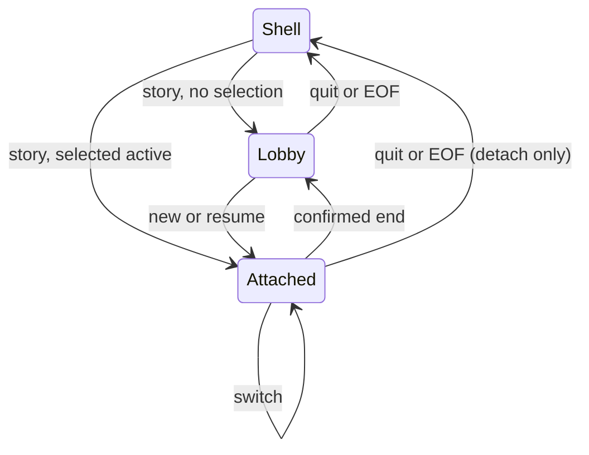

# Story sessions

> **Availability:** bare `story` and `story chat` provide an interactive TTY
> session lobby. It can list, create, resume, switch, and end story sessions,
> but it cannot send chat turns or select conversation history yet.

Key terms: **lobby**—the prompt with no attached session; **selected**—the
workspace's saved default; **attached**—temporarily leased by this process;
**end**—make a session inactive without deleting its data.

## The lobby at a glance



In words: entry opens the lobby or attaches the saved active session. Creating,
resuming, or switching leads to an attachment. Confirmed end returns to the
lobby and makes that session inactive. Quit or EOF returns to the shell; it
releases attachment but leaves the session active.

## Scenario: first session, return, switch, and end

Create a workspace, then name the first session explicitly:

```console
$ story init ./session-demo
$ cd ./session-demo
$ story chat chapter_01
story[chapter_01:lead]> /quit
```

Because `chapter_01` did not exist, explicit entry creates, selects, and
attaches it without a question. `/quit` detaches it but does not end it.

Return with bare entry, then switch twice:

```console
$ story
story[chapter_01:lead]> /session new chapter_02
story[chapter_02:lead]> /session resume chapter_01
story[chapter_01:lead]> /session end
End session chapter_01? [y/N] yes
story[lobby]> /quit
```

Bare entry finds the saved active `chapter_01` and attaches it. Creating
`chapter_02` switches to a new selected session. Resuming `chapter_01` switches
back. Confirmed end makes `chapter_01` inactive but deliberately retains it as
the saved selection.

The next bare entry recognizes that inactive selection and asks before
resuming it; Enter accepts the displayed yes default:

```console
$ story
Resume selected session chapter_01? [Y/n]
story[chapter_01:lead]> /quit
```

Use `/session list` to see active, selected, and lease status. `/help session`
shows the parser-owned session syntax.

## Current boundary

The lobby dispatches only `/help`, `/session list`, `/session new`,
`/session resume`, `/session end`, and `/quit` (including documented aliases).
Other registered commands return an unavailable error. No chat turn, selected
conversation, history, transcript, search, or artifact action is wired until
follow-up Issues #22 and #11.

Exact installed syntax and exit codes are in the [CLI reference](../reference/cli.md).
Switch failure ordering is in [Session lifecycle](../design/session-lifecycle.md#attach-and-switch-ordering).
Lease and provider-thread details are in
[Backend and sessions](../reference/backend-and-sessions.md).
