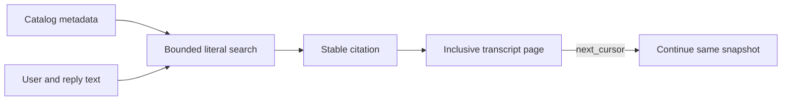

# Conversation search and cited transcript pages

> **Availability:** conversation search and bounded transcript pages are Python
> APIs. They are not wired to `StoryRuntime`,
> interactive dispatch, `/search`, or `/transcript`.

Key terms: **scope**—the authorized current story session; **hit**—the strongest
match from one conversation;
**citation**—stable session and conversation IDs plus an optional exact event
reference; **page**—an inclusive, bounded transcript read; **cursor**—
continuation data for the same transcript snapshot.



## Search, cite, page, continue

From an initialized workspace, search, open a cited event, and continue:

```python
import story_writing_agents as swa

workspace = swa.Workspace("/path/to/initialized-story")
catalog = swa.FilesystemConversationCatalog(workspace)
store = swa.FilesystemConversationEventStore(workspace, catalog=catalog)
memory = swa.ConversationMemoryService(
    swa.ConversationSearchScope("novel"), catalog, store
)

result = memory.search(swa.ConversationSearchQuery("council vessel"))
if result.hits:
    citation = result.hits[0].citation
    page = memory.read_transcript(
        citation.conversation_id, start_sequence=citation.sequence or 1,
        max_events=1, citation=citation
    )
    if page.next_cursor is not None:
        next_page = memory.continue_transcript(page.next_cursor)
```

A citation validates identity, not range; the example starts at its event
sequence, or `1` for a subject hit.

## Search rules

`ConversationSearchQuery(text, limit=10, include_archived=False)` is literal,
not fuzzy, regex, or semantic. Text is strict UTF-8, nonblank, and free of
Unicode category-C characters. Comparison applies NFKC, case folding, trimming,
and whitespace collapse. Search is active-only; `include_archived=True` adds
archived records.

Each conversation returns at most one hit, from its first matching source:

| Rank | `ConversationSearchMatchKind` | Match source |
| --- | --- | --- |
| 1 | `EXACT_SUBJECT` (`exact_subject`) | Whole normalized subject |
| 2 | `SUBJECT_PREFIX` (`subject_prefix`) | Start of normalized subject |
| 3 | `SUBJECT_SUBSTRING` (`subject_substring`) | Anywhere in normalized subject |
| 4 | `TRANSCRIPT` (`transcript`) | First matching user message or agent reply |

Subject matches skip the transcript. Transcript search takes the first matching
user message or reply; runtime errors consume scan work but never match. The
reference scan visits conversations by creation time then ID and events by
sequence. Results sort by rank, normalized subject, then conversation ID.

A citation carries immutable session/conversation IDs plus an atomic optional
event trio: `turn_id`, one-based `sequence`, and `event_kind`. Transcript hits
have the trio; subject hits do not. Renaming can age hit metadata but not the
citation. Normalized snippets contain the complete match without claiming to be
verbatim. `scan_truncated` warns of scan limits; `truncated` also covers the hit
limit. Counts describe only the bounded scan.

## Transcript pages

```python
read_transcript(conversation_id, *, start_sequence=1, end_sequence=None,
                turn_id=None, max_events=24, citation=None)
continue_transcript(cursor)
```

Ranges are inclusive; an omitted end uses the snapshotted last sequence. A
`turn_id` must exist somewhere in that snapshot: unknown raises `ValueError`,
while known-but-outside-range returns an empty, non-truncated page. With no end,
starting exactly one past the snapshot is also empty; farther ahead is stale.
Pages stay chronological and may include runtime errors that search ignores.

Pages never split events. They stop before either cap and return `next_cursor`;
an oversized first event raises `ValueError`. The cursor preserves the request
and snapshot; `truncated` is true exactly when it exists. Any append stales the
cursor, so restart the read.

## Fixed bounds and failures

`CONVERSATION_MEMORY_POLICY` fixes these limits:

| Area | Default | Maximum |
| --- | ---: | ---: |
| Query length | — | 200 characters before and after normalization |
| Returned hits | 10 | 50 |
| One search scan | — | 256 conversations and 10,000 events |
| One snippet | — | 240 characters and 1,024 UTF-8 bytes |
| One transcript page | 24 events | 100 events and 32,768 content bytes |

Unsafe IDs raise `SessionIdError`; wrong types raise `TypeError`; invalid values,
ranges, citation combinations, oversized first events, and stale cursors,
turns, or event citations raise `ValueError`. Missing conversations raise
`ConversationNotFoundError`; filesystem corruption or containment failures use
`WorkspaceFormatError` or `WorkspaceSecurityError`. An absent session search is
empty. All search/page operations are provider-free, index-free, and
nonmutating.

The [catalog](conversation-catalog.md) is authoritative for identity and
metadata; [transcripts](conversation-transcripts.md) for event schemas and
pairing. See [Privacy](../operations/privacy-and-provider.md) before displaying
sensitive results.
