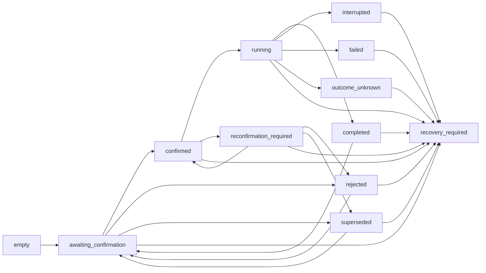

# Conversation transcripts and history

The active transcript is the readable projection of one authoritative
schema-v2 collaboration-event stream. Filesystem and SQLite storage implement
the same `CollaborationEventStore` port:

```python
append_batch(batch: CollaborationEventBatch) -> CollaborationAppendReceipt
read(session_id: str, conversation_id: str) -> tuple[CollaborationEvent, ...]
read_context(session_id: str,
             conversation_id: str) -> CollaborationHistoryProjection
```

`append_batch()` is atomic and validates a complete contiguous canonical batch
before mutation. `read()` returns the complete canonical stream.
`read_context()` returns the validated state projection. The separate pure
`select_bounded_collaboration_context()` function requires explicit event IDs
for content-bearing readable context; its default contains no record text.

## What users see

`/history [COUNT]` reads the focused active conversation. `/transcript ID
[COUNT] [--from SEQUENCE]` reads a bounded active or archived conversation
without changing focus. Each row exposes semantic identity before readable
fields:

```text
History (1/2)
  [event proposal_event]
    Sequence: 1
    Turn: turn_a
    Step: step_a
    Kind: message
    Direction: lead_to_user
    Actors: lead_orchestrator → user
    proposal.purpose: Consult specialists before recommending the next action.
```

Exact decoration varies by terminal. Private event payload fields, provider
instructions, route fingerprints, credentials, and arbitrary workspace bytes
are not part of the readable record.

After the rows, `/history` explains durable workflow state:

```text
[context]
  History displayed: 2/2 records
  Last sequence: 2
  Current state: awaiting_confirmation
  User meaning: A proposal is waiting for your confirmation.
  Next safe action: submit_confirmation
  Next action meaning: Review the proposal and submit a confirmation decision.
```

For a new conversation the exact semantic values are:

```text
History displayed: 0/0 records
Last sequence: 0
Current state: empty
User meaning: No collaboration event has been recorded yet.
Next safe action: none
Next action meaning: No history-derived action is pending.
```

`/status` reports the same current state and next-safe-action meanings for the
focus. These are observations, not executable buttons or proof that the
provider-bound lead workflow is installed.

## State and next-action meanings

| State | User meaning | Next safe action |
| --- | --- | --- |
| `empty` | No collaboration event has been recorded yet. | `none` |
| `awaiting_confirmation` | A proposal is waiting for your confirmation. | `submit_confirmation` |
| `reconfirmation_required` | The earlier confirmation is no longer sufficient; review and confirm the updated proposal. | `submit_confirmation` |
| `confirmed` | You confirmed the proposal; execution has not started yet. | `start_or_reconfirm` |
| `running` | The confirmed work is currently being executed. | `finalize_result` when a result awaits finalization; otherwise `none` |
| `completed` | The confirmed work completed and its result is recorded. | `none` |
| `rejected` | You rejected the proposal; that work will not execute. | `continue_with_lead` |
| `superseded` | A newer proposal replaced this proposal. | `continue_with_lead` |
| `interrupted` | Execution stopped before a complete outcome was recorded. | `continue_with_lead` |
| `failed` | Execution failed and the failure outcome is recorded. | `continue_with_lead` |
| `outcome_unknown` | Execution may have occurred, but its outcome cannot be proven. | `inspect_and_resolve_outcome` |
| `recovery_required` | History requires operator inspection before any safe continuation. | `repair_authoritative_history` |

Next-action labels mean:

| Action | User meaning |
| --- | --- |
| `none` | No history-derived action is pending. |
| `submit_confirmation` | Review the proposal and submit a confirmation decision. |
| `start_or_reconfirm` | Start confirmed work, or reconfirm if its basis changed. |
| `finalize_result` | Record the terminal result for the running work. |
| `continue_with_lead` | Continue the conversation with the lead agent. |
| `inspect_and_resolve_outcome` | Inspect durable evidence and resolve the uncertain outcome. |
| `repair_authoritative_history` | Repair authoritative history before continuing. |

## Transition flow

The projector validates the whole stream before exposing a state:



`recovery_required` is terminal. An illegal transition, identity mismatch,
noncanonical field, partial batch, corrupt byte stream, or inconsistent
sequence fails closed rather than producing a plausible state.

## Unsupported owning-boundary history

The active filesystem owner rejects a conversation directory containing
`transcript.jsonl`. The SQLite owner rejects any row in the unsupported
`conversation_events` table (an empty table is only a recognized sentinel).
The check happens before append/read mutation. The runtime neither selects that
data nor combines it with v2 history. #454 separately owns rejection at the
whole-workspace boundary.

See [Conversation search](conversation-search.md) for exact citations and
snapshot-safe pages, [Collaboration history](collaboration-history.md) for the
complete event contract, and [Session storage](configuration/session-storage.md)
for physical paths.
