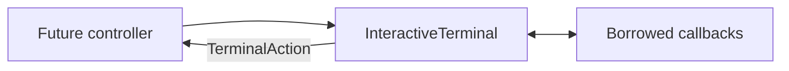

# Interactive terminal component

> **Availability:** this importable Python component is not an installed TTY.
> Issue #10 must connect parsing, runtime calls, and persistence.

Key terms: **controller**—the future coordinator; **callback**—borrowed I/O;
**composition**—a call-local buffer; **record**—one output-callback string.

## Public API

Import from `story_writing_agents.interactive_terminal`, not the facade. Exact
`__all__` is the types/functions below plus `INTERACTIVE_ERROR_SPECS`.

```python
InteractiveTerminal(read_line: Callable[[str], str], write_text: Callable[[str], None], *, width: int = 80)
read_main(*, session_id: str | None = None, agent_id: str | None = None) -> TerminalAction
compose(mode: ComposeMode, *, agent_id: str | None = None) -> TerminalAction
write_lobby_orientation(workspace: str) -> None
write_session_orientation(workspace: str, session_id: str, attachment: AttachmentKind, agent_id: str, history_count: int) -> None
write_status(kind: TerminalMessageKind, text: str) -> None
write_run(debate_id: str, text: str) -> None
write_agent(agent_id: str, text: str) -> None
write_help(command: str | None = None) -> None
write_error(error: InteractiveError, *, secrets: Iterable[str] = ()) -> None
sanitize_terminal_text(text: str) -> str
TerminalAction(kind: TerminalActionKind, *, text: str | None = None, line_count: int = 0, character_count: int = 0)
InteractiveErrorSpec(summary: str, hint: str)
InteractiveError(code: InteractiveErrorCode, *, summary: str | None = None, hint: str | None = None)
```

Values are frozen and slotted; `width` is at least 20. Callbacks are synchronous and ordinary failures propagate.

| Enum | Exact values |
| --- | --- |
| `AttachmentKind` | `created`, `attached`, `resumed` |
| `ComposeMode` | `chat`, `run` |
| `TerminalActionKind` | `line`, `send`, `cancel`, `interrupt`, `eof` |
| `TerminalMessageKind` | `compose`, `session`, `routing`, `context`, `waiting`, `result`, `cancelled`, `hint` |

`line` carries one line and zero counts; `send` carries nonblank LF-joined text with exact counts. Discard actions carry counts but no text.

## Prompts and orientation

Prompts are exact, including the final space:

```python
"story[lobby]> "
f"story[{session_id}:{alias}]> "
f"compose[chat:{alias}:{line_number}]> "
f"compose[run:{line_number}]> "
```

Pass canonical IDs such as `plot_architect`; display aliases such as `plot` are invalid as `agent_id`.
Attached prompts need both IDs; `read_main()` returns `line`, interrupt, or EOF actions without parsing.

Lobby orientation is one record:

```text
Story chat
Workspace: WORKSPACE
Session: lobby
Provider calls are unavailable in the lobby. Use /session new NAME, /session resume [NAME], or /session list.
Type /help for commands; /quit exits.
```

Session orientation shows `SESSION (created|attached|resumed)`, target display
name, visible room event count, the local/shared-room notice, and `/quit leaves
the story session active.` The caller supplies these facts.

## Scenario: compose one chat message



For `ComposeMode.CHAT` targeting `plot_architect`, quoted prompts retain their
trailing spaces:

```text
[compose] Target: plot. Use /send to submit or /cancel to discard.
"compose[chat:plot:1]> "  The bell rings.
"compose[chat:plot:2]> "  Mira waits. 🙂
"compose[chat:plot:3]> "  /send
[compose] Sending 2 lines, 29 characters to plot.
```

The result is `TerminalAction(send, text="The bell rings.\nMira waits. 🙂",
line_count=2, character_count=29)`. Counts include the joining LF and count the
emoji as one Unicode code point.

Only exact `/send` and `/cancel` control composition. `/say /send` and
`/say /cancel` append literal lines; near misses are text. Blank-only `/send`
reports `Nothing to send.` without advancing. Cancel, interrupt, and EOF return
no text, retain discarded counts, and write one discard status.

## Help, output, and errors

Help comes only from parser-owned `COMMANDS`: full help shows groups, syntax,
aliases, and flags; contextual help adds the example. See the
[Command parser](interactive-command-parser.md) for meaning.

Output forms are orientation/help blocks, `[KIND]`, `[run ID]`, `alias> `, and
`[error CODE]` plus `[hint]`. Every write is one sanitized, LF-ended record; see
[Terminal safety](../operations/terminal-safety.md).

The immutable error registry maps all 25 codes to a default summary and hint:

| Area | Codes |
| --- | --- |
| Terminal/workspace | `tty_required`, `workspace_not_initialized`, `workspace_invalid`, `workspace_unsafe`, `configuration_invalid`, `command_invalid`, `agent_invalid` |
| Session/transcript | `session_invalid`, `session_exists`, `session_not_found`, `session_in_use`, `session_inactive`, `transcript_invalid` |
| Provider | `provider_preflight_failed`, `provider_exited`, `provider_timed_out`, `provider_protocol_error` |
| Consensus/artifact | `draft_input_invalid`, `consensus_deadlock`, `consensus_failed`, `artifact_conflict` |
| Lifecycle/internal | `operation_cancelled`, `operation_interrupted`, `cleanup_failed`, `internal_error` |

The controller chooses the code and optional copy/secrets; the component never classifies
exceptions or performs parsing, TTY detection, provider/file I/O, persistence, readline, or durable history.
