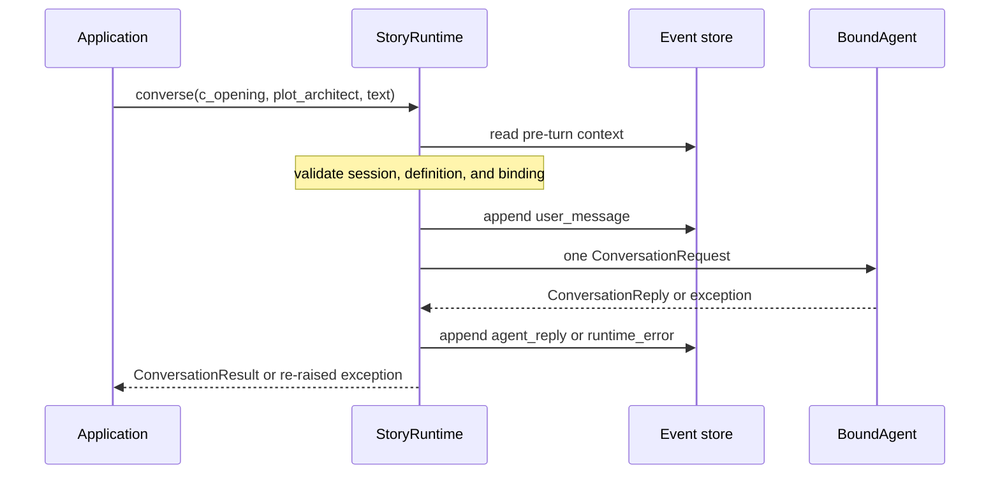

# Runtime API

> **Availability:** debate execution and persisted conversation turns are implemented; the installed shell dispatches one turn for its selected conversation.

Key terms: **runtime**—the coordinator; **preflight**—checks before a user event;
**context**—earlier turns sent to the provider; **outcome**—reply or runtime error.

## Construction and entry points

```python
StoryRuntime(workspace: Workspace | str | pathlib.Path,
             backend: AgentBackend | None = None, *,
             conversation_event_store: ConversationEventStore | None = None)
StoryRuntime.session(session_id: str) -> RuntimeSession
StoryRuntime.apply_directive(session_id: str, text: str) -> dict[str, object]
StoryRuntime.set_runtime_overrides(session_id: str, overrides: Mapping[str, Any]) -> dict[str, Any]
StoryRuntime.inspect_session(session_id: str) -> dict[str, Any]
StoryRuntime.inspect_debate(session_id: str, debate_id: str) -> dict[str, Any]
await StoryRuntime.converse(session_id: str, conversation_id: str,
                            agent_id: str, text: str) -> ConversationResult
await StoryRuntime.run_prompt(session_id: str, prompt: str, *, manuscript_name: str | None = None, max_debate_rounds: int | None = None, debate_id: str | None = None) -> DebateResult
await StoryRuntime.run_draft(session_id: str, draft: str, *, manuscript_name: str | None = None, max_debate_rounds: int | None = None, debate_id: str | None = None) -> DebateResult
RuntimeSession(runtime: StoryRuntime, session_id: str)
await RuntimeSession.converse(conversation_id: str, agent_id: str, text: str) -> ConversationResult
await RuntimeSession.run_prompt(prompt: str, **options) -> DebateResult
await RuntimeSession.run_draft(draft: str, **options) -> DebateResult
```

`RuntimeSession` also provides `apply_directive()`, `set_overrides()`, `inspect()`,
and `inspect_debate()`. `Runtime`/`Session` alias `StoryRuntime`/`RuntimeSession`.

The event-store collaborator is keyword-only. The runtime keeps an injected
store or creates one `FilesystemConversationEventStore`. It never creates, selects, renames,
searches, or retrieves conversations. A caller supplies an existing identity;
an explicitly addressed archived identity is allowed.

## One conversation turn

```python
@dataclass(frozen=True, slots=True)
class ConversationResult:
    session_id: str
    conversation_id: str
    turn_id: str
    agent_id: str
    content: str
    context: ConversationContextWindow
```

There are no defaults. IDs are safe, the agent is canonical, and content is
nonempty strict UTF-8. The runtime generates `turn_id` as `t_` plus 32 lowercase
UUID hex characters. `context` is the validated pre-turn provider snapshot; it
excludes the current turn and is not reread after the reply.

### Scenario: ask about an opening

An application has already created conversation `c_opening` in active session
`novel`. It calls:

```python
result = await runtime.session("novel").converse("c_opening", "plot_architect", "Should the reveal happen here?")
```



One runtime locks per session/conversation, reads context, preflights the active
session and current definition, binds the agent, and rechecks definition files.
Only then does it append and validate the user event. It sends one request,
validates the reply, constructs the result, and appends and validates the reply.
Every store return is revalidated; wrong-scope or corrupt data fails closed.

Before the user append, failure creates no event or provider call. Afterward,
ordinary provider, configuration, protocol, invalid-reply, or result failures
append a sanitized `runtime_error` and re-raise the original. A failed error
append raises its storage exception from the original. See the
[sanitizer](../operations/privacy-and-provider.md#runtime-error-diagnostics).

Cancellation after the user append best-effort stores exactly
`CancelledError: conversation turn was cancelled`, then re-raises cancellation.
A reply-write failure records no false provider error. That failure, a hard
interruption, or failed cancellation persistence can leave the user event
unmatched for [recovery](../operations/recovery-and-limitations.md#conversation-turn-recovery).

## Debate calls and results

```python
DebateResult(session_id: str, debate_id: str, input_kind: InputKind,
             status: DebateStatus, revision_id: str | None, rounds_completed: int,
             final_candidate: str | None, latest_candidate: str | None, manuscript_path: str | None,
             core_updates: tuple[str, ...] = (), messages: tuple[DebateMessage, ...] = (),
             error: str | None = None, action_required: str | None = None)
```

`run_prompt()` and `run_draft()` accept keyword-only `manuscript_name`,
`max_debate_rounds`, and `debate_id`. Preflight errors are raised. Handled
execution failures normally return a `failed` `DebateResult`; cancellation is
re-raised after a best-effort `interrupted` transition.

Only `consensus` means all three voters approved and artifacts committed. See
[Consensus workflow](../design/consensus-workflow.md).

Session inspection returns `session_id`, normalized `overrides`, and sorted
debates. Debate inspection returns IDs, `status`, `terminal`, `state`, `result`,
and `messages`, omitting internal owner tokens and duplicate result messages.
